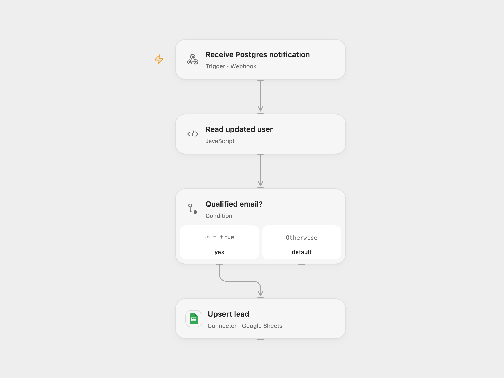

# Sync Postgres Leads to Google Sheets

Filter updated Postgres users and upsert qualified leads in Google Sheets.

<picture>
  <source media="(prefers-color-scheme: dark)" srcset="preview-dark.png">
  
</picture>

[Open Flow JSON](templates/postgres-updates-to-qualified-leads-sheet.openflow.json) · [n8n JSON](templates/postgres-updates-to-qualified-leads-sheet.n8n.json)

## Setup and use

Configure Postgres credentials, schema and table in the n8n trigger. Its UPDATE notification must include id, username and email. Configure the Google Sheet and credentials, with id, username and email headers. For n8n mode enable **Postgres Trigger**; for Open Flow mode disable it, enable **Postgres Trigger (Open Flow)**, configure **Forward to Open Flow**, and deploy Open Flow with its own Google Sheets connection and sheet ID. The trigger creates a database trigger and notification function; its database account needs the required privileges. Choose one mode and restrict access to the Open Flow endpoint, which does not authenticate callers.

## Behavior

For each update, the workflow reads the new row from the notification payload. If email does not contain `n8n.io`, it updates or adds a sheet row keyed by id with username and email. Postgres notifications and the relay are not a durable queue; inspect execution history and reconcile affected rows after outages or failed deliveries. If a Sheets write response is lost, inspect the row before retrying.

Inspiration &amp; credits

## Changes to the source

- Read the Postgres trigger's notification payload rather than the example's top-level mock fields; replace source-specific sheet and table identifiers and add an optional relay.

Adapted from [Postgres qualified leads](https://github.com/Zie619/n8n-workflows/blob/ae8cf6dc5b873cbb4f74587aa9180ed3a9f70682/workflows/Code/0307_Code_Postgres_Automate_Triggered.json) in [Zie619/n8n-workflows](https://github.com/Zie619/n8n-workflows). The source export does not identify a separate template author or license.

The collection’s [MIT notice](https://github.com/Zie619/n8n-workflows/blob/94007c1445d9258a7da116646b79473e7c7c3282/LICENSE) is pinned at a later revision. This is the collection notice at that revision; it does not establish a separate original template author's license. Our changes are listed above; see [repository licensing](../../README.md#licensing).

> MIT License
>
> Copyright (c) 2025 Zie619
>
> Permission is hereby granted, free of charge, to any person obtaining a copy
> of this software and associated documentation files (the "Software"), to deal
> in the Software without restriction, including without limitation the rights
> to use, copy, modify, merge, publish, distribute, sublicense, and/or sell
> copies of the Software, and to permit persons to whom the Software is
> furnished to do so, subject to the following conditions:
>
> The above copyright notice and this permission notice shall be included in all
> copies or substantial portions of the Software.
>
> THE SOFTWARE IS PROVIDED "AS IS", WITHOUT WARRANTY OF ANY KIND, EXPRESS OR
> IMPLIED, INCLUDING BUT NOT LIMITED TO THE WARRANTIES OF MERCHANTABILITY,
> FITNESS FOR A PARTICULAR PURPOSE AND NONINFRINGEMENT. IN NO EVENT SHALL THE
> AUTHORS OR COPYRIGHT HOLDERS BE LIABLE FOR ANY CLAIM, DAMAGES OR OTHER
> LIABILITY, WHETHER IN AN ACTION OF CONTRACT, TORT OR OTHERWISE, ARISING FROM,
> OUT OF OR IN CONNECTION WITH THE SOFTWARE OR THE USE OR OTHER DEALINGS IN THE
> SOFTWARE.

