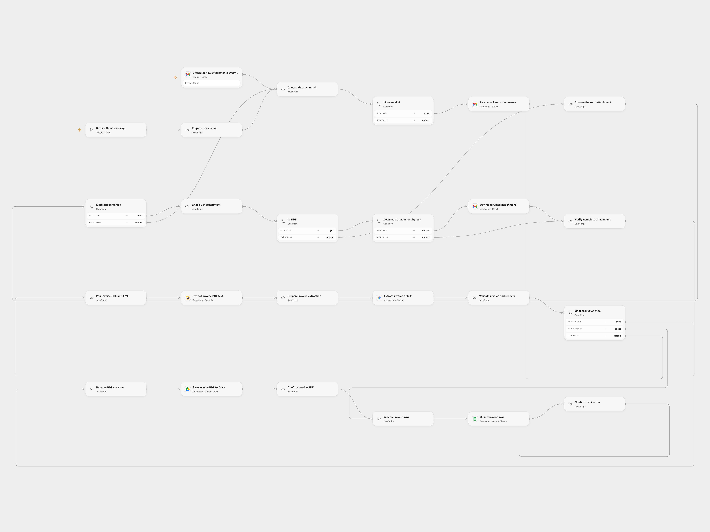

# Process Colombian Invoices from Gmail ZIP

Extract Colombian invoice details from ZIP attachments and organize their PDFs and spreadsheet rows.

<!-- template-actions:start -->
[](https://openflow.run/templates/process-colombian-invoices-from-gmail-zip/) [](templates/process-colombian-invoices-from-gmail-zip.n8n.json)
<!-- template-actions:end -->

<picture>
  <source media="(prefers-color-scheme: dark)" srcset="preview-dark.png">
  
</picture>

## Setup

Connect Gmail, Encodian, Gemini, Google Drive and Google Sheets. Set the Drive folder in **Choose the next attachment**, spreadsheet ID and sheet name in **Upsert invoice row**, and the Gmail transit hostname in **Verify complete attachment**. Enable persistent State. Use one format and avoid overlapping runs.

## Behavior

Every 30 minutes the workflow examines Gmail ZIP attachments. Each supported archive contains exactly one PDF and one XML invoice. It extracts PDF text, combines it with XML for Gemini, validates the invoice fields and arithmetic, creates the original PDF with the invoice date and number in its name, and upserts the row by issuer NIT and invoice number. Review extracted data against the source. The Open Flow ZIP is limited to 512 KiB compressed and expanded, with at most 20 entries; each entry is at most 256 KiB. Scanned PDFs require OCR and ambiguous archives stop for review.

If an external write is uncertain, inspect Drive or Sheets before retrying. In **Validate invoice and recover** enter the pending key, resolution confirmed or absent and, for a confirmed PDF creation, its Drive file ID. Use **Retry a Gmail message**, then clear recovery fields. A completed Drive PDF is retained while the sheet stage resumes. Inspect both Drive and Sheets; if only the PDF was created, complete the sheet row manually before marking the row done. Delete the pending row only after verifying that neither write occurred. Enable the authenticated **Resume Gmail message** webhook and POST the original messageId to retry. Protect mail, transit and execution data.

<details>
<summary>In n8n</summary>

In n8n configure matching connections, a Drive folder, the sheet and a Data Table for write checkpoints. In n8n, a pending Data Table row blocks the archive.

</details>

<details>
<summary>Inspiration &amp; credits</summary>

The source grouped invoice documents by arrival order; this version requires one PDF/XML pair per archive, validates totals and stops on uncertain writes. It bundles fflate 0.7.4 under the MIT license.

Adapted from [Colombian electronic invoices processing](https://github.com/Zie619/n8n-workflows/blob/ae8cf6dc5b873cbb4f74587aa9180ed3a9f70682/workflows/Code/1765_Code_Filter_Process_Triggered.json) in [Zie619/n8n-workflows](https://github.com/Zie619/n8n-workflows). Attribution: Zie619 / n8n-workflows.

The collection’s [MIT notice](https://github.com/Zie619/n8n-workflows/blob/94007c1445d9258a7da116646b79473e7c7c3282/LICENSE) is pinned at a later revision. This is the collection notice at that revision; it does not establish a separate original template author's license. Our changes are listed above; see [repository licensing](../../README.md#licensing).

> MIT License
>
> Copyright (c) 2025 Zie619
>
> Permission is hereby granted, free of charge, to any person obtaining a copy
> of this software and associated documentation files (the "Software"), to deal
> in the Software without restriction, including without limitation the rights
> to use, copy, modify, merge, publish, distribute, sublicense, and/or sell
> copies of the Software, and to permit persons to whom the Software is
> furnished to do so, subject to the following conditions:
>
> The above copyright notice and this permission notice shall be included in all
> copies or substantial portions of the Software.
>
> THE SOFTWARE IS PROVIDED "AS IS", WITHOUT WARRANTY OF ANY KIND, EXPRESS OR
> IMPLIED, INCLUDING BUT NOT LIMITED TO THE WARRANTIES OF MERCHANTABILITY,
> FITNESS FOR A PARTICULAR PURPOSE AND NONINFRINGEMENT. IN NO EVENT SHALL THE
> AUTHORS OR COPYRIGHT HOLDERS BE LIABLE FOR ANY CLAIM, DAMAGES OR OTHER
> LIABILITY, WHETHER IN AN ACTION OF CONTRACT, TORT OR OTHERWISE, ARISING FROM,
> OUT OF OR IN CONNECTION WITH THE SOFTWARE OR THE USE OR OTHER DEALINGS IN THE
> SOFTWARE.

**fflate 0.7.4 MIT license**

```text
MIT License

Copyright (c) 2020 Arjun Barrett

Permission is hereby granted, free of charge, to any person obtaining a copy
of this software and associated documentation files (the "Software"), to deal
in the Software without restriction, including without limitation the rights
to use, copy, modify, merge, publish, distribute, sublicense, and/or sell
copies of the Software, and to permit persons to whom the Software is
furnished to do so, subject to the following conditions:

The above copyright notice and this permission notice shall be included in all
copies or substantial portions of the Software.

THE SOFTWARE IS PROVIDED "AS IS", WITHOUT WARRANTY OF ANY KIND, EXPRESS OR
IMPLIED, INCLUDING BUT NOT LIMITED TO THE WARRANTIES OF MERCHANTABILITY,
FITNESS FOR A PARTICULAR PURPOSE AND NONINFRINGEMENT. IN NO EVENT SHALL THE
AUTHORS OR COPYRIGHT HOLDERS BE LIABLE FOR ANY CLAIM, DAMAGES OR OTHER
LIABILITY, WHETHER IN AN ACTION OF CONTRACT, TORT OR OTHERWISE, ARISING FROM,
OUT OF OR IN CONNECTION WITH THE SOFTWARE OR THE USE OR OTHER DEALINGS IN THE
SOFTWARE.
```

</details>
