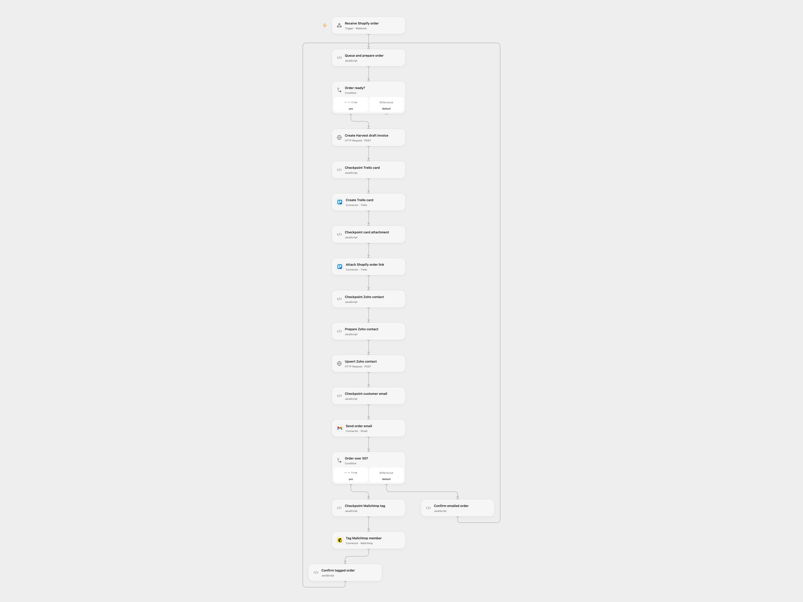

# Process Shopify Orders Across Sales Tools

Create sales records and send an order email when a Shopify order is created.

<picture>
  <source media="(prefers-color-scheme: dark)" srcset="preview-dark.png">
  
</picture>

[Open Flow JSON](templates/process-shopify-orders-across-sales-tools.openflow.json) · [n8n JSON](templates/process-shopify-orders-across-sales-tools.n8n.json)

## Setup

Connect Trello, Gmail and Mailchimp. Set the Trello list and Mailchimp audience. Configure the Harvest account ID, client ID and User-Agent contact, and bind Secret Variables `HARVEST_TOKEN` and `ZOHO_AUTHORIZATION` (the full Zoho authorization header). Set the Zoho API URL for your account's region. Enter your own 15% coupon code and make sure the code is valid in Shopify. Enable persistent State and prevent overlapping runs.

For Open Flow deploy its webhook and import the n8n workflow. Connect the Shopify Trigger, set **Choose delivery mode** to `relay`, and set the deployed webhook URL in **Forward order to Open Flow**. Restrict access to that URL; it does not authenticate the relay. For direct n8n mode, select `direct`, configure the source service credentials and IDs, and create an n8n Data Table with text column `order_id` for the checkpoint nodes. Activate one format.

## Behavior

For each new Shopify order, create a draft Harvest invoice with the order number as purchase order, create a Trello card and attach the order status link, upsert the customer in Zoho CRM, and send an order email. Orders over 50 in the order's currency receive the coupon message and the Mailchimp `high-order` tag. Other orders receive the thank-you message. The source invoice contains no line items; add them before issuing the draft. The Mailchimp customer must already be in the configured audience.

Open Flow stores order data and checkpoints in State. If a write has an unknown result, subsequent orders are queued and no writes are replayed. Inspect the pending order in each service, complete or undo partial work, then enter its Shopify GraphQL order ID in **Queue and prepare order** to acknowledge it; another order event starts the queue. In n8n a Data Table checkpoint blocks repeat processing of an order; inspect and resolve partial work before removing it. Previous writes remain if a later step fails.

Inspiration &amp; credits

## Changes to the source

- Remove private IDs and use explicit service configuration; add the missing source province.
- Serialize the branches and add durable checkpoints. Open Flow uses an n8n relay for Shopify and splits Trello card creation and URL attachment.

Adapted from [Shopify order processing across sales tools](https://github.com/Zie619/n8n-workflows/blob/ae8cf6dc5b873cbb4f74587aa9180ed3a9f70682/workflows/Zohocrm/0086_Zohocrm_Trello_Create_Triggered.json) in [Zie619/n8n-workflows](https://github.com/Zie619/n8n-workflows). The source export does not identify a separate template author or license.

The collection’s [MIT notice](https://github.com/Zie619/n8n-workflows/blob/94007c1445d9258a7da116646b79473e7c7c3282/LICENSE) is pinned at a later revision. This is the collection notice at that revision; it does not establish a separate original template author's license. Our changes are listed above; see [repository licensing](../../README.md#licensing).

> MIT License
>
> Copyright (c) 2025 Zie619
>
> Permission is hereby granted, free of charge, to any person obtaining a copy
> of this software and associated documentation files (the "Software"), to deal
> in the Software without restriction, including without limitation the rights
> to use, copy, modify, merge, publish, distribute, sublicense, and/or sell
> copies of the Software, and to permit persons to whom the Software is
> furnished to do so, subject to the following conditions:
>
> The above copyright notice and this permission notice shall be included in all
> copies or substantial portions of the Software.
>
> THE SOFTWARE IS PROVIDED "AS IS", WITHOUT WARRANTY OF ANY KIND, EXPRESS OR
> IMPLIED, INCLUDING BUT NOT LIMITED TO THE WARRANTIES OF MERCHANTABILITY,
> FITNESS FOR A PARTICULAR PURPOSE AND NONINFRINGEMENT. IN NO EVENT SHALL THE
> AUTHORS OR COPYRIGHT HOLDERS BE LIABLE FOR ANY CLAIM, DAMAGES OR OTHER
> LIABILITY, WHETHER IN AN ACTION OF CONTRACT, TORT OR OTHERWISE, ARISING FROM,
> OUT OF OR IN CONNECTION WITH THE SOFTWARE OR THE USE OR OTHER DEALINGS IN THE
> SOFTWARE.

