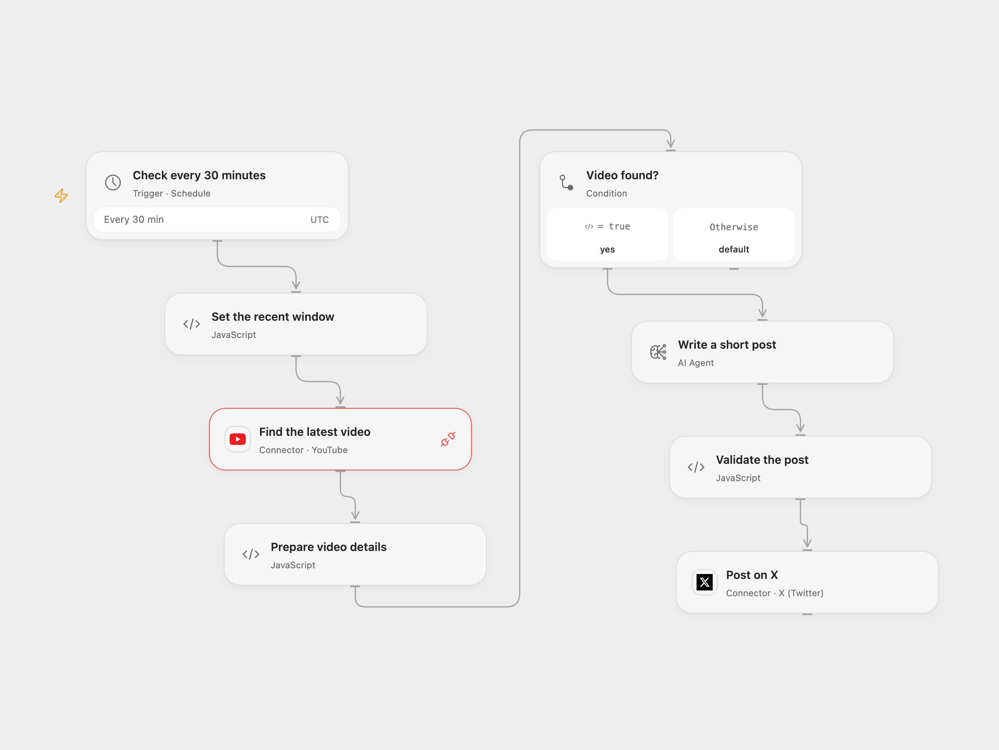

# Promote New YouTube Videos on X

Find the latest recent video from a YouTube channel and write a short X post.

<picture>
  <source media="(prefers-color-scheme: dark)" srcset="preview-dark.png">
  
</picture>

[Open Flow JSON](templates/promote-new-youtube-videos-on-x.openflow.json) · [n8n JSON](templates/promote-new-youtube-videos-on-x.n8n.json)

## Setup

Connect YouTube in **Find the latest video** and set its channel ID. Configure the AI model and connect **Post on X** to an account allowed to post. In n8n select YouTube, OpenAI and X credentials and set the channel ID. Activate one format.

## Behavior

Every 30 minutes, search the channel for its latest video published in the preceding 30 minutes. If found, an AI model writes an X post including the video link. No video means no post. The latest-only search can miss multiple uploads; indexing delays, downtime and schedule boundaries can miss videos. There is no persistent deduplication or workflow retry. n8n OAuth2 can refresh the X token and resend once after HTTP 401. Review model output and check X before retrying a failed or uncertain post. YouTube search uses API quota. Open Flow runs at UTC half-hour boundaries; n8n's interval is phased from activation.

Inspiration &amp; credits

## Changes to the source

- Replace the personal channel and credentials with setup. Open Flow uses the YouTube Connection Proxy for channel-only search, as the Search Action requires a query term.
- Sort results by publication date in both formats; the source omitted the order and the API defaults to relevance.
- Check the generated post includes the video URL and fits 140 characters before posting. Open Flow uses an AI Agent; n8n retains the source model node.

Adapted from [Post New YouTube Videos to X](https://github.com/Zie619/n8n-workflows/blob/ae8cf6dc5b873cbb4f74587aa9180ed3a9f70682/workflows/Schedule/1574_Schedule_Youtube_Create_Scheduled.json) in [Zie619/n8n-workflows](https://github.com/Zie619/n8n-workflows). The matching [n8n listing](https://n8n.io/workflows/2242-post-new-youtube-videos-to-x/) credits Mike Russell. The original template does not state a separate license.

The collection’s [MIT notice](https://github.com/Zie619/n8n-workflows/blob/94007c1445d9258a7da116646b79473e7c7c3282/LICENSE) is pinned at a later revision. This is the collection notice at that revision; it does not establish a separate original template author's license. Our changes are listed above; see [repository licensing](../../README.md#licensing).

> MIT License
>
> Copyright (c) 2025 Zie619
>
> Permission is hereby granted, free of charge, to any person obtaining a copy
> of this software and associated documentation files (the "Software"), to deal
> in the Software without restriction, including without limitation the rights
> to use, copy, modify, merge, publish, distribute, sublicense, and/or sell
> copies of the Software, and to permit persons to whom the Software is
> furnished to do so, subject to the following conditions:
>
> The above copyright notice and this permission notice shall be included in all
> copies or substantial portions of the Software.
>
> THE SOFTWARE IS PROVIDED "AS IS", WITHOUT WARRANTY OF ANY KIND, EXPRESS OR
> IMPLIED, INCLUDING BUT NOT LIMITED TO THE WARRANTIES OF MERCHANTABILITY,
> FITNESS FOR A PARTICULAR PURPOSE AND NONINFRINGEMENT. IN NO EVENT SHALL THE
> AUTHORS OR COPYRIGHT HOLDERS BE LIABLE FOR ANY CLAIM, DAMAGES OR OTHER
> LIABILITY, WHETHER IN AN ACTION OF CONTRACT, TORT OR OTHERWISE, ARISING FROM,
> OUT OF OR IN CONNECTION WITH THE SOFTWARE OR THE USE OR OTHER DEALINGS IN THE
> SOFTWARE.

