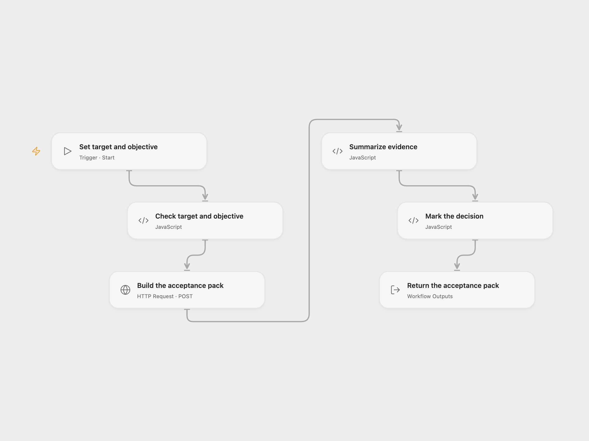

# Public Page Automation Preflight

Request an automation acceptance pack for a public page and return its evidence and review decision.

<!-- template-actions:start -->
 
<!-- template-actions:end -->

<picture>
  <source media="(prefers-color-scheme: dark)" srcset="preview-dark.png">
  
</picture>

## Setup

1. Subscribe to [Automation Integration Preflight](https://rapidapi.com/tinyopsstudio/api/automation-integration-preflight) through RapidAPI.
2. Create the secret variable `RAPIDAPI_KEY` and bind it to the API key input in **Build the acceptance pack**.
3. Run the workflow with a public HTTP or HTTPS `targetUrl` of up to 2048 characters and a nonempty `objective` of up to 500 characters. Submit pages you are authorized to share with the provider.

## Behavior

The workflow sends the page URL and objective to Automation Integration Preflight. The result keeps the full acceptance pack, including the launch gate, acceptance tests and prioritized backlog, alongside the available page, target, security header and readiness evidence.

The result is `READY_TO_IMPLEMENT` when the provider's launch gate says `ready`, its readiness score is at least 80 and its risk flag list is empty. Other results are `NEEDS_REVIEW`. An absent or nonnumeric score counts as zero, and a missing or malformed risk flag list requires review. A failed request stops the workflow. The request timeout is 30 seconds.

The URL check rejects embedded credentials and selected literal private hosts. It does not resolve DNS or inspect redirects followed by the external service. The provider contract was checked against the source workflow and replayed with synthetic responses. Test with your own subscription to verify availability and response compatibility before relying on results.

In n8n

Use a self-hosted task runner with `NODE_FUNCTION_ALLOW_BUILTIN=url` so **Validate Public Target** can import Node's URL parser. Create a Header Auth credential with header name `x-rapidapi-key` and your RapidAPI key. Select it in **Build Acceptance Pack**. Edit **Set Target and Objective** before running manually. The request timeout is 45 seconds.

Inspiration &amp; credits

## Changes to the source

Correct the IPv6 loopback check, reject embedded credentials and enforce the provider's URL length limit. Treat nonnumeric scores as zero and require an explicit empty risk flag list before marking a pack ready. Use the native secret binding and explicitly import the URL parser where needed.

Adapted from [Audit a Public Page and Build an Automation Acceptance Pack](https://github.com/enescingoz/awesome-n8n-templates/blob/827110332c21cbe000ab13f6d292d5adb1f1f8db/devops/Audit%20a%20Public%20Page%20and%20Build%20an%20Automation%20Acceptance%20Pack.json) in [enescingoz/awesome-n8n-templates](https://github.com/enescingoz/awesome-n8n-templates).

Source collection notice: © 2024–2026 Enes Cingoz, [CC BY 4.0](https://github.com/enescingoz/awesome-n8n-templates/blob/827110332c21cbe000ab13f6d292d5adb1f1f8db/LICENSE). The source export does not identify a separate template author or license. See [repository licensing](../../README.md#licensing) for the scope of OOMOL contributions and third-party material.

