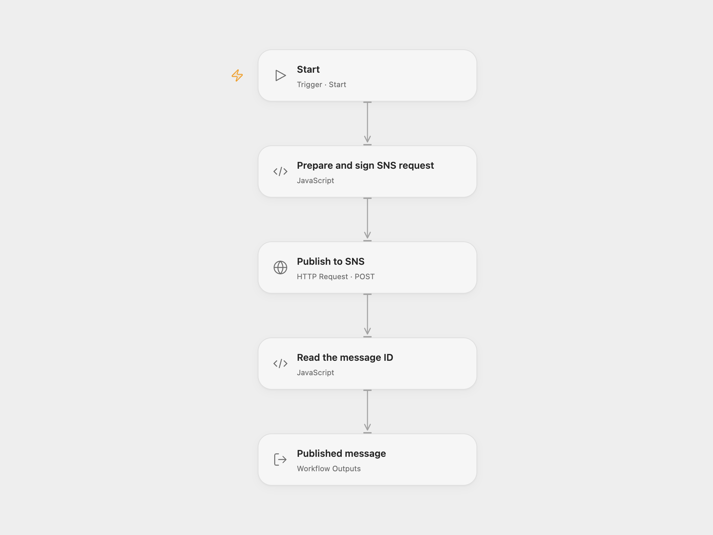

# Publish a Message to an SNS Topic

Publish a message with a subject to an Amazon SNS topic.

<picture>
  <source media="(prefers-color-scheme: dark)" srcset="preview-dark.png">
  
</picture>

[Open Flow JSON](templates/publish-a-message-to-an-sns-topic.openflow.json) · [n8n JSON](templates/publish-a-message-to-an-sns-topic.n8n.json)

## Setup

In Open Flow, set the standard SNS topic ARN, message and subject in **Prepare and sign SNS request**. Bind AWS access key ID and secret access key to secret Variables; if using temporary credentials, bind the same session token Variable both to **Prepare and sign SNS request** and to **Publish to SNS** → **X-Amz-Security-Token**. Leave both unset for long-lived credentials. In n8n, connect AWS credentials to **AWS SNS** and select the target topic, then set the message and subject. The AWS identity needs `sns:Publish` for that topic.

## Behavior

The workflow supports standard topics; FIFO topics require a message group ID and are not covered. A run publishes one message and returns its SNS message ID. SNS sends the subject to email subscriptions and delivers the message to the topic's subscribers. An unsuccessful or uncertain request stops the run without an automatic retry. Check SNS before retrying an uncertain publication.

Inspiration &amp; credits

## Changes to the source

- Replace the source topic example with a configured ARN. Open Flow signs a native HTTPS request using AWS Signature Version 4; n8n uses its AWS SNS node.

Adapted from [Manualtrigger Workflow](https://github.com/Zie619/n8n-workflows/blob/ae8cf6dc5b873cbb4f74587aa9180ed3a9f70682/workflows/Manual/0981_Manual_Awssns_Automate_Triggered.json) in [Zie619/n8n-workflows](https://github.com/Zie619/n8n-workflows). The source export does not identify a separate template author or license.

The collection’s [MIT notice](https://github.com/Zie619/n8n-workflows/blob/94007c1445d9258a7da116646b79473e7c7c3282/LICENSE) is pinned at a later revision. This is the collection notice at that revision; it does not establish a separate original template author's license. Our changes are listed above; see [repository licensing](../../README.md#licensing).

> MIT License
>
> Copyright (c) 2025 Zie619
>
> Permission is hereby granted, free of charge, to any person obtaining a copy
> of this software and associated documentation files (the "Software"), to deal
> in the Software without restriction, including without limitation the rights
> to use, copy, modify, merge, publish, distribute, sublicense, and/or sell
> copies of the Software, and to permit persons to whom the Software is
> furnished to do so, subject to the following conditions:
>
> The above copyright notice and this permission notice shall be included in all
> copies or substantial portions of the Software.
>
> THE SOFTWARE IS PROVIDED "AS IS", WITHOUT WARRANTY OF ANY KIND, EXPRESS OR
> IMPLIED, INCLUDING BUT NOT LIMITED TO THE WARRANTIES OF MERCHANTABILITY,
> FITNESS FOR A PARTICULAR PURPOSE AND NONINFRINGEMENT. IN NO EVENT SHALL THE
> AUTHORS OR COPYRIGHT HOLDERS BE LIABLE FOR ANY CLAIM, DAMAGES OR OTHER
> LIABILITY, WHETHER IN AN ACTION OF CONTRACT, TORT OR OTHERWISE, ARISING FROM,
> OUT OF OR IN CONNECTION WITH THE SOFTWARE OR THE USE OR OTHER DEALINGS IN THE
> SOFTWARE.

