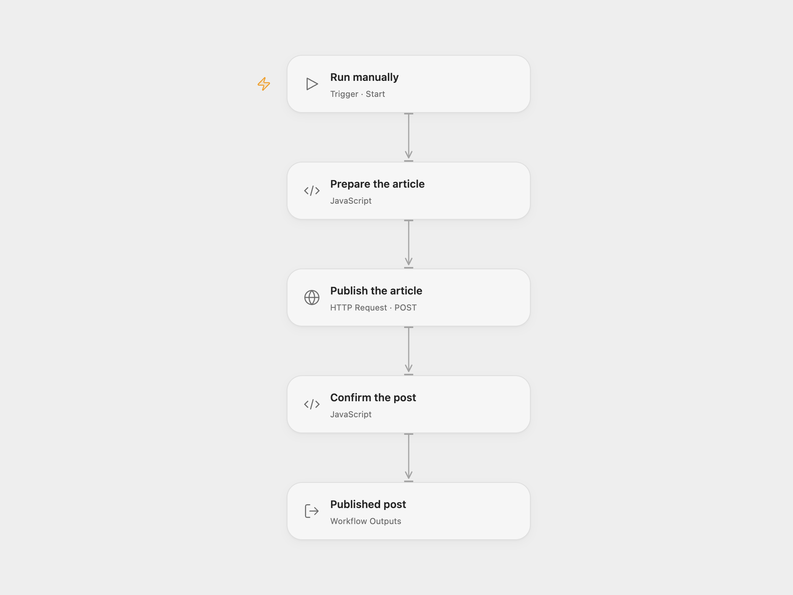

# Publish a Post to a Medium Publication

Publish a supplied article to a Medium publication.

<picture>
  <source media="(prefers-color-scheme: dark)" srcset="preview-dark.png">
  
</picture>

[Open Flow JSON](templates/publish-a-post-to-a-medium-publication.openflow.json) · [n8n JSON](templates/publish-a-post-to-a-medium-publication.n8n.json)

## Setup and use

[Medium no longer issues new API integration tokens or permits new integrations](https://help.medium.com/hc/en-us/articles/213480228-API-Importing); existing tokens continue to work. An existing token with permission to publish to the chosen publication is required. The API is no longer supported.

In Open Flow, enter the publication ID, title, article content and `markdown` or `html` format in **Prepare the article**. Bind the existing token to secret Variable **MEDIUM_API_TOKEN** in **Publish the article**. In n8n, configure the Medium credential and enter the same fields in **Medium**. The title and content are initially empty.

## Behavior

A manual run submits one article to the selected publication. The source omits publish status, so Medium defaults to **public**. Publication editors can publish publicly. Writers can only submit drafts and need an editor's approval; change the request's publishStatus to draft in Open Flow or the Medium node's additional fields in n8n. The post title must also appear in the content if it should appear on the article page. The workflow sends no tags and returns Medium's response. An uncertain request may already have created a post; check the publication before retrying.

Inspiration &amp; credits

## Changes to the source

- Open Flow validates required fields and confirms a returned post ID. Medium's original API and public default are preserved.

Adapted from [Publish post to a publication](https://github.com/Zie619/n8n-workflows/blob/ae8cf6dc5b873cbb4f74587aa9180ed3a9f70682/workflows/Manual/1139_Manual_Medium_Automation_Triggered.json) in [Zie619/n8n-workflows](https://github.com/Zie619/n8n-workflows). The source export does not identify a separate template author or license.

The collection’s [MIT notice](https://github.com/Zie619/n8n-workflows/blob/94007c1445d9258a7da116646b79473e7c7c3282/LICENSE) is pinned at a later revision. This is the collection notice at that revision; it does not establish a separate original template author's license. Our changes are listed above; see [repository licensing](../../README.md#licensing).

> MIT License
>
> Copyright (c) 2025 Zie619
>
> Permission is hereby granted, free of charge, to any person obtaining a copy
> of this software and associated documentation files (the "Software"), to deal
> in the Software without restriction, including without limitation the rights
> to use, copy, modify, merge, publish, distribute, sublicense, and/or sell
> copies of the Software, and to permit persons to whom the Software is
> furnished to do so, subject to the following conditions:
>
> The above copyright notice and this permission notice shall be included in all
> copies or substantial portions of the Software.
>
> THE SOFTWARE IS PROVIDED "AS IS", WITHOUT WARRANTY OF ANY KIND, EXPRESS OR
> IMPLIED, INCLUDING BUT NOT LIMITED TO THE WARRANTIES OF MERCHANTABILITY,
> FITNESS FOR A PARTICULAR PURPOSE AND NONINFRINGEMENT. IN NO EVENT SHALL THE
> AUTHORS OR COPYRIGHT HOLDERS BE LIABLE FOR ANY CLAIM, DAMAGES OR OTHER
> LIABILITY, WHETHER IN AN ACTION OF CONTRACT, TORT OR OTHERWISE, ARISING FROM,
> OUT OF OR IN CONNECTION WITH THE SOFTWARE OR THE USE OR OTHER DEALINGS IN THE
> SOFTWARE.

