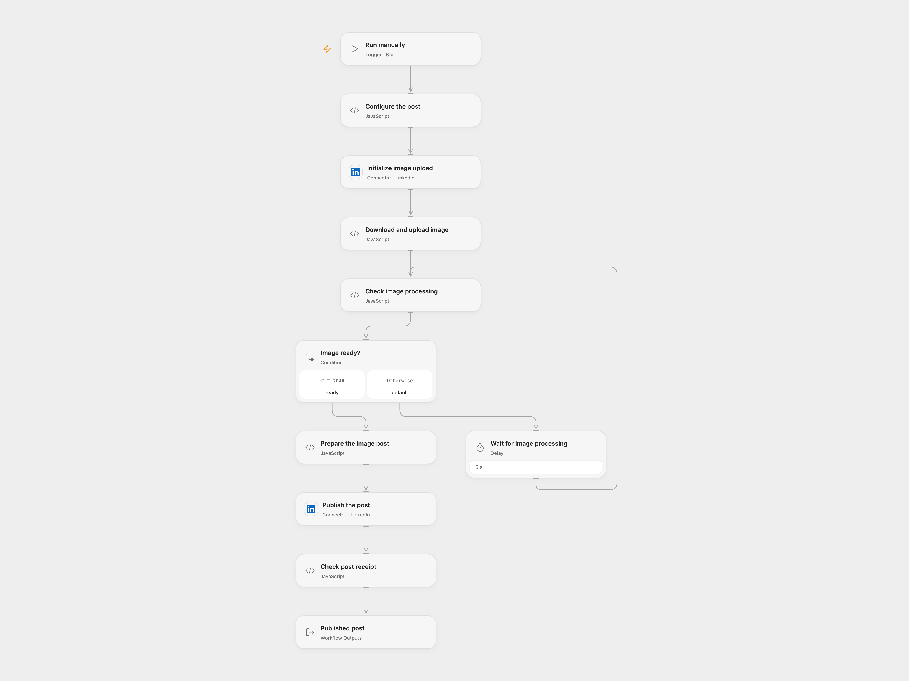

# Publish an Image to LinkedIn

Publish a configured image and message to a LinkedIn personal profile.

<picture>
  <source media="(prefers-color-scheme: dark)" srcset="preview-dark.png">
  
</picture>

[Open Flow JSON](templates/publish-an-image-to-linkedin.openflow.json) · [n8n JSON](templates/publish-an-image-to-linkedin.n8n.json)

## Setup and use

In Open Flow connect LinkedIn with permission to post as your personal profile. Set your person URN and message in **Configure the post**. Supply a LinkedIn access token for the same member as secret Variable **LINKEDIN_UPLOAD_TOKEN** in **Download and upload image** and **Check image processing**. Set your directly accessible HTTPS image URL in **Download and upload image**, and change its host check and HTTP capability to match. Use an image you have permission to share. In n8n configure the LinkedIn credential on the three LinkedIn HTTP nodes, set the same person ID in **Initialize image upload** and **Publish image post**, and set the message and image URL.

## Behavior

A manual run downloads an image, uploads it to LinkedIn and publishes a public image post. Open Flow accepts image responses up to 1 MiB and does not follow redirects. LinkedIn processes images asynchronously. Both formats check for an available image before posting and stop if processing fails or times out. If upload or post results are unknown, inspect LinkedIn before retrying to avoid a duplicate post.

Inspiration &amp; credits

## Changes to the source

- Replace the personal account with configuration. Both formats use LinkedIn's Images and Posts APIs; Open Flow uses a separate upload token.

Adapted from [Publish an image to LinkedIn](https://github.com/Zie619/n8n-workflows/blob/ae8cf6dc5b873cbb4f74587aa9180ed3a9f70682/workflows/Manual/1096_Manual_Linkedin_Automation_Webhook.json) in [Zie619/n8n-workflows](https://github.com/Zie619/n8n-workflows). The source export does not identify a separate template author or license.

The collection’s [MIT notice](https://github.com/Zie619/n8n-workflows/blob/94007c1445d9258a7da116646b79473e7c7c3282/LICENSE) is pinned at a later revision. This is the collection notice at that revision; it does not establish a separate original template author's license. Our changes are listed above; see [repository licensing](../../README.md#licensing).

> MIT License
>
> Copyright (c) 2025 Zie619
>
> Permission is hereby granted, free of charge, to any person obtaining a copy
> of this software and associated documentation files (the "Software"), to deal
> in the Software without restriction, including without limitation the rights
> to use, copy, modify, merge, publish, distribute, sublicense, and/or sell
> copies of the Software, and to permit persons to whom the Software is
> furnished to do so, subject to the following conditions:
>
> The above copyright notice and this permission notice shall be included in all
> copies or substantial portions of the Software.
>
> THE SOFTWARE IS PROVIDED "AS IS", WITHOUT WARRANTY OF ANY KIND, EXPRESS OR
> IMPLIED, INCLUDING BUT NOT LIMITED TO THE WARRANTIES OF MERCHANTABILITY,
> FITNESS FOR A PARTICULAR PURPOSE AND NONINFRINGEMENT. IN NO EVENT SHALL THE
> AUTHORS OR COPYRIGHT HOLDERS BE LIABLE FOR ANY CLAIM, DAMAGES OR OTHER
> LIABILITY, WHETHER IN AN ACTION OF CONTRACT, TORT OR OTHERWISE, ARISING FROM,
> OUT OF OR IN CONNECTION WITH THE SOFTWARE OR THE USE OR OTHER DEALINGS IN THE
> SOFTWARE.

