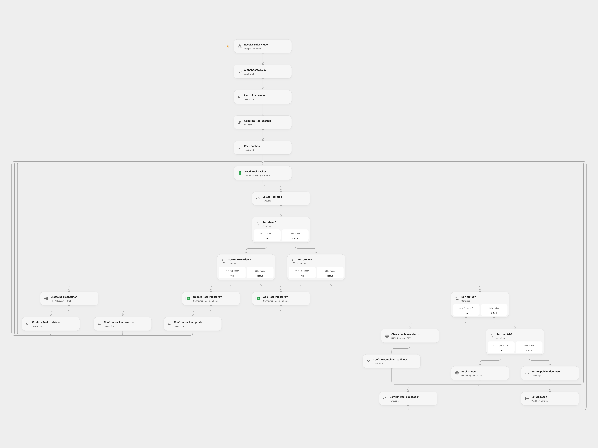

# Publish Drive Reels to Instagram

Publish publicly downloadable Drive videos as Instagram Reels.

<picture>
  <source media="(prefers-color-scheme: dark)" srcset="preview-dark.png">
  
</picture>

[Open Flow JSON](templates/publish-drive-reels-to-instagram.openflow.json) · [n8n JSON](templates/publish-drive-reels-to-instagram.n8n.json)

## Setup

Configure an Instagram Professional account, Page access token, Google Drive and Google Sheets. Videos must be public, satisfy Meta Reel specifications, and have a direct, publicly retrievable download URL. Use a Posts sheet with File ID, Name, Caption, Video URL and Thumbnail columns. In n8n configure the Drive trigger folder, Google Drive OAuth, Google Sheets, the two Facebook Graph API nodes, and Header Auth containing the Page token for Check container status. Create a private Data Table with item_key, status and payload text columns and select it on every Data Table node. Configure Header Auth on Resume video and set your Instagram account ID. Direct mode is the default. To use Open Flow, change mode in Prepare Reel to relay, configure the Open Flow URL and matching Header Auth on Forward video to Open Flow, connect Google Sheets, set REEL_RELAY_AUTH to that Authorization header and META_PAGE_ACCESS_TOKEN to the Page token, and enable persistent State. Prevent concurrent runs for the same file and tracker edits.

The workflow records the caption and video under its file ID, creates a Reel container, checks for FINISHED and publishes it. If processing is incomplete, POST the same fileId to the authenticated Resume video webhook later. n8n compares streaming SHA-256 hashes of the original Drive video and the public URL before either mode proceeds; keep the file unchanged while Meta fetches it. A public download may return an interstitial instead of video and will be rejected. Unknown sheet, container or publication results stop the workflow. Inspect the service before retrying. In Open Flow enter the pending key and confirmed or absent in Select Reel step; for confirmed container creation also enter its ID, then clear the recovery fields. In direct n8n mode inspect the Data Table row: for an absent operation change pending-sheet, pending-create or pending-publish to ready-sheet, ready-create or ready-publish; for a confirmed sheet set ready-create, for a confirmed container put containerId in its payload and set ready-status, and for confirmed publication set done. Resume the same file only after verification. Never replay an unknown publication. The caption is generated from the filename and should be reviewed.

The source used a browser-view link as video and attempted to publish immediately. This workflow requires a publicly accessible video download and waits for container readiness. Only Reels are configured by the source. Public sharing exposes the video.

Inspiration &amp; credits

Adapted from [Instagram Reel automation](https://github.com/Zie619/n8n-workflows/blob/ae8cf6dc5b873cbb4f74587aa9180ed3a9f70682/workflows/Googledrive/0839_GoogleDrive_GoogleSheets_Create_Triggered.json) in [Zie619/n8n-workflows](https://github.com/Zie619/n8n-workflows). The source export does not identify a separate template author or license.

The collection’s [MIT notice](https://github.com/Zie619/n8n-workflows/blob/94007c1445d9258a7da116646b79473e7c7c3282/LICENSE) is pinned at a later revision. This is the collection notice at that revision; it does not establish a separate original template author's license. Our changes are listed above; see [repository licensing](../../README.md#licensing).

> MIT License
>
> Copyright (c) 2025 Zie619
>
> Permission is hereby granted, free of charge, to any person obtaining a copy
> of this software and associated documentation files (the "Software"), to deal
> in the Software without restriction, including without limitation the rights
> to use, copy, modify, merge, publish, distribute, sublicense, and/or sell
> copies of the Software, and to permit persons to whom the Software is
> furnished to do so, subject to the following conditions:
>
> The above copyright notice and this permission notice shall be included in all
> copies or substantial portions of the Software.
>
> THE SOFTWARE IS PROVIDED "AS IS", WITHOUT WARRANTY OF ANY KIND, EXPRESS OR
> IMPLIED, INCLUDING BUT NOT LIMITED TO THE WARRANTIES OF MERCHANTABILITY,
> FITNESS FOR A PARTICULAR PURPOSE AND NONINFRINGEMENT. IN NO EVENT SHALL THE
> AUTHORS OR COPYRIGHT HOLDERS BE LIABLE FOR ANY CLAIM, DAMAGES OR OTHER
> LIABILITY, WHETHER IN AN ACTION OF CONTRACT, TORT OR OTHERWISE, ARISING FROM,
> OUT OF OR IN CONNECTION WITH THE SOFTWARE OR THE USE OR OTHER DEALINGS IN THE
> SOFTWARE.

