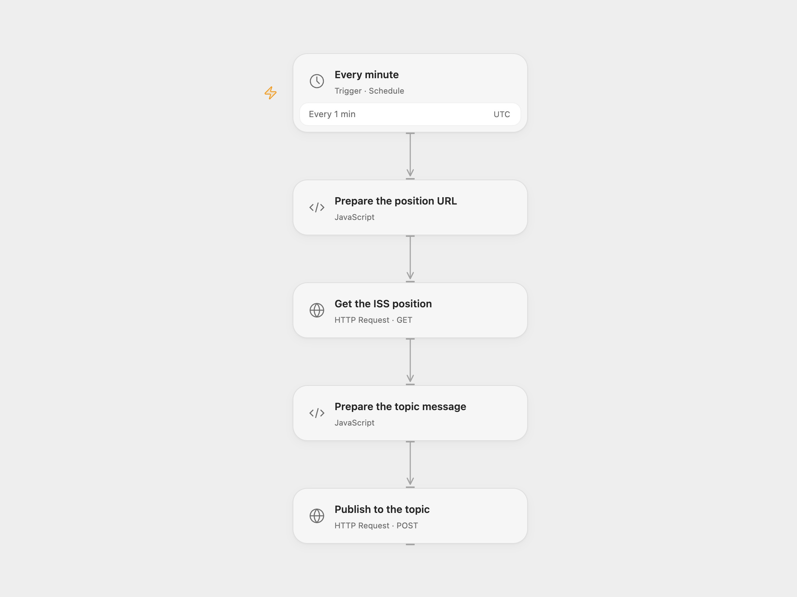

# Publish ISS Position to ActiveMQ

Publish the current ISS position to an ActiveMQ topic every minute.

<picture>
  <source media="(prefers-color-scheme: dark)" srcset="preview-dark.png">
  
</picture>

[Open Flow JSON](templates/publish-iss-position-to-activemq.openflow.json) · [n8n JSON](templates/publish-iss-position-to-activemq.n8n.json)

## Setup and use

For Open Flow, enable the [ActiveMQ Classic REST API](https://activemq.apache.org/components/classic/documentation/rest) on a broker reachable from the workflow. In **Publish to the topic**, set the HTTPS URL to your broker's `/api/message?destination=topic%3A%2F%2FYOUR_TOPIC` and bind its username and password as secret Variables. Configure broker access to publish to that topic.

For n8n, configure the AMQP credential and the address `topic://YOUR_TOPIC` in **AMQP Sender**, using the same broker and topic as the REST destination. Activate one format.

## Behavior

Every minute, retrieve the ISS position and publish one JSON message containing Name, Latitude, Longitude and Timestamp. Open Flow runs at the minute boundary; n8n Cron V1 uses a fixed second within each minute. Open Flow stops on invalid position data or an HTTP error. A publish with an unknown outcome may already have succeeded; check the broker before retrying.

Inspiration &amp; credits

## Changes to the source

- Correct the position API timestamp from milliseconds to seconds. Open Flow publishes through the ActiveMQ Classic REST API; n8n retains AMQP. Configure the destination and credentials for your broker.

Adapted from [Publish ISS position to an ActiveMQ topic](https://github.com/Zie619/n8n-workflows/blob/ae8cf6dc5b873cbb4f74587aa9180ed3a9f70682/workflows/Http/0015_HTTP_Cron_Update_Webhook.json) in [Zie619/n8n-workflows](https://github.com/Zie619/n8n-workflows). The source export does not identify a separate template author or license.

The collection’s [MIT notice](https://github.com/Zie619/n8n-workflows/blob/94007c1445d9258a7da116646b79473e7c7c3282/LICENSE) is pinned at a later revision. This is the collection notice at that revision; it does not establish a separate original template author's license. Our changes are listed above; see [repository licensing](../../README.md#licensing).

> MIT License
>
> Copyright (c) 2025 Zie619
>
> Permission is hereby granted, free of charge, to any person obtaining a copy
> of this software and associated documentation files (the "Software"), to deal
> in the Software without restriction, including without limitation the rights
> to use, copy, modify, merge, publish, distribute, sublicense, and/or sell
> copies of the Software, and to permit persons to whom the Software is
> furnished to do so, subject to the following conditions:
>
> The above copyright notice and this permission notice shall be included in all
> copies or substantial portions of the Software.
>
> THE SOFTWARE IS PROVIDED "AS IS", WITHOUT WARRANTY OF ANY KIND, EXPRESS OR
> IMPLIED, INCLUDING BUT NOT LIMITED TO THE WARRANTIES OF MERCHANTABILITY,
> FITNESS FOR A PARTICULAR PURPOSE AND NONINFRINGEMENT. IN NO EVENT SHALL THE
> AUTHORS OR COPYRIGHT HOLDERS BE LIABLE FOR ANY CLAIM, DAMAGES OR OTHER
> LIABILITY, WHETHER IN AN ACTION OF CONTRACT, TORT OR OTHERWISE, ARISING FROM,
> OUT OF OR IN CONNECTION WITH THE SOFTWARE OR THE USE OR OTHER DEALINGS IN THE
> SOFTWARE.

