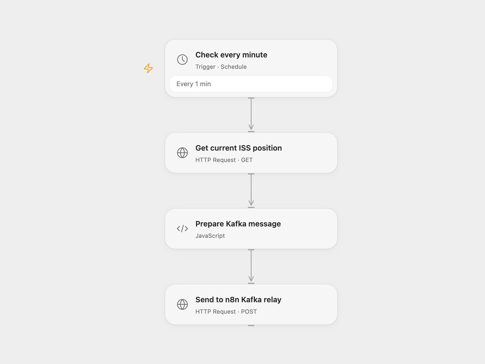

# Publish ISS Position to Kafka

Publish the current International Space Station position to a Kafka topic every minute.

<picture>
  <source media="(prefers-color-scheme: dark)" srcset="preview-dark.png">
  
</picture>

[Open Flow JSON](templates/publish-iss-position-to-kafka.openflow.json) · [n8n JSON](templates/publish-iss-position-to-kafka.n8n.json)

## Setup and use

Import the supplied n8n workflow and connect both Kafka nodes with access to the iss-position topic. To run in n8n, enable **Cron** and disable **Kafka relay webhook**. To run in Open Flow, disable **Cron**, enable **Kafka relay webhook**, activate the n8n workflow and put the production webhook URL in **Send to n8n Kafka relay**. Use one mode to avoid duplicate messages. The relay does not authenticate callers; restrict access to its webhook.

## Behavior

Every minute, read the current ISS position and publish JSON with Name, Latitude, Longitude and Timestamp as strings. In Open Flow mode, n8n responds after the Kafka producer finishes sending; a producer error returns an HTTP failure. The source producer uses no broker acknowledgements by default, so a successful response does not establish broker delivery. If an acknowledgement or Kafka send is uncertain, the topic may already contain the message.

Inspiration &amp; credits

## Changes to the source

- Request the current-position endpoint instead of passing a millisecond timestamp to the positions endpoint. Add an n8n webhook relay so Open Flow can use the source Kafka node.

Adapted from [ISS position to Kafka](https://github.com/Zie619/n8n-workflows/blob/ae8cf6dc5b873cbb4f74587aa9180ed3a9f70682/workflows/Http/1226_HTTP_Kafka_Update_Webhook.json) in [Zie619/n8n-workflows](https://github.com/Zie619/n8n-workflows). The source export does not identify a separate template author or license.

The collection’s [MIT notice](https://github.com/Zie619/n8n-workflows/blob/94007c1445d9258a7da116646b79473e7c7c3282/LICENSE) is pinned at a later revision. This is the collection notice at that revision; it does not establish a separate original template author's license. Our changes are listed above; see [repository licensing](../../README.md#licensing).

> MIT License
>
> Copyright (c) 2025 Zie619
>
> Permission is hereby granted, free of charge, to any person obtaining a copy
> of this software and associated documentation files (the "Software"), to deal
> in the Software without restriction, including without limitation the rights
> to use, copy, modify, merge, publish, distribute, sublicense, and/or sell
> copies of the Software, and to permit persons to whom the Software is
> furnished to do so, subject to the following conditions:
>
> The above copyright notice and this permission notice shall be included in all
> copies or substantial portions of the Software.
>
> THE SOFTWARE IS PROVIDED "AS IS", WITHOUT WARRANTY OF ANY KIND, EXPRESS OR
> IMPLIED, INCLUDING BUT NOT LIMITED TO THE WARRANTIES OF MERCHANTABILITY,
> FITNESS FOR A PARTICULAR PURPOSE AND NONINFRINGEMENT. IN NO EVENT SHALL THE
> AUTHORS OR COPYRIGHT HOLDERS BE LIABLE FOR ANY CLAIM, DAMAGES OR OTHER
> LIABILITY, WHETHER IN AN ACTION OF CONTRACT, TORT OR OTHERWISE, ARISING FROM,
> OUT OF OR IN CONNECTION WITH THE SOFTWARE OR THE USE OR OTHER DEALINGS IN THE
> SOFTWARE.

