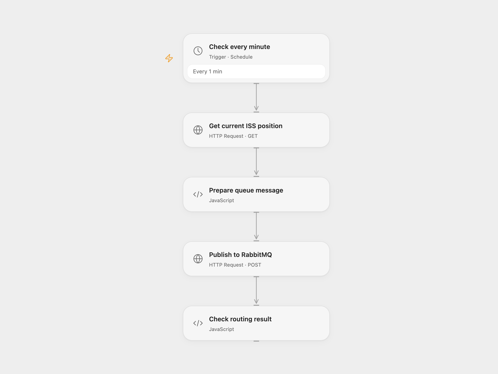

# Publish ISS Position to RabbitMQ

Publish the current International Space Station position to a RabbitMQ queue every minute.

<picture>
  <source media="(prefers-color-scheme: dark)" srcset="preview-dark.png">
  
</picture>

[Open Flow JSON](templates/publish-iss-position-to-rabbitmq.openflow.json) · [n8n JSON](templates/publish-iss-position-to-rabbitmq.n8n.json)

## Setup and use

Create the iss-position queue and connect RabbitMQ in n8n. For Open Flow enable the RabbitMQ management plugin and its HTTPS HTTP API, enter its base URL, virtual host and queue in **Prepare queue message**, and bind secret Variables RABBITMQ_USERNAME and RABBITMQ_PASSWORD with permission to publish. Activate one format.

## Behavior

Every minute, read the current ISS position and publish JSON with numeric Latitude, Longitude and Timestamp and string Name. Open Flow uses the management API and default exchange to route to the existing queue, and stops if the response reports no routing. n8n uses AMQP. If a publish result is unknown, the queue may already contain the message. RabbitMQ describes its HTTP API as inefficient for high-volume publishing.

Inspiration &amp; credits

## Changes to the source

- Request the current-position endpoint instead of passing a millisecond timestamp to the positions endpoint. Open Flow uses the management API as its RabbitMQ transport.

Adapted from [ISS position to RabbitMQ](https://github.com/Zie619/n8n-workflows/blob/ae8cf6dc5b873cbb4f74587aa9180ed3a9f70682/workflows/Http/0287_HTTP_Rabbitmq_Update_Scheduled.json) in [Zie619/n8n-workflows](https://github.com/Zie619/n8n-workflows). The source export does not identify a separate template author or license.

The collection’s [MIT notice](https://github.com/Zie619/n8n-workflows/blob/94007c1445d9258a7da116646b79473e7c7c3282/LICENSE) is pinned at a later revision. This is the collection notice at that revision; it does not establish a separate original template author's license. Our changes are listed above; see [repository licensing](../../README.md#licensing).

> MIT License
>
> Copyright (c) 2025 Zie619
>
> Permission is hereby granted, free of charge, to any person obtaining a copy
> of this software and associated documentation files (the "Software"), to deal
> in the Software without restriction, including without limitation the rights
> to use, copy, modify, merge, publish, distribute, sublicense, and/or sell
> copies of the Software, and to permit persons to whom the Software is
> furnished to do so, subject to the following conditions:
>
> The above copyright notice and this permission notice shall be included in all
> copies or substantial portions of the Software.
>
> THE SOFTWARE IS PROVIDED "AS IS", WITHOUT WARRANTY OF ANY KIND, EXPRESS OR
> IMPLIED, INCLUDING BUT NOT LIMITED TO THE WARRANTIES OF MERCHANTABILITY,
> FITNESS FOR A PARTICULAR PURPOSE AND NONINFRINGEMENT. IN NO EVENT SHALL THE
> AUTHORS OR COPYRIGHT HOLDERS BE LIABLE FOR ANY CLAIM, DAMAGES OR OTHER
> LIABILITY, WHETHER IN AN ACTION OF CONTRACT, TORT OR OTHERWISE, ARISING FROM,
> OUT OF OR IN CONNECTION WITH THE SOFTWARE OR THE USE OR OTHER DEALINGS IN THE
> SOFTWARE.

