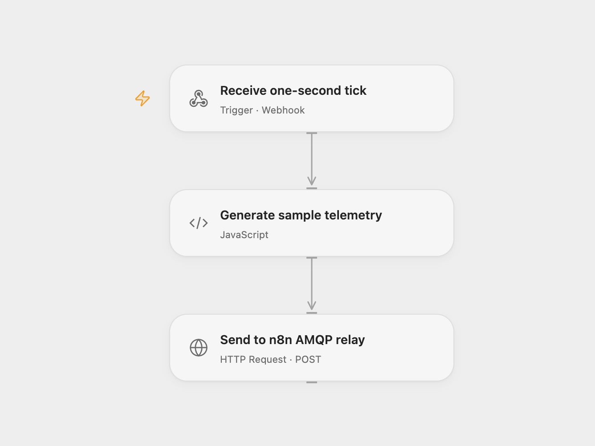

# Publish Machine Telemetry to AMQP

Generate sample machine telemetry every second and publish it to an AMQP destination.

<picture>
  <source media="(prefers-color-scheme: dark)" srcset="preview-dark.png">
  
</picture>

[Open Flow JSON](templates/publish-machine-telemetry-to-amqp.openflow.json) · [n8n JSON](templates/publish-machine-telemetry-to-amqp.n8n.json)

## Setup and use

Import the supplied n8n workflow and configure both AMQP nodes with the same AMQP 1.0 connection and destination. For n8n mode enable **Interval** and disable **Open Flow interval** and **AMQP relay webhook**. For Open Flow mode disable **Interval**, enable the other two, enter the deployed Open Flow webhook URL in **Send tick to Open Flow**, and enter the n8n production webhook URL in **Send to n8n AMQP relay**. Activate the n8n workflow and use one mode. Neither webhook authenticates callers; restrict access to both.

## Behavior

Every second, generate a machine name, random temperature and uptime from 0 through 99, and the current Unix timestamp in milliseconds. These sample values are sent as an AMQP object. In Open Flow mode n8n forwards a tick to Open Flow; Open Flow generates the telemetry and sends it to the n8n AMQP relay. The relay responds after the sender submits the message; sender failure returns HTTP failure. The tick request is acknowledged before the Open Flow run finishes, so inspect that run for relay failures. A successful AMQP relay response does not establish broker delivery. A lost response can mean the message was already sent. Intervals can overlap if delivery takes longer than one second.

Inspiration &amp; credits

## Changes to the source

- Fix the source expressions and retain its one-second interval and AMQP 1.0 sender using the supplied n8n tick and producer relay for Open Flow.

Adapted from [Machine telemetry to AMQP](https://github.com/Zie619/n8n-workflows/blob/ae8cf6dc5b873cbb4f74587aa9180ed3a9f70682/workflows/Interval/0211_Interval_Amqp_Automation_Scheduled.json) in [Zie619/n8n-workflows](https://github.com/Zie619/n8n-workflows). The source export does not identify a separate template author or license.

The collection’s [MIT notice](https://github.com/Zie619/n8n-workflows/blob/94007c1445d9258a7da116646b79473e7c7c3282/LICENSE) is pinned at a later revision. This is the collection notice at that revision; it does not establish a separate original template author's license. Our changes are listed above; see [repository licensing](../../README.md#licensing).

> MIT License
>
> Copyright (c) 2025 Zie619
>
> Permission is hereby granted, free of charge, to any person obtaining a copy
> of this software and associated documentation files (the "Software"), to deal
> in the Software without restriction, including without limitation the rights
> to use, copy, modify, merge, publish, distribute, sublicense, and/or sell
> copies of the Software, and to permit persons to whom the Software is
> furnished to do so, subject to the following conditions:
>
> The above copyright notice and this permission notice shall be included in all
> copies or substantial portions of the Software.
>
> THE SOFTWARE IS PROVIDED "AS IS", WITHOUT WARRANTY OF ANY KIND, EXPRESS OR
> IMPLIED, INCLUDING BUT NOT LIMITED TO THE WARRANTIES OF MERCHANTABILITY,
> FITNESS FOR A PARTICULAR PURPOSE AND NONINFRINGEMENT. IN NO EVENT SHALL THE
> AUTHORS OR COPYRIGHT HOLDERS BE LIABLE FOR ANY CLAIM, DAMAGES OR OTHER
> LIABILITY, WHETHER IN AN ACTION OF CONTRACT, TORT OR OTHERWISE, ARISING FROM,
> OUT OF OR IN CONNECTION WITH THE SOFTWARE OR THE USE OR OTHER DEALINGS IN THE
> SOFTWARE.

