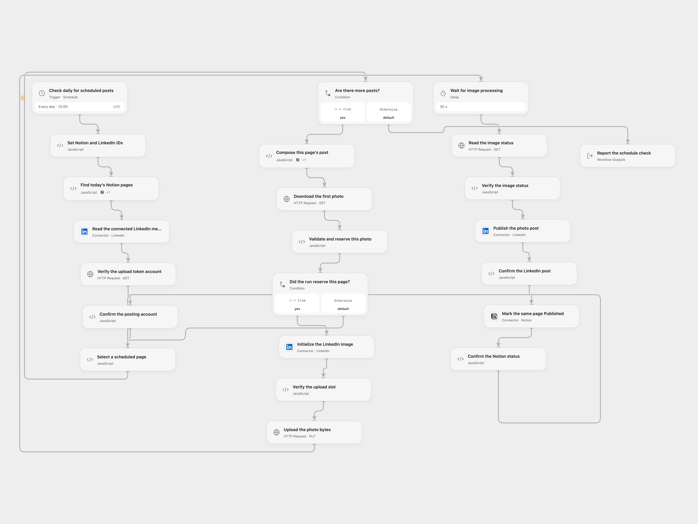

# Publish Scheduled Notion Photos to LinkedIn

Publish each Notion page scheduled for today as a LinkedIn post with its first photo, then mark that page Published.

<!-- template-actions:start -->
 
<!-- template-actions:end -->

<picture>
  <source media="(prefers-color-scheme: dark)" srcset="preview-dark.png">
  
</picture>

## Setup

1. Share your editorial data source with a Notion connection that can read and update its pages. Use a date-only **Date** property and a **Status** select property with a **Published** option. Enter the data source ID in **Set Notion and LinkedIn IDs** and bind the same Notion connection in **Find today’s Notion pages**, **Compose this page’s post**, and **Mark the same page Published**. [Notion data source IDs](https://developers.notion.com/reference/query-a-data-source)
2. In **Set Notion and LinkedIn IDs**, enter the exact member URN from your authorized LinkedIn personal account. Bind the same LinkedIn connection in **Read the connected LinkedIn member**, **Initialize the LinkedIn image**, and **Publish the photo post**, with account read, member publishing, and Provider API access. Create a Secret Variable named `LINKEDIN_UPLOAD_TOKEN` with a current OAuth access token for that same member and the `openid`, `profile`, and `w_member_social` scopes. Bind it as the bearer token in **Verify the upload token account**, **Upload the photo bytes**, and **Read the image status**. The workflow checks both logins against your configured member before uploading. [LinkedIn member authorization](https://learn.microsoft.com/en-us/linkedin/consumer/integrations/self-serve/share-on-linkedin)
3. Add the post text as top-level blocks and upload the photo to the same Notion page. Use materials you have permission to share on your public LinkedIn feed. Keep persistent State enabled and publish one active copy of the workflow.

## Behavior

At 15:00 UTC each day the workflow reads that day’s pages in creation order, skipping those with **Status** set to **Published**. It reads each page’s own ordered top-level blocks, adds an extra line break before text beginning with a hyphen, and uses the first Notion-hosted image. JPEG, PNG, and GIF images up to 10 MiB are supported. Each Notion list is limited to ten pages of 100 results.

The workflow gives LinkedIn 30 seconds to process each upload, then checks that the image is available. Only then does it post the image and the page’s text to the configured personal profile. An HTTP 201 with a valid LinkedIn post ID allows the workflow to set that same Notion page’s **Status** to **Published**. This uses LinkedIn’s documented legacy image-status read with the member write scope. [LinkedIn Images API](https://learn.microsoft.com/en-us/linkedin/marketing/community-management/shares/images-api) · [LinkedIn Posts API](https://learn.microsoft.com/en-us/linkedin/marketing/community-management/shares/posts-api)

An upload or publication failure stops the run and reserves the current page. If the post exists, reconcile **Status** in Notion manually. Clear a reservation only after checking the configured profile and confirming the post was never created. A subsequent run skips reserved pages and processes eligible pages in its date window.

In n8n

Set the IDs in **Set Notion and LinkedIn IDs**. In the Notion HTTP nodes, use one Notion API credential with access to the configured data source. Select the same LinkedIn OAuth credential in every LinkedIn HTTP node. For a personal app, turn off **Organization Support** and **Legacy** to use OAuth with OpenID Connect and `w_member_social`.

The image status is checked immediately after the upload and up to nine more times, with five seconds between checks.

Create a Data Table with a string column named `request_key` and select it in **Check a previous attempt** and **Validate and reserve this photo**. This stores attempts across runs. On a self-hosted instance, use regular mode with `N8N_CONCURRENCY_PRODUCTION_LIMIT=1` and avoid overlapping manual runs. Inspect a failed execution and reconcile the post and page before removing a reservation. [n8n concurrency control](https://docs.n8n.io/hosting/scaling/concurrency-control/)

Inspiration &amp; credits

## Changes to the source

Use date-only ISO dates and a portable UTC schedule. Keep each page’s text, image, and status together when several posts share the same date. The active source publishes as a member, and the workflow targets the configured personal profile.

Adapted from [Notion to LinkedIn](https://github.com/Zie619/n8n-workflows/blob/ae8cf6dc5b873cbb4f74587aa9180ed3a9f70682/workflows/Linkedin/1939_Linkedin_Code_Automation_Webhook.json) in [Zie619/n8n-workflows](https://github.com/Zie619/n8n-workflows). Attribution: Zie619 / n8n-workflows.

The collection’s [MIT notice](https://github.com/Zie619/n8n-workflows/blob/94007c1445d9258a7da116646b79473e7c7c3282/LICENSE) is pinned at a later revision. This is the collection notice at that revision; it does not establish a separate original template author's license. Our changes are listed above; see [repository licensing](../../README.md#licensing).

> MIT License
>
> Copyright (c) 2025 Zie619
>
> Permission is hereby granted, free of charge, to any person obtaining a copy
> of this software and associated documentation files (the "Software"), to deal
> in the Software without restriction, including without limitation the rights
> to use, copy, modify, merge, publish, distribute, sublicense, and/or sell
> copies of the Software, and to permit persons to whom the Software is
> furnished to do so, subject to the following conditions:
>
> The above copyright notice and this permission notice shall be included in all
> copies or substantial portions of the Software.
>
> THE SOFTWARE IS PROVIDED "AS IS", WITHOUT WARRANTY OF ANY KIND, EXPRESS OR
> IMPLIED, INCLUDING BUT NOT LIMITED TO THE WARRANTIES OF MERCHANTABILITY,
> FITNESS FOR A PARTICULAR PURPOSE AND NONINFRINGEMENT. IN NO EVENT SHALL THE
> AUTHORS OR COPYRIGHT HOLDERS BE LIABLE FOR ANY CLAIM, DAMAGES OR OTHER
> LIABILITY, WHETHER IN AN ACTION OF CONTRACT, TORT OR OTHERWISE, ARISING FROM,
> OUT OF OR IN CONNECTION WITH THE SOFTWARE OR THE USE OR OTHER DEALINGS IN THE
> SOFTWARE.

