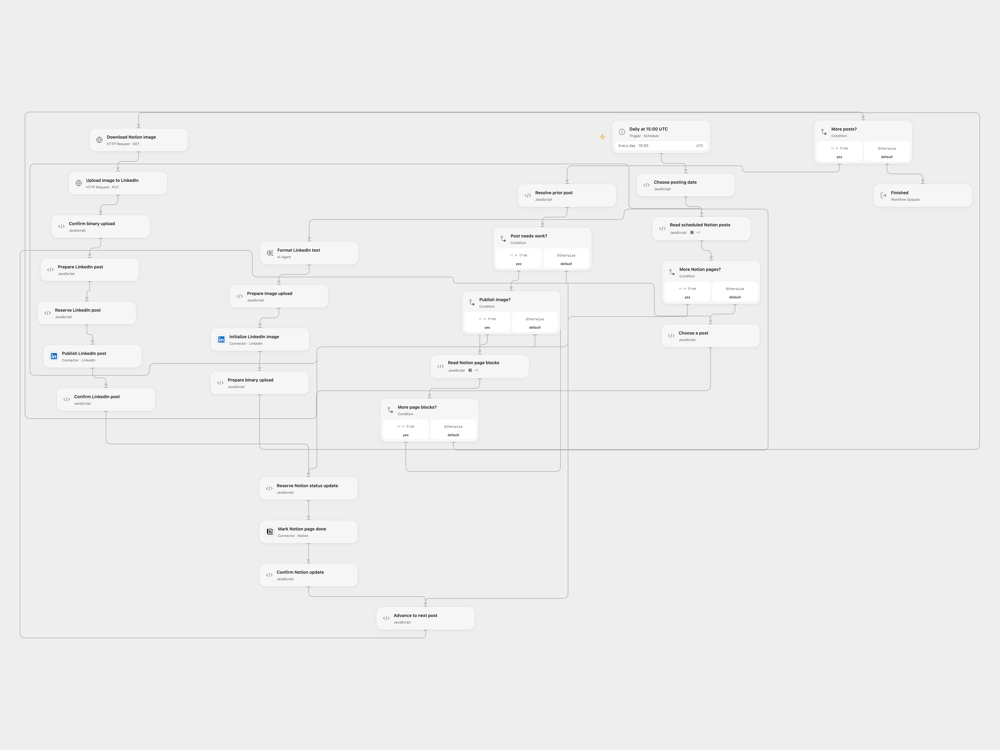

# Publish Notion Posts to LinkedIn

Format scheduled Notion posts, publish their images on LinkedIn and mark the matching page done.

<!-- template-actions:start -->
 
<!-- template-actions:end -->

<picture>
  <source media="(prefers-color-scheme: dark)" srcset="preview-dark.png">
  
</picture>

## Setup

Connect Notion, LinkedIn and a text model. Configure the Notion data source ID in **Read scheduled Notion posts**, its Date and Status properties, and your LinkedIn personal URN in **Prepare image upload**. Bind `LINKEDIN_ACCESS_TOKEN` as a secret variable, enable persistent State, and prevent overlapping runs.

## Behavior

Daily at 15:00 UTC, the workflow reads Notion pages scheduled for that date and not marked Done. For each page, it reads the direct text blocks and first image, formats the text, downloads the image as a Run Artifact, uploads it directly to LinkedIn's upload URL, publishes the image post and updates the same Notion page. Text is sent to the model; formatted text and images are sent to LinkedIn. The model can alter meaning; review source material and outputs.

If a publish or status update has an unknown result, inspect LinkedIn or Notion. Enter its pending key in **Resolve prior post**, set resolution to `confirmed` or `absent`, rerun, and clear the fields.

In n8n

Import the n8n workflow and configure the Notion database, LinkedIn OAuth credentials, and a Data Table with text columns `item_key` and `status`. Inspect the pending-post or pending-status Data Table row if a run stops mid-way; complete a missing status update manually and mark the row `done`, or delete a pending-post row only after confirming no post was created.

Inspiration &amp; credits

## Changes to the source

Process pages individually, replace the private assistant, download and upload post images via Run Artifacts, skip completed pages and checkpoint publication and status updates.

Adapted from [Automate LinkedIn Outreach with Notion and OpenAI](https://github.com/enescingoz/awesome-n8n-templates/blob/827110332c21cbe000ab13f6d292d5adb1f1f8db/Notion/Automate%20LinkedIn%20Outreach%20with%20Notion%20and%20OpenAI.json) in [enescingoz/awesome-n8n-templates](https://github.com/enescingoz/awesome-n8n-templates).

Source collection notice: © 2024–2026 Enes Cingoz, [CC BY 4.0](https://github.com/enescingoz/awesome-n8n-templates/blob/827110332c21cbe000ab13f6d292d5adb1f1f8db/LICENSE). The source export does not identify a separate template author or license. See [repository licensing](../../README.md#licensing) for the scope of OOMOL contributions and third-party material.

