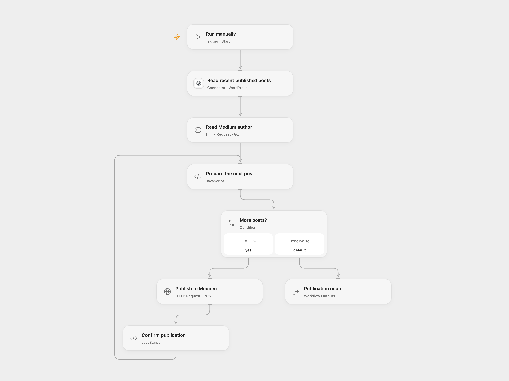

# Publish Recent WordPress Posts to Medium

Publish up to five recent WordPress posts to Medium.

<picture>
  <source media="(prefers-color-scheme: dark)" srcset="preview-dark.png">
  
</picture>

[Open Flow JSON](templates/publish-recent-wordpress-posts-to-medium.openflow.json) · [n8n JSON](templates/publish-recent-wordpress-posts-to-medium.n8n.json)

## Setup

Connect a WordPress site with REST API access to **Read recent published posts**. Create a secret Variable containing an existing Medium integration token and bind it to both **Read Medium author** and **Publish to Medium**. Medium no longer issues new API tokens, but says existing tokens continue to work. In n8n, connect WordPress and configure the same Header Auth credential on both Medium HTTP nodes with name `Authorization` and value `Bearer YOUR_MEDIUM_TOKEN`. Run one format manually.

## Behavior

The workflow reads up to five recently published posts, newest first, and publishes their rendered HTML to your Medium profile one at a time. Each post is public with the source's three email-marketing tags and follower notification disabled. Configure the tags in **Prepare the next post** in Open Flow or **Publish to Medium** in n8n for your content. Use only content you have permission to republish.

A failure stops the run; earlier posts remain published. No deduplication or automatic retry is configured. If a publish result is uncertain, check Medium before retrying; another run can publish duplicates. Open Flow HTTP requests have a 30-second limit and stop on redirects. Its combined five-post input must fit the execution size limit; unusual HTML entities in titles require review before publishing.

Inspiration &amp; credits

## Changes to the source

- Use the WordPress REST API for the latest five published posts instead of a particular site's HTML selectors. Configure your own WordPress and Medium accounts.
- Use authenticated HTTP in n8n so `notifyFollowers: false` is actually sent; the original Medium node omits false. Check the Medium response before processing the next post.

Adapted from [WordPress blog to Medium publishing](https://github.com/Zie619/n8n-workflows/blob/ae8cf6dc5b873cbb4f74587aa9180ed3a9f70682/workflows/Http/0390_HTTP_Manual_Automation_Webhook.json) in [Zie619/n8n-workflows](https://github.com/Zie619/n8n-workflows). The matching [n8n listing](https://n8n.io/workflows/2062-posting-from-wordpress-to-medium/) credits Zacharia Kimotho. The original template does not state a separate license.

The collection’s [MIT notice](https://github.com/Zie619/n8n-workflows/blob/94007c1445d9258a7da116646b79473e7c7c3282/LICENSE) is pinned at a later revision. This is the collection notice at that revision; it does not establish a separate original template author's license. Our changes are listed above; see [repository licensing](../../README.md#licensing).

> MIT License
>
> Copyright (c) 2025 Zie619
>
> Permission is hereby granted, free of charge, to any person obtaining a copy
> of this software and associated documentation files (the "Software"), to deal
> in the Software without restriction, including without limitation the rights
> to use, copy, modify, merge, publish, distribute, sublicense, and/or sell
> copies of the Software, and to permit persons to whom the Software is
> furnished to do so, subject to the following conditions:
>
> The above copyright notice and this permission notice shall be included in all
> copies or substantial portions of the Software.
>
> THE SOFTWARE IS PROVIDED "AS IS", WITHOUT WARRANTY OF ANY KIND, EXPRESS OR
> IMPLIED, INCLUDING BUT NOT LIMITED TO THE WARRANTIES OF MERCHANTABILITY,
> FITNESS FOR A PARTICULAR PURPOSE AND NONINFRINGEMENT. IN NO EVENT SHALL THE
> AUTHORS OR COPYRIGHT HOLDERS BE LIABLE FOR ANY CLAIM, DAMAGES OR OTHER
> LIABILITY, WHETHER IN AN ACTION OF CONTRACT, TORT OR OTHERWISE, ARISING FROM,
> OUT OF OR IN CONNECTION WITH THE SOFTWARE OR THE USE OR OTHER DEALINGS IN THE
> SOFTWARE.

