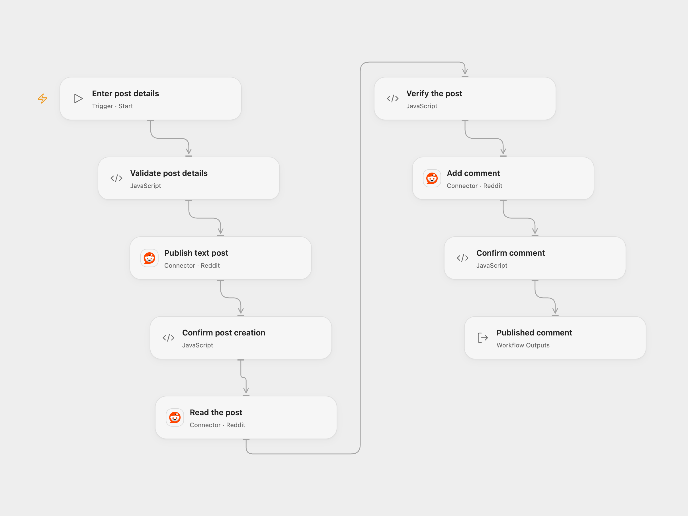

# Publish a Reddit Post and Comment

Publish a text post to a subreddit, verify it and add a comment to the same post.

<picture>
  <source media="(prefers-color-scheme: dark)" srcset="preview-dark.png">
  
</picture>

[Open Flow JSON](templates/publish-reddit-post-and-comment.openflow.json) · [n8n JSON](templates/publish-reddit-post-and-comment.n8n.json)

## Setup

Connect a Reddit account with permission to submit posts, read the chosen subreddit and comment. In Open Flow select the Reddit connection on **Publish text post**, **Read the post** and **Add comment**. Run with a subreddit name without `r/`, title, post text and comment. In n8n, edit **Set post details** and select Reddit credentials on the three Reddit nodes.

## Behavior

A manual run publishes one text post, reads that post back and adds one comment to it. Both the post and comment are public in accordance with the subreddit’s visibility and rules. Open Flow requests at most one comment while reading the post; the comment tree itself is not used. A missing or mismatched post stops before commenting. A failure or lost response can leave a post or comment on Reddit; inspect the subreddit before repeating an uncertain run. There is no automatic retry or rollback.

Inspiration &amp; credits

## Changes to the source

- Replace example content and subreddit with user input, and verify the post and comment IDs before reporting success.

Adapted from [Create, get and comment on a Reddit post](https://github.com/Zie619/n8n-workflows/blob/ae8cf6dc5b873cbb4f74587aa9180ed3a9f70682/workflows/Manual/1197_Manual_Reddit_Automate_Triggered.json) in [Zie619/n8n-workflows](https://github.com/Zie619/n8n-workflows). The matching [n8n community listing](https://n8n.io/workflows/928-create-a-post-with-comments-in-reddit-automatically/) credits Harshil Agrawal. The original template does not state a separate license.

The collection’s [MIT notice](https://github.com/Zie619/n8n-workflows/blob/94007c1445d9258a7da116646b79473e7c7c3282/LICENSE) is pinned at a later revision. This is the collection notice at that revision; it does not establish a separate original template author's license. Our changes are listed above; see [repository licensing](../../README.md#licensing).

> MIT License
>
> Copyright (c) 2025 Zie619
>
> Permission is hereby granted, free of charge, to any person obtaining a copy
> of this software and associated documentation files (the "Software"), to deal
> in the Software without restriction, including without limitation the rights
> to use, copy, modify, merge, publish, distribute, sublicense, and/or sell
> copies of the Software, and to permit persons to whom the Software is
> furnished to do so, subject to the following conditions:
>
> The above copyright notice and this permission notice shall be included in all
> copies or substantial portions of the Software.
>
> THE SOFTWARE IS PROVIDED "AS IS", WITHOUT WARRANTY OF ANY KIND, EXPRESS OR
> IMPLIED, INCLUDING BUT NOT LIMITED TO THE WARRANTIES OF MERCHANTABILITY,
> FITNESS FOR A PARTICULAR PURPOSE AND NONINFRINGEMENT. IN NO EVENT SHALL THE
> AUTHORS OR COPYRIGHT HOLDERS BE LIABLE FOR ANY CLAIM, DAMAGES OR OTHER
> LIABILITY, WHETHER IN AN ACTION OF CONTRACT, TORT OR OTHERWISE, ARISING FROM,
> OUT OF OR IN CONNECTION WITH THE SOFTWARE OR THE USE OR OTHER DEALINGS IN THE
> SOFTWARE.

