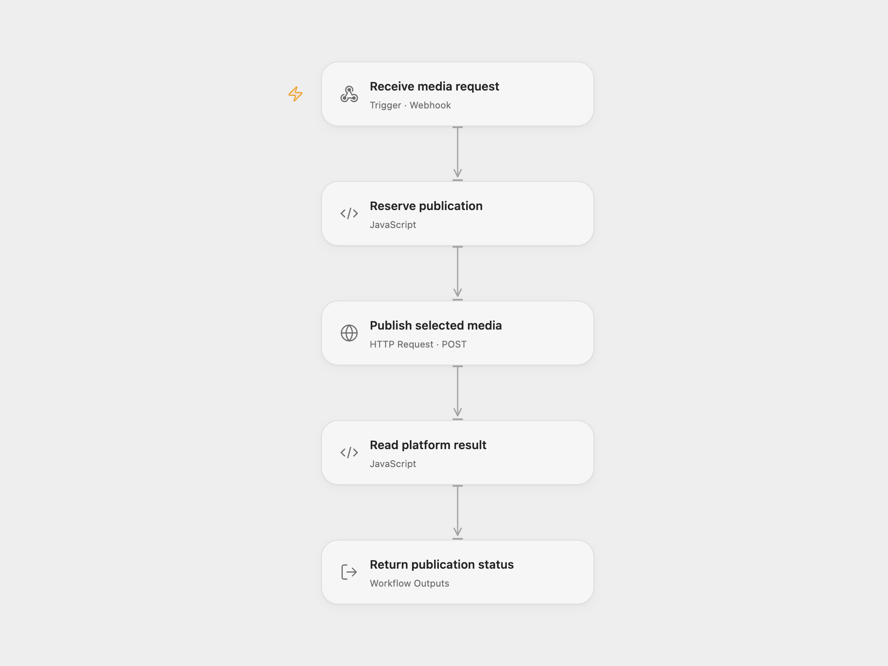

# Publish Selected Social Media Upload

Publish a photo or video to one selected social platform through Upload-Post.

<picture>
  <source media="(prefers-color-scheme: dark)" srcset="preview-dark.png">
  
</picture>

[Open Flow JSON](templates/publish-selected-social-media-upload.openflow.json) · [n8n JSON](templates/publish-selected-social-media-upload.n8n.json)

## Setup

Connect the intended social account to an Upload-Post profile and create an API key. In n8n configure Header Auth as Authorization: Apikey followed by the key. Select a Data Table with item_key and status text columns, and prevent overlapping runs. Direct mode accepts one JPG or MP4 file.

For Open Flow select relay mode in **Prepare upload**, provide a public HTTPS URL to the JPG or MP4 and its MIME type in the form, and configure the deployed webhook URL. Bind UPLOAD_POST_AUTHORIZATION as a secret containing Apikey followed by the key, enable persistent State, and restrict webhook access to trusted n8n. The URL must be reachable by Upload-Post and should not contain private content. Use one mode.

## Behavior

Select instagram, linkedin, facebook, x, tiktok or threads, enter the Upload-Post profile and caption, and supply the image or video. Facebook requires its Page ID. Direct n8n sends the original file bytes; Open Flow sends a public URL for Upload-Post to fetch. Only a selected platform's explicit success is reported as published. A background response includes a request ID; check Upload-Post status for its final platform result. Platform features and media limits vary.

A publication is reserved before the external request. If the result is unknown, failed or processing, inspect Upload-Post and the target platform before retrying. In Open Flow enter the pending key and confirmed or absent in **Reserve publication**, replay the same submission and clear the fields. In n8n inspect the pending Data Table row, mark done after confirmed publication, or delete only after confirming no publication occurred.

See [Upload-Post photo](https://docs.upload-post.com/api/upload-photo/) and [video](https://docs.upload-post.com/api/upload-video/) documentation.

Inspiration &amp; credits

Add URL-based Open Flow mode and checkpoints, use the documented Facebook Page field, and distinguish background processing from publication.

Adapted from [Social Media Publisher](https://github.com/Zie619/n8n-workflows/blob/ae8cf6dc5b873cbb4f74587aa9180ed3a9f70682/workflows/Form/1968_Form_Stickynote_Automation_Webhook.json) in [Zie619/n8n-workflows](https://github.com/Zie619/n8n-workflows). The source export does not identify a separate template author or license.

The collection’s [MIT notice](https://github.com/Zie619/n8n-workflows/blob/94007c1445d9258a7da116646b79473e7c7c3282/LICENSE) is pinned at a later revision. This is the collection notice at that revision; it does not establish a separate original template author's license. Our changes are listed above; see [repository licensing](../../README.md#licensing).

> MIT License
>
> Copyright (c) 2025 Zie619
>
> Permission is hereby granted, free of charge, to any person obtaining a copy
> of this software and associated documentation files (the "Software"), to deal
> in the Software without restriction, including without limitation the rights
> to use, copy, modify, merge, publish, distribute, sublicense, and/or sell
> copies of the Software, and to permit persons to whom the Software is
> furnished to do so, subject to the following conditions:
>
> The above copyright notice and this permission notice shall be included in all
> copies or substantial portions of the Software.
>
> THE SOFTWARE IS PROVIDED "AS IS", WITHOUT WARRANTY OF ANY KIND, EXPRESS OR
> IMPLIED, INCLUDING BUT NOT LIMITED TO THE WARRANTIES OF MERCHANTABILITY,
> FITNESS FOR A PARTICULAR PURPOSE AND NONINFRINGEMENT. IN NO EVENT SHALL THE
> AUTHORS OR COPYRIGHT HOLDERS BE LIABLE FOR ANY CLAIM, DAMAGES OR OTHER
> LIABILITY, WHETHER IN AN ACTION OF CONTRACT, TORT OR OTHERWISE, ARISING FROM,
> OUT OF OR IN CONNECTION WITH THE SOFTWARE OR THE USE OR OTHER DEALINGS IN THE
> SOFTWARE.

