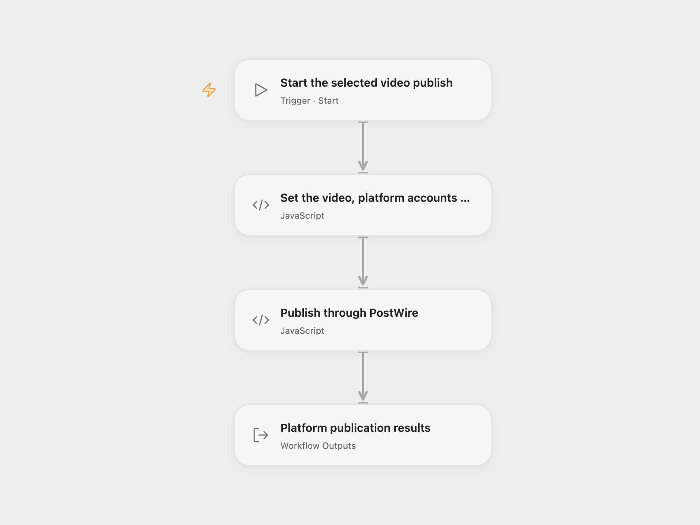

# Publish One Video with Native Social Captions

Use PostWire to write a distinct caption for each selected network and publish the same video to its approved accounts.

<!-- template-actions:start -->
 
<!-- template-actions:end -->

<picture>
  <source media="(prefers-color-scheme: dark)" srcset="preview-dark.png">
  
</picture>

## Setup

1. In PostWire, connect the intended TikTok, Instagram or YouTube accounts to one Brand with OAuth. Get the Brand ID and the exact handle reported for each account you plan to use. Create a PostWire API key that can publish for that Brand. [PostWire brands](https://postwire.io/docs/brands/)
2. In **Set the video, platform accounts and publication key**, replace the example with your idea, approved direct HTTPS MP4 URL, Brand ID, selected platforms and their expected handles. Set a unique `publication_key` for this intended publish. TikTok defaults to `SELF_ONLY`. You can select another privacy level your creator account allows. Instagram and YouTube use the connected accounts’ publishing settings.
3. In **Publish through PostWire**, bind **Token** to the `POSTWIRE_API_KEY` secret variable. Review the settings, set `confirm` to `true` and run manually. Open **Platform publication results**.

## Behavior

The workflow confirms the selected Brand accounts and checks TikTok’s allowed privacy levels when TikTok is selected. PostWire drafts an individual caption for each selected platform. The publish request keeps the original video URL and includes any YouTube title and tags returned by PostWire.

The workflow submits one publish request. Results distinguish a confirmed post, an accepted post that is still processing, an approval hold, a plan limit, a failure and an unconfirmed outcome. Follow the returned status link with your PostWire API credentials or check the dashboard. A pending approval requires a person to approve it in PostWire. [PostWire publishes and status](https://postwire.io/docs/publishing/)

If an outcome is partial or unconfirmed, check each selected account in PostWire before resubmitting anything. A publish request that exceeds 30 seconds can return an unconfirmed result. Keep the same publication key for the same attempt. PostWire uses that key to prevent duplicate publication for 24 hours when publishing has started. The workflow makes no automatic retries. A plan may hold some networks in a batch. [PostWire errors and idempotency](https://postwire.io/docs/errors/)

In n8n

Set the same fields in **Set the video, platform accounts and publication key**. Select the same PostWire Bearer Auth credential for **Read the configured brand accounts**, **Read the TikTok creator permissions**, **Draft native captions in PostWire**, and **Submit one PostWire publish request**. Run manually and open **Platform publication results**.

Inspiration &amp; credits

Adapted from [Publish one video natively to TikTok Instagram and YouTube with PostWire](https://github.com/enescingoz/awesome-n8n-templates/blob/827110332c21cbe000ab13f6d292d5adb1f1f8db/Instagram_Twitter_Social_Media/Publish%20one%20video%20natively%20to%20TikTok%20Instagram%20and%20YouTube%20with%20PostWire.json) in [enescingoz/awesome-n8n-templates](https://github.com/enescingoz/awesome-n8n-templates).

Source collection notice: © 2024–2026 Enes Cingoz, [CC BY 4.0](https://github.com/enescingoz/awesome-n8n-templates/blob/827110332c21cbe000ab13f6d292d5adb1f1f8db/LICENSE). The [source contribution](https://github.com/enescingoz/awesome-n8n-templates/commit/caeb155f2827b72a6aa94ce0510f82664d098c7e) credits Renzo Madueno. See [repository licensing](../../README.md#licensing) for the scope of OOMOL contributions and third-party material.

This version confirms the intended Brand and accounts, verifies the native caption mapping, and distinguishes platform receipts without replaying a partial batch.

