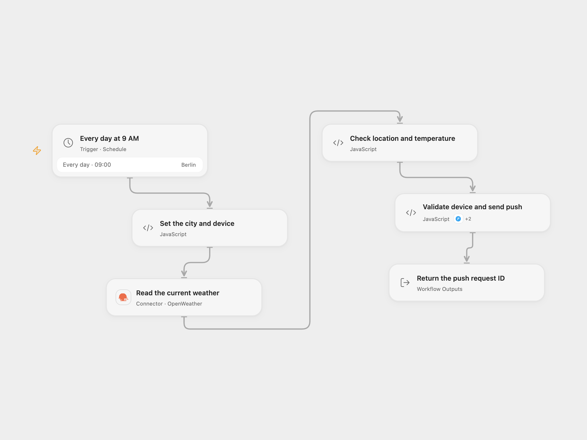

# Push a Daily Local Temperature

Read the current temperature in Celsius at 9:00 a.m. and send it to one named Pushover device.

<!-- template-actions:start -->
[](https://openflow.run/templates/push-daily-local-temperature/) [](templates/push-daily-local-temperature.n8n.json)
<!-- template-actions:end -->

<picture>
  <source media="(prefers-color-scheme: dark)" srcset="preview-dark.png">
  
</picture>

## Setup

1. Set the city name, two-letter country code, and coordinates in **Set the city and device**. The defaults are Berlin, Germany. Use the city name OpenWeather returns for your coordinates.
2. Connect OpenWeather in **Read the current weather**. Create a Pushover application and use its API token to connect both actions in **Validate device and send push**. Bind your personal User Key to that node using the secret variable `PUSHOVER_USER_KEY`. Enter one active Pushover device name in **Set the city and device**.
3. Review the time and time zone in **Every day at 9 AM**, then publish. The default is 9:00 a.m. in Europe/Berlin. Adjust the schedule if you want notifications in another time zone.

## Behavior

The workflow checks the returned city, country and coordinates before using OpenWeather’s current `main.temp` in degrees Celsius. It validates your named Pushover device before sending **Today's Weather Update**. The output contains Pushover’s queued-request ID. If Pushover cannot confirm the send, the workflow stops without retrying.

Pushover can deliver to all active devices if the selected device becomes inactive between validation and sending. Use a personal User Key and keep the selected device active. [Pushover API](https://pushover.net/api)

<details>
<summary>In n8n</summary>

Connect an OpenWeatherMap credential in **Read the current weather**. Create a **Custom Auth** credential with the following structure, replacing both values in the credential editor. Assign the same credential to **Verify the Pushover device** and **Send the weather notification**.

```json
{"body":{"token":"YOUR_APPLICATION_TOKEN","user":"YOUR_PERSONAL_USER_KEY"}}
```

Set the city and device in **Set the city and device**. Change the time in **Every day at 9 AM** and the time zone in workflow settings, then activate. The final node returns the queued-request ID.

</details>

<details>
<summary>Inspiration &amp; credits</summary>

Adapted from [Send a daily weather notification](https://github.com/Zie619/n8n-workflows/blob/ae8cf6dc5b873cbb4f74587aa9180ed3a9f70682/workflows/Openweathermap/0161_Openweathermap_Spontit_Update_Scheduled.json) in [Zie619/n8n-workflows](https://github.com/Zie619/n8n-workflows). Attribution: Zie619 / n8n-workflows.

The collection’s [MIT notice](https://github.com/Zie619/n8n-workflows/blob/94007c1445d9258a7da116646b79473e7c7c3282/LICENSE) is pinned at a later revision. This is the collection notice at that revision; it does not establish a separate original template author's license. Our changes are listed above; see [repository licensing](../../README.md#licensing).

> MIT License
>
> Copyright (c) 2025 Zie619
>
> Permission is hereby granted, free of charge, to any person obtaining a copy
> of this software and associated documentation files (the "Software"), to deal
> in the Software without restriction, including without limitation the rights
> to use, copy, modify, merge, publish, distribute, sublicense, and/or sell
> copies of the Software, and to permit persons to whom the Software is
> furnished to do so, subject to the following conditions:
>
> The above copyright notice and this permission notice shall be included in all
> copies or substantial portions of the Software.
>
> THE SOFTWARE IS PROVIDED "AS IS", WITHOUT WARRANTY OF ANY KIND, EXPRESS OR
> IMPLIED, INCLUDING BUT NOT LIMITED TO THE WARRANTIES OF MERCHANTABILITY,
> FITNESS FOR A PARTICULAR PURPOSE AND NONINFRINGEMENT. IN NO EVENT SHALL THE
> AUTHORS OR COPYRIGHT HOLDERS BE LIABLE FOR ANY CLAIM, DAMAGES OR OTHER
> LIABILITY, WHETHER IN AN ACTION OF CONTRACT, TORT OR OTHERWISE, ARISING FROM,
> OUT OF OR IN CONNECTION WITH THE SOFTWARE OR THE USE OR OTHER DEALINGS IN THE
> SOFTWARE.

## Changes to the source

Pushover replaces Spontit after the original API could not be reached over HTTPS. The workflow keeps the original 9:00 a.m. hour and Celsius message. The original export did not specify a time zone. Coordinates distinguish cities that share a name. [OpenWeather current weather](https://openweathermap.org/api/current)

</details>
