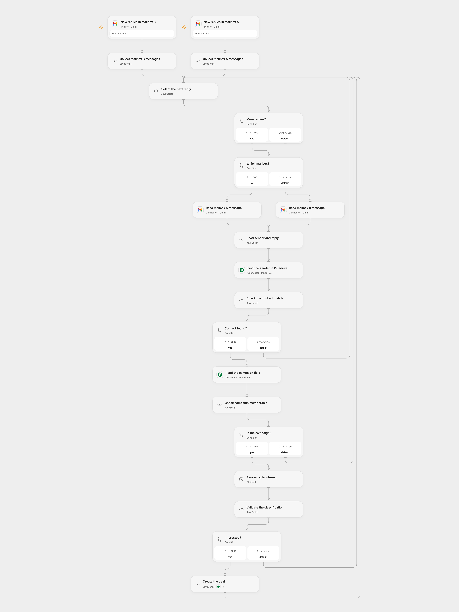

# Qualify Campaign Replies in Pipedrive

Classify campaign email replies and create a Pipedrive deal for interested contacts.

<picture>
  <source media="(prefers-color-scheme: dark)" srcset="preview-dark.png">
  
</picture>

[Open Flow JSON](templates/qualify-campaign-replies-in-pipedrive.openflow.json) · [n8n JSON](templates/qualify-campaign-replies-in-pipedrive.n8n.json)

## Setup

Connect each Gmail trigger and its matching **Read mailbox** node to the same mailbox, and connect Pipedrive. On **Read the campaign field**, set the Pipedrive custom field key; set the same key and its option ID for `True` in **Check campaign membership**. Bind the Pipedrive connection to the single Action in **Create the deal**. Configure an AI model and use a campaign field named `in_campaign` with a `True` option in n8n. Connect both Gmail accounts, Pipedrive and OpenAI in n8n. Activate one format.

## Behavior

Each minute, new emails in the two mailboxes are matched by sender email to the first exact Pipedrive person. Only people whose campaign field equals the configured option are classified for interest in a meeting or call. An interested reply creates a deal linked to that person. Unmatched, out-of-campaign or uninterested replies create no deal. Email content is sent to the configured AI model; review its decisions.

The workflows do not deduplicate deals. An uncertain creation may have succeeded; inspect Pipedrive before retrying. Existing deals and repeated replies can create duplicates. Multiple people sharing an address can cause the first match to be used.

Inspiration &amp; credits

## Changes to the source

- Exclude drafts, search the sender's email exactly and link the new deal to the matched person. Configure the campaign field and replace the source model with a selectable model.

Adapted from [Qualify replies from Pipedrive persons with AI](https://github.com/enescingoz/awesome-n8n-templates/blob/827110332c21cbe000ab13f6d292d5adb1f1f8db/Other_Integrations_and_Use_Cases/Qualify%20replies%20from%20Pipedrive%20persons%20with%20AI.json) in [enescingoz/awesome-n8n-templates](https://github.com/enescingoz/awesome-n8n-templates).

Source collection notice: © 2024–2026 Enes Cingoz, [CC BY 4.0](https://github.com/enescingoz/awesome-n8n-templates/blob/827110332c21cbe000ab13f6d292d5adb1f1f8db/LICENSE). The source export does not identify a separate template author or license. See [repository licensing](../../README.md#licensing) for the scope of OOMOL contributions and third-party material.

