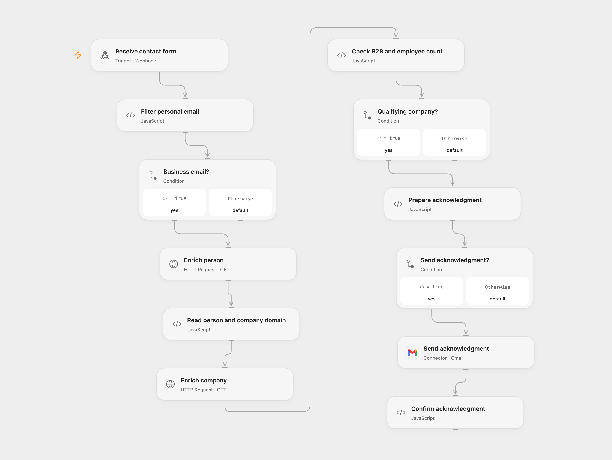

# Qualify Contact Form Leads with Clearbit

Enrich business contacts and email those at B2B companies with at least 500 employees.

<!-- template-actions:start -->
 
<!-- template-actions:end -->

<picture>
  <source media="(prefers-color-scheme: dark)" srcset="preview-dark.png">
  
</picture>

## Setup

Use an existing Clearbit account with Person and Company API access. Bind `CLEARBIT_API_KEY` as a secret variable, connect Gmail, set your signature in **Prepare acknowledgment**, and enable persistent State. Publish the workflow and open the hosted Webhook form URL (or POST JSON `{"role": "Product", "email": "alex@company.com"}`).

## Behavior

The hosted form asks for role and business email. The source's literal personal-email substring exclusions run first. Clearbit finds the person by email and the company by employment domain. Only companies tagged B2B with more than 499 employees receive the personalized acknowledgment. The role is collected but not used in qualification. Missing enrichment stops processing; it is not treated as a match. Contact details are sent to Clearbit and may be retained in execution history.

If email delivery is uncertain, inspect Gmail before retrying. Replay the same submission with the pending key in **Prepare acknowledgment** and resolution `confirmed` if sent or `absent` if not, then clear both fields.

In n8n

Import the n8n workflow, connect Clearbit and Gmail, and set your signature in **Send Email**. Select one Data Table with `item_key` and `status` text columns in all checkpoint nodes; prevent overlapping executions. If email delivery is uncertain, inspect the pending Data Table row and sent mail, mark it `done` if sent, or delete it only if no email was sent.

Inspiration &amp; credits

Added hosted form intake and delivery checkpoints; retained the source filter and qualification rules.

Adapted from [Contact form lead qualification](https://github.com/Zie619/n8n-workflows/blob/ae8cf6dc5b873cbb4f74587aa9180ed3a9f70682/workflows/Filter/0411_Filter_Form_Send_Triggered.json) in [Zie619/n8n-workflows](https://github.com/Zie619/n8n-workflows). The source export does not identify a separate template author or license.

The collection’s [MIT notice](https://github.com/Zie619/n8n-workflows/blob/94007c1445d9258a7da116646b79473e7c7c3282/LICENSE) is pinned at a later revision. This is the collection notice at that revision; it does not establish a separate original template author's license. Our changes are listed above; see [repository licensing](../../README.md#licensing).

> MIT License
>
> Copyright (c) 2025 Zie619
>
> Permission is hereby granted, free of charge, to any person obtaining a copy
> of this software and associated documentation files (the "Software"), to deal
> in the Software without restriction, including without limitation the rights
> to use, copy, modify, merge, publish, distribute, sublicense, and/or sell
> copies of the Software, and to permit persons to whom the Software is
> furnished to do so, subject to the following conditions:
>
> The above copyright notice and this permission notice shall be included in all
> copies or substantial portions of the Software.
>
> THE SOFTWARE IS PROVIDED "AS IS", WITHOUT WARRANTY OF ANY KIND, EXPRESS OR
> IMPLIED, INCLUDING BUT NOT LIMITED TO THE WARRANTIES OF MERCHANTABILITY,
> FITNESS FOR A PARTICULAR PURPOSE AND NONINFRINGEMENT. IN NO EVENT SHALL THE
> AUTHORS OR COPYRIGHT HOLDERS BE LIABLE FOR ANY CLAIM, DAMAGES OR OTHER
> LIABILITY, WHETHER IN AN ACTION OF CONTRACT, TORT OR OTHERWISE, ARISING FROM,
> OUT OF OR IN CONNECTION WITH THE SOFTWARE OR THE USE OR OTHER DEALINGS IN THE
> SOFTWARE.

