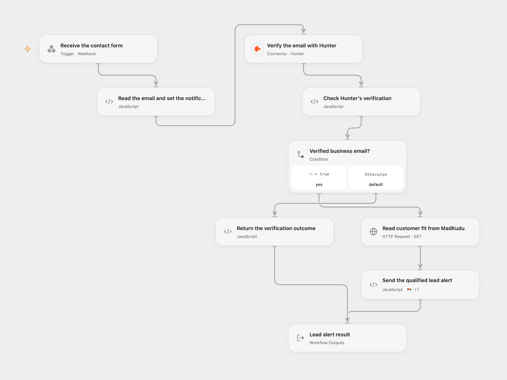

# Qualify Contact Form Leads with Hunter and MadKudu

Verify a business email, check its MadKudu customer fit, and alert an internal recipient in Gmail when the score clears your threshold.

<!-- template-actions:start -->
 
<!-- template-actions:end -->

<picture>
  <source media="(prefers-color-scheme: dark)" srcset="preview-dark.png">
  
</picture>

## Setup

1. In **Read the email and set the notification recipient**, set `notificationEmail` to one internal address approved to receive lead details. Connect Hunter with Email Verifier credits in **Verify the email with Hunter** and Gmail in **Send the qualified lead alert**. [Hunter Email Verifier API](https://hunter.io/api-documentation/v2#email-verifier)
2. Bind the secret variable `MADKUDU_LEGACY_API_KEY` to **Authentication Username** in **Read customer fit from MadKudu**. Use the Legacy Scoring API key for your MadKudu customer fit model. The workflow already supplies the empty Basic Auth password. [MadKudu Person API](https://developers.madkudu.com/legacy-api/demographics-person-api) · [Legacy authentication](https://developers.madkudu.com/legacy-api/authentication)
3. Publish the workflow and share the URL from **Receive the contact form**. Share it where you are authorized to send applicants’ business addresses to Hunter and MadKudu.

## Behavior

The form asks for one business email and acknowledges receipt. Hunter must return exactly `valid` for that address before the workflow queries MadKudu. Pending and other verification statuses stop the submission’s qualification. MadKudu must return the same person and a numeric customer fit score strictly greater than 60. A score of 60 sends no alert. Change `threshold` in **Read the email and set the notification recipient** to use another cutoff.

Gmail sends one plain-text alert to the configured internal address. It includes the lead’s name and available company, domain, location and MadKudu signals. If the person has no name, the alert uses the verified address. The contact receives no automatic reply. Browser acknowledgments contain no qualification or provider details.

The execution output includes the Gmail ID when the send is confirmed. If Gmail’s result is uncertain, check Sent before trying again. The workflow does not retry the send automatically. Submitting the form again can produce another alert.

In n8n

Set the notification address and cutoff in **Read the email and set the notification recipient**. Attach an HTTP Header Auth credential named `X-API-Key` to **Verify the email with Hunter** for Hunter. In **Read customer fit from MadKudu**, use HTTP Header Auth named `Authorization` with the value `Basic <base64(legacy-api-key:)>`. Include the trailing colon inside the Base64 input. Connect Gmail OAuth2 in **Send the qualified lead alert**. Activate the workflow and share the production URL from **Receive the contact form**. An unconfirmed Gmail send appears as a failed execution so you can check Sent.

Inspiration &amp; credits

Adapted from [Alert via Gmail when a great lead submits a form with MadKudu and Hunter](https://github.com/Zie619/n8n-workflows/blob/ae8cf6dc5b873cbb4f74587aa9180ed3a9f70682/workflows/Hunter/0424_Hunter_Form_Send_Webhook.json) in [Zie619/n8n-workflows](https://github.com/Zie619/n8n-workflows). Attribution: Mutasem (original workflow), Zie619 (collection). See the [original n8n template](https://n8n.io/workflows/2120-alert-via-gmail-when-a-great-lead-submits-form-with-madkudu-and-hunter/).

The collection’s [MIT notice](https://github.com/Zie619/n8n-workflows/blob/94007c1445d9258a7da116646b79473e7c7c3282/LICENSE) is pinned at a later revision. This is the collection notice at that revision; it does not establish a separate original template author's license. Our changes are listed above; see [repository licensing](../../README.md#licensing).

> MIT License
>
> Copyright (c) 2025 Zie619
>
> Permission is hereby granted, free of charge, to any person obtaining a copy
> of this software and associated documentation files (the "Software"), to deal
> in the Software without restriction, including without limitation the rights
> to use, copy, modify, merge, publish, distribute, sublicense, and/or sell
> copies of the Software, and to permit persons to whom the Software is
> furnished to do so, subject to the following conditions:
>
> The above copyright notice and this permission notice shall be included in all
> copies or substantial portions of the Software.
>
> THE SOFTWARE IS PROVIDED "AS IS", WITHOUT WARRANTY OF ANY KIND, EXPRESS OR
> IMPLIED, INCLUDING BUT NOT LIMITED TO THE WARRANTIES OF MERCHANTABILITY,
> FITNESS FOR A PARTICULAR PURPOSE AND NONINFRINGEMENT. IN NO EVENT SHALL THE
> AUTHORS OR COPYRIGHT HOLDERS BE LIABLE FOR ANY CLAIM, DAMAGES OR OTHER
> LIABILITY, WHETHER IN AN ACTION OF CONTRACT, TORT OR OTHERWISE, ARISING FROM,
> OUT OF OR IN CONNECTION WITH THE SOFTWARE OR THE USE OR OTHER DEALINGS IN THE
> SOFTWARE.

This adaptation makes the address required, verifies both provider responses against it, and makes the internal recipient and cutoff configurable. The default score rule and alert contents follow the original.

