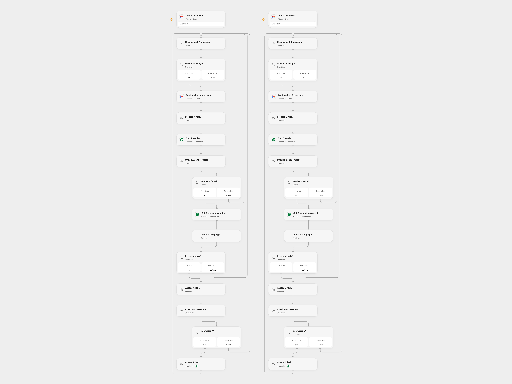

# Qualify Sales Replies and Create Pipedrive Deals

Identify campaign contacts interested in a meeting and create a Pipedrive deal from their Gmail reply.

<picture>
  <source media="(prefers-color-scheme: dark)" srcset="preview-dark.png">
  
</picture>

[Open Flow JSON](templates/qualify-sales-replies-and-create-pipedrive-deals.openflow.json) · [n8n JSON](templates/qualify-sales-replies-and-create-pipedrive-deals.n8n.json)

## Setup

Connect two Gmail inboxes, Pipedrive and an AI model. For each mailbox configure matching Gmail connections on **Check mailbox** and **Read mailbox**, the same Pipedrive account on its search, person and deal nodes, and a model on its assessment node. For one inbox, remove the unused mailbox branch. Set the Pipedrive person single-option campaign field's 40-character key and the numeric option ID representing True in **Prepare reply** for each mailbox. Grant access to the people and deals. In n8n connect both Gmail triggers, the Pipedrive nodes and OpenAI; create the person single-option field named **in_campaign** with an option labeled **True**. Activate one format.

## Behavior

Each inbox is checked every minute. For each message, the workflow searches for its sender by exact email, checks the matching person's campaign field and asks the model whether the reply expresses interest in a meeting or call. A positive classification creates a deal linked to that person. No match or a non-campaign contact is skipped. Ambiguous matches stop. The email text is sent to the configured AI model. AI can misclassify replies, so review the resulting deals.

The workflow does not deduplicate deals across runs or inboxes. An uncertain create may already have succeeded; inspect Pipedrive before retrying. Earlier deals remain if a later message fails. Emails and model outputs can contain personal data, so restrict execution history.

Inspiration &amp; credits

## Changes to the source

- Use exact email matching, stop on ambiguous matches, and link the created deal to the matched person. Configure the campaign option by its field key and ID.
- Process each mailbox's messages in order, retaining the association between email and CRM person. The AI is asked for a structured yes/no result.

Adapted from [Qualify replies from Pipedrive persons with AI](https://github.com/Zie619/n8n-workflows/blob/ae8cf6dc5b873cbb4f74587aa9180ed3a9f70682/workflows/Code/0379_Code_Pipedrive_Create_Triggered.json) in [Zie619/n8n-workflows](https://github.com/Zie619/n8n-workflows). The matching [n8n listing](https://n8n.io/workflows/2039-qualify-replies-from-pipedrive-persons-with-ai/) credits Mark de Jonge. The original template does not state a separate license.

The collection’s [MIT notice](https://github.com/Zie619/n8n-workflows/blob/94007c1445d9258a7da116646b79473e7c7c3282/LICENSE) is pinned at a later revision. This is the collection notice at that revision; it does not establish a separate original template author's license. Our changes are listed above; see [repository licensing](../../README.md#licensing).

> MIT License
>
> Copyright (c) 2025 Zie619
>
> Permission is hereby granted, free of charge, to any person obtaining a copy
> of this software and associated documentation files (the "Software"), to deal
> in the Software without restriction, including without limitation the rights
> to use, copy, modify, merge, publish, distribute, sublicense, and/or sell
> copies of the Software, and to permit persons to whom the Software is
> furnished to do so, subject to the following conditions:
>
> The above copyright notice and this permission notice shall be included in all
> copies or substantial portions of the Software.
>
> THE SOFTWARE IS PROVIDED "AS IS", WITHOUT WARRANTY OF ANY KIND, EXPRESS OR
> IMPLIED, INCLUDING BUT NOT LIMITED TO THE WARRANTIES OF MERCHANTABILITY,
> FITNESS FOR A PARTICULAR PURPOSE AND NONINFRINGEMENT. IN NO EVENT SHALL THE
> AUTHORS OR COPYRIGHT HOLDERS BE LIABLE FOR ANY CLAIM, DAMAGES OR OTHER
> LIABILITY, WHETHER IN AN ACTION OF CONTRACT, TORT OR OTHERWISE, ARISING FROM,
> OUT OF OR IN CONNECTION WITH THE SOFTWARE OR THE USE OR OTHER DEALINGS IN THE
> SOFTWARE.

