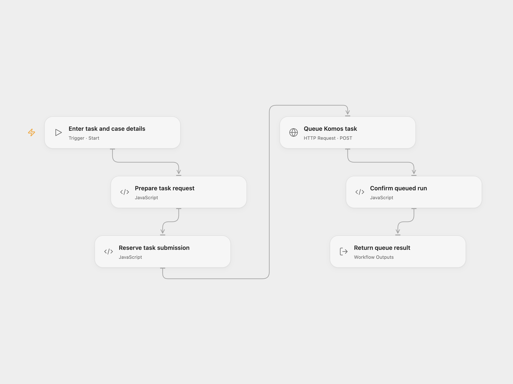

# Queue Regulated Browser Operations

Queue a saved Komos browser operations task and review its run.

<picture>
  <source media="(prefers-color-scheme: dark)" srcset="preview-dark.png">
  
</picture>

[Open Flow JSON](templates/queue-regulated-browser-operations.openflow.json) · [n8n JSON](templates/queue-regulated-browser-operations.n8n.json)

## Setup and use

Configure a saved Komos task and API key. In Open Flow bind KOMOS_API_KEY as a secret and enable persistent State. In n8n configure a Bearer Auth credential and a Data Table with item_key and status text columns. Use one mode.

Enter the task ID, case details, applicant name, portal URL, workflow type, industry and a unique request ID. The workflow queues one asynchronous run with review_required set to true and returns the provider response. Review the run history, browser actions and approval checkpoints in Komos; this workflow does not make an employment decision. The saved task controls the actual browser behavior.

Keep the same request ID when investigating an uncertain submission. Komos documents idempotency for clientRequestId. Check the provider run history and pending State or Data Table row before resolving a submission; use a new ID for a new intended run. Avoid overlapping submissions.

Inspiration &amp; credits

Adapted from [Komos Regulated Browser Ops Task Queue](https://github.com/enescingoz/awesome-n8n-templates/blob/827110332c21cbe000ab13f6d292d5adb1f1f8db/Other_Integrations_and_Use_Cases/Komos%20Regulated%20Browser%20Ops%20Task%20Queue.json) in [enescingoz/awesome-n8n-templates](https://github.com/enescingoz/awesome-n8n-templates).

Source collection notice: © 2024–2026 Enes Cingoz, [CC BY 4.0](https://github.com/enescingoz/awesome-n8n-templates/blob/827110332c21cbe000ab13f6d292d5adb1f1f8db/LICENSE). The source export does not identify a separate template author or license. See [repository licensing](../../README.md#licensing) for the scope of OOMOL contributions and third-party material.

