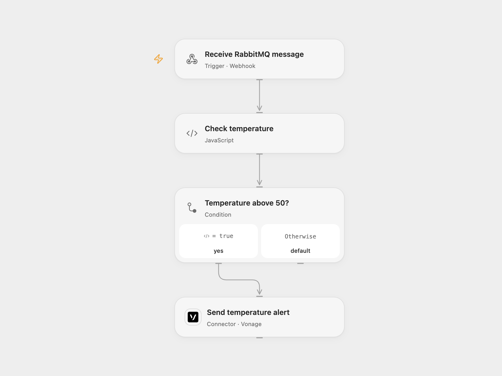

# RabbitMQ Temperature Alert by Vonage SMS

Send a Vonage SMS when a RabbitMQ JSON message reports a temperature above 50.

<picture>
  <source media="(prefers-color-scheme: dark)" srcset="preview-dark.png">
  
</picture>

[Open Flow JSON](templates/rabbitmq-temperature-alert-vonage-sms.openflow.json) · [n8n JSON](templates/rabbitmq-temperature-alert-vonage-sms.n8n.json)

## Setup

Import the bundled n8n workflow and connect the RabbitMQ credential. Set the queue in **RabbitMQ** and send JSON messages with a numeric `temp` field. For Open Flow, connect Vonage, set the sender and destination in **Send temperature alert**, set **Choose delivery mode** to `relay` and configure the Open Flow URL in **Forward RabbitMQ message**. The sender must be permitted for the destination.

For n8n-only operation leave the mode as `direct`, connect Vonage and set its sender and destination. Activate one mode. The Open Flow webhook is unauthenticated and may send SMS messages to the configured recipient; restrict access to trusted callers.

## Behavior

A temperature strictly above 50 sends one SMS with the value; 50 and below send nothing. The source trigger acknowledges messages immediately, before downstream processing. The Open Flow webhook acknowledges before processing, so a later relay or SMS failure is visible in the respective execution. An uncertain SMS may have been sent; inspect Vonage before replaying.

Inspiration &amp; credits

## Changes to the source

- Replace the missing SMS sender and recipient with configuration and add an optional RabbitMQ trigger relay.

Adapted from [Receive messages from a queue via RabbitMQ and send an SMS](https://github.com/Zie619/n8n-workflows/blob/ae8cf6dc5b873cbb4f74587aa9180ed3a9f70682/workflows/Noop/0291_Noop_Rabbitmq_Send_Triggered.json) in [Zie619/n8n-workflows](https://github.com/Zie619/n8n-workflows). The source export does not identify a separate template author or license.

The collection’s [MIT notice](https://github.com/Zie619/n8n-workflows/blob/94007c1445d9258a7da116646b79473e7c7c3282/LICENSE) is pinned at a later revision. This is the collection notice at that revision; it does not establish a separate original template author's license. Our changes are listed above; see [repository licensing](../../README.md#licensing).

> MIT License
>
> Copyright (c) 2025 Zie619
>
> Permission is hereby granted, free of charge, to any person obtaining a copy
> of this software and associated documentation files (the "Software"), to deal
> in the Software without restriction, including without limitation the rights
> to use, copy, modify, merge, publish, distribute, sublicense, and/or sell
> copies of the Software, and to permit persons to whom the Software is
> furnished to do so, subject to the following conditions:
>
> The above copyright notice and this permission notice shall be included in all
> copies or substantial portions of the Software.
>
> THE SOFTWARE IS PROVIDED "AS IS", WITHOUT WARRANTY OF ANY KIND, EXPRESS OR
> IMPLIED, INCLUDING BUT NOT LIMITED TO THE WARRANTIES OF MERCHANTABILITY,
> FITNESS FOR A PARTICULAR PURPOSE AND NONINFRINGEMENT. IN NO EVENT SHALL THE
> AUTHORS OR COPYRIGHT HOLDERS BE LIABLE FOR ANY CLAIM, DAMAGES OR OTHER
> LIABILITY, WHETHER IN AN ACTION OF CONTRACT, TORT OR OTHERWISE, ARISING FROM,
> OUT OF OR IN CONNECTION WITH THE SOFTWARE OR THE USE OR OTHER DEALINGS IN THE
> SOFTWARE.

