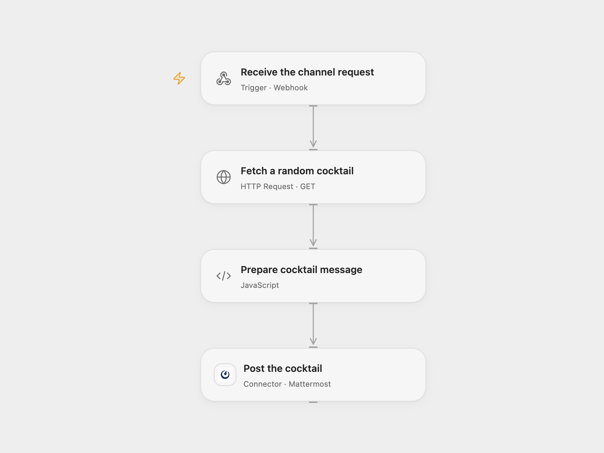

# Random Cocktail to Mattermost

Fetch a random cocktail and post its instructions, glass and image to a Mattermost channel.

<picture>
  <source media="(prefers-color-scheme: dark)" srcset="preview-dark.png">
  
</picture>

[Open Flow JSON](templates/random-cocktail-to-mattermost.openflow.json) · [n8n JSON](templates/random-cocktail-to-mattermost.n8n.json)

## Setup

Connect Mattermost with permission to post in the intended channel. Deploy the webhook, then POST JSON with the target channel ID, for example `{"channel_id":"YOUR_MATTERMOST_CHANNEL_ID"}`. In n8n, select Mattermost credentials and activate the workflow.

The webhook is unauthenticated, as in the source. Anyone who knows its URL can select a channel accessible to the connected account; protect the URL and limit the account’s permissions.

## Behavior

Each accepted request fetches one random drink from TheCocktailDB and sends its name, instructions and glass in a Mattermost message, with the drink image as an attachment. A failed lookup or post stops the run; an uncertain post may already have arrived. Repeating a request may choose another drink and create another message. Open Flow checks the required response fields before posting; n8n uses the returned fields directly.

## Changes to the source

- Replace the original webhook path and credential with setup.
- Preserve the dynamic channel, random lookup, message and image. Open Flow validates the required fields.

Source and license

Adapted from [Mattermost Webhook](https://github.com/Zie619/n8n-workflows/blob/ae8cf6dc5b873cbb4f74587aa9180ed3a9f70682/workflows/Http/0154_HTTP_Mattermost_Automation_Webhook.json) in [Zie619/n8n-workflows](https://github.com/Zie619/n8n-workflows). The source export does not identify a separate template author or license.

The collection’s [MIT notice](https://github.com/Zie619/n8n-workflows/blob/94007c1445d9258a7da116646b79473e7c7c3282/LICENSE) is pinned at a later revision. This is the collection notice at that revision; it does not establish a separate original template author's license. Our changes are listed above; see [repository licensing](../../README.md#licensing).

> MIT License
>
> Copyright (c) 2025 Zie619
>
> Permission is hereby granted, free of charge, to any person obtaining a copy
> of this software and associated documentation files (the "Software"), to deal
> in the Software without restriction, including without limitation the rights
> to use, copy, modify, merge, publish, distribute, sublicense, and/or sell
> copies of the Software, and to permit persons to whom the Software is
> furnished to do so, subject to the following conditions:
>
> The above copyright notice and this permission notice shall be included in all
> copies or substantial portions of the Software.
>
> THE SOFTWARE IS PROVIDED "AS IS", WITHOUT WARRANTY OF ANY KIND, EXPRESS OR
> IMPLIED, INCLUDING BUT NOT LIMITED TO THE WARRANTIES OF MERCHANTABILITY,
> FITNESS FOR A PARTICULAR PURPOSE AND NONINFRINGEMENT. IN NO EVENT SHALL THE
> AUTHORS OR COPYRIGHT HOLDERS BE LIABLE FOR ANY CLAIM, DAMAGES OR OTHER
> LIABILITY, WHETHER IN AN ACTION OF CONTRACT, TORT OR OTHERWISE, ARISING FROM,
> OUT OF OR IN CONNECTION WITH THE SOFTWARE OR THE USE OR OTHER DEALINGS IN THE
> SOFTWARE.

