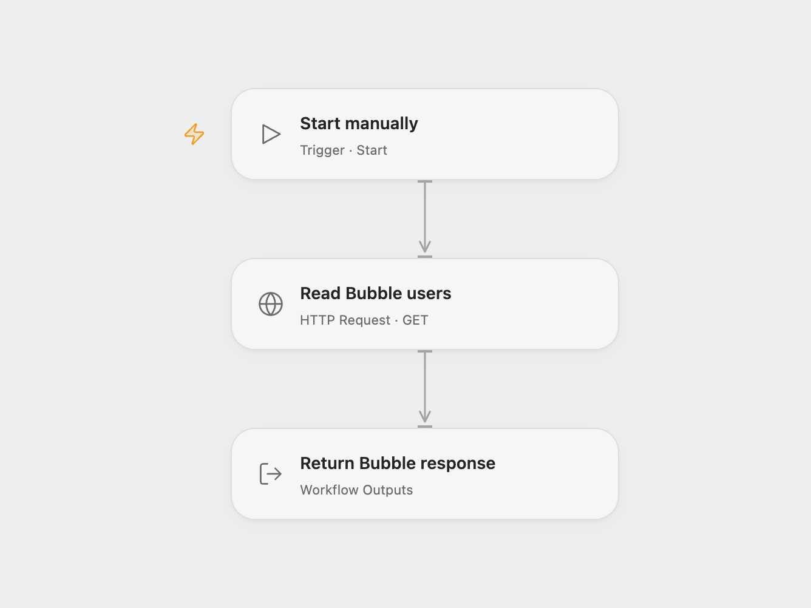

# Read Bubble Users Through the Data API

Read the first page of Bubble user records with the Data API.

<picture>
  <source media="(prefers-color-scheme: dark)" srcset="preview-dark.png">
  
</picture>

[Open Flow JSON](templates/read-bubble-users-through-data-api.openflow.json) · [n8n JSON](templates/read-bubble-users-through-data-api.n8n.json)

## Setup

Enable the Data API and expose the user data type in Bubble. In Open Flow, set the app's HTTPS Data API URL in **Read Bubble users** and bind a secret Variable containing the Bubble token. The example URL uses Bubble's test environment; adjust it for your app and environment. In n8n, set the URL and configure a Header Auth credential whose name is `Authorization` and whose value is `Bearer YOUR_TOKEN`. Run either format manually.

A Bubble API token authenticates as an administrator and bypasses privacy rules. A user token has the permissions of that user. Choose the intended access, restrict the token and protect workflow execution data.

## Behavior

Each run makes one authenticated GET for the `user` data type and returns Bubble's JSON response, including its results and pagination fields. Without a limit, Bubble returns up to 100 records on the first page. This workflow does not fetch later pages; inspect `remaining` in the response. A failed request stops the run.

Inspiration &amp; credits

## Changes to the source

- Replace the personal Bubble app URL and header credential with configurable settings; Open Flow uses a bearer-token Variable.

Adapted from [Access Bubble Data API users](https://github.com/Zie619/n8n-workflows/blob/ae8cf6dc5b873cbb4f74587aa9180ed3a9f70682/workflows/Manual/0199_Manual_HTTP_Automation_Webhook.json) in [Zie619/n8n-workflows](https://github.com/Zie619/n8n-workflows). The source export does not identify a separate template author or license.

The collection’s [MIT notice](https://github.com/Zie619/n8n-workflows/blob/94007c1445d9258a7da116646b79473e7c7c3282/LICENSE) is pinned at a later revision. This is the collection notice at that revision; it does not establish a separate original template author's license. Our changes are listed above; see [repository licensing](../../README.md#licensing).

> MIT License
>
> Copyright (c) 2025 Zie619
>
> Permission is hereby granted, free of charge, to any person obtaining a copy
> of this software and associated documentation files (the "Software"), to deal
> in the Software without restriction, including without limitation the rights
> to use, copy, modify, merge, publish, distribute, sublicense, and/or sell
> copies of the Software, and to permit persons to whom the Software is
> furnished to do so, subject to the following conditions:
>
> The above copyright notice and this permission notice shall be included in all
> copies or substantial portions of the Software.
>
> THE SOFTWARE IS PROVIDED "AS IS", WITHOUT WARRANTY OF ANY KIND, EXPRESS OR
> IMPLIED, INCLUDING BUT NOT LIMITED TO THE WARRANTIES OF MERCHANTABILITY,
> FITNESS FOR A PARTICULAR PURPOSE AND NONINFRINGEMENT. IN NO EVENT SHALL THE
> AUTHORS OR COPYRIGHT HOLDERS BE LIABLE FOR ANY CLAIM, DAMAGES OR OTHER
> LIABILITY, WHETHER IN AN ACTION OF CONTRACT, TORT OR OTHERWISE, ARISING FROM,
> OUT OF OR IN CONNECTION WITH THE SOFTWARE OR THE USE OR OTHER DEALINGS IN THE
> SOFTWARE.

