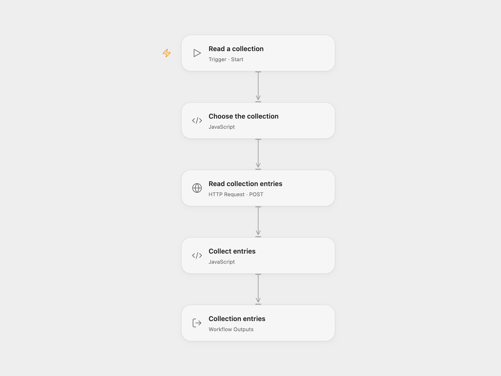

# Read Cockpit Collection Entries

Read up to 100 entries from a Cockpit CMS collection.

<picture>
  <source media="(prefers-color-scheme: dark)" srcset="preview-dark.png">
  
</picture>

[Open Flow JSON](templates/read-cockpit-collection-entries.openflow.json) · [n8n JSON](templates/read-cockpit-collection-entries.n8n.json)

## Setup and use

Use a Cockpit CMS v1 instance and a token permitted to read the collection. In Open Flow, set its HTTPS base URL and collection name in **Choose the collection**, then bind the token as the secret Variable **COCKPIT_API_TOKEN** in **Read collection entries**. In n8n, set the collection and Cockpit credential. The example collection is `samplecollection`.

## Behavior

Run manually to read up to 100 entries with their returned fields. Open Flow returns an array; n8n emits one item per entry. An empty collection returns an empty array or no items. The workflow does not fetch later entries. This uses Cockpit v1's `/api/collections/get` endpoint; newer Cockpit versions use a different API. The token is sent as a query parameter, so restrict access to server and proxy logs.

Inspiration &amp; credits

## Changes to the source

- Open Flow requires HTTPS for the configured instance and uses the v1 collection HTTP endpoint.

Adapted from [Read Cockpit collection entries](https://github.com/Zie619/n8n-workflows/blob/ae8cf6dc5b873cbb4f74587aa9180ed3a9f70682/workflows/Manual/0990_Manual_Cockpit_Automate_Triggered.json) in [Zie619/n8n-workflows](https://github.com/Zie619/n8n-workflows). The source export does not identify a separate template author or license.

The collection’s [MIT notice](https://github.com/Zie619/n8n-workflows/blob/94007c1445d9258a7da116646b79473e7c7c3282/LICENSE) is pinned at a later revision. This is the collection notice at that revision; it does not establish a separate original template author's license. Our changes are listed above; see [repository licensing](../../README.md#licensing).

> MIT License
>
> Copyright (c) 2025 Zie619
>
> Permission is hereby granted, free of charge, to any person obtaining a copy
> of this software and associated documentation files (the "Software"), to deal
> in the Software without restriction, including without limitation the rights
> to use, copy, modify, merge, publish, distribute, sublicense, and/or sell
> copies of the Software, and to permit persons to whom the Software is
> furnished to do so, subject to the following conditions:
>
> The above copyright notice and this permission notice shall be included in all
> copies or substantial portions of the Software.
>
> THE SOFTWARE IS PROVIDED "AS IS", WITHOUT WARRANTY OF ANY KIND, EXPRESS OR
> IMPLIED, INCLUDING BUT NOT LIMITED TO THE WARRANTIES OF MERCHANTABILITY,
> FITNESS FOR A PARTICULAR PURPOSE AND NONINFRINGEMENT. IN NO EVENT SHALL THE
> AUTHORS OR COPYRIGHT HOLDERS BE LIABLE FOR ANY CLAIM, DAMAGES OR OTHER
> LIABILITY, WHETHER IN AN ACTION OF CONTRACT, TORT OR OTHERWISE, ARISING FROM,
> OUT OF OR IN CONNECTION WITH THE SOFTWARE OR THE USE OR OTHER DEALINGS IN THE
> SOFTWARE.

