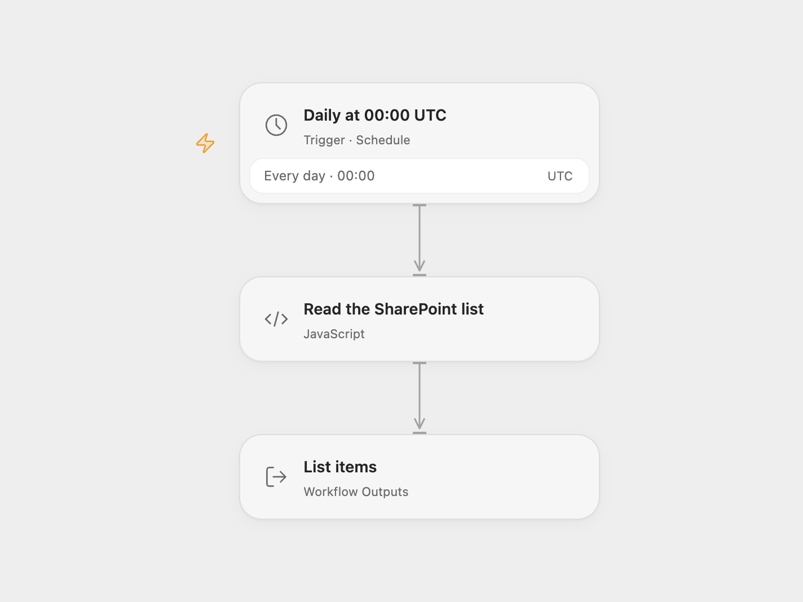

# Read a SharePoint List on a Schedule

Read all items from a SharePoint list on a daily schedule.

<picture>
  <source media="(prefers-color-scheme: dark)" srcset="preview-dark.png">
  
</picture>

[Open Flow JSON](templates/read-sharepoint-list-on-schedule.openflow.json) · [n8n JSON](templates/read-sharepoint-list-on-schedule.n8n.json)

## Setup

Register a Microsoft Entra application with Microsoft Graph application permission **Sites.Read.All** and administrator consent. In **Read the SharePoint list**, set the tenant ID, client ID, site ID and list ID. Store the application secret in Secret Variable `MICROSOFT_CLIENT_SECRET`.

In n8n, set the same site and list IDs in **Configure list**. Configure an OAuth2 API credential for client credentials with your tenant's token URL, client ID, client secret and scope `https://graph.microsoft.com/.default`, and set Authentication to **Body**; select it in **Read Graph list pages**. Activate one format.

## Behavior

At 00:00 UTC each day, fetch all pages of the list using Microsoft Graph and return the items with their expanded fields. The source's schedule used the instance timezone; this version uses UTC. The outputs can be used by later workflow steps or inspected in execution history. The list contents may contain sensitive information. Results reflect the application's permissions and can change during pagination. Large lists must fit workflow execution limits.

A token or list request failure stops the run. No records are modified.

Inspiration &amp; credits

## Changes to the source

- Replace the legacy SharePoint ACS token endpoint with Microsoft Entra client credentials and Microsoft Graph. Use site and list IDs and return Graph item objects with expanded fields.
- Follow Graph pagination and keep the application secret and access token out of workflow outputs.

Adapted from [Scheduled SharePoint list reader](https://github.com/Zie619/n8n-workflows/blob/ae8cf6dc5b873cbb4f74587aa9180ed3a9f70682/workflows/Http/0626_HTTP_Schedule_Create_Scheduled.json) in [Zie619/n8n-workflows](https://github.com/Zie619/n8n-workflows). The source export does not identify a separate template author or license.

The collection’s [MIT notice](https://github.com/Zie619/n8n-workflows/blob/94007c1445d9258a7da116646b79473e7c7c3282/LICENSE) is pinned at a later revision. This is the collection notice at that revision; it does not establish a separate original template author's license. Our changes are listed above; see [repository licensing](../../README.md#licensing).

> MIT License
>
> Copyright (c) 2025 Zie619
>
> Permission is hereby granted, free of charge, to any person obtaining a copy
> of this software and associated documentation files (the "Software"), to deal
> in the Software without restriction, including without limitation the rights
> to use, copy, modify, merge, publish, distribute, sublicense, and/or sell
> copies of the Software, and to permit persons to whom the Software is
> furnished to do so, subject to the following conditions:
>
> The above copyright notice and this permission notice shall be included in all
> copies or substantial portions of the Software.
>
> THE SOFTWARE IS PROVIDED "AS IS", WITHOUT WARRANTY OF ANY KIND, EXPRESS OR
> IMPLIED, INCLUDING BUT NOT LIMITED TO THE WARRANTIES OF MERCHANTABILITY,
> FITNESS FOR A PARTICULAR PURPOSE AND NONINFRINGEMENT. IN NO EVENT SHALL THE
> AUTHORS OR COPYRIGHT HOLDERS BE LIABLE FOR ANY CLAIM, DAMAGES OR OTHER
> LIABILITY, WHETHER IN AN ACTION OF CONTRACT, TORT OR OTHERWISE, ARISING FROM,
> OUT OF OR IN CONNECTION WITH THE SOFTWARE OR THE USE OR OTHER DEALINGS IN THE
> SOFTWARE.

