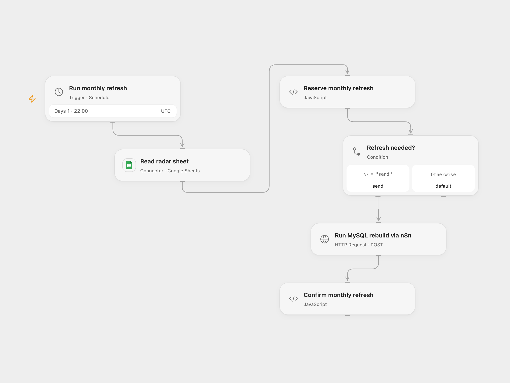

# Rebuild Tech Radar MySQL from Google Sheets

Replace the tech radar table each month using the current sheet.

<picture>
  <source media="(prefers-color-scheme: dark)" srcset="preview-dark.png">
  
</picture>

[Open Flow JSON](templates/rebuild-tech-radar-mysql-from-sheets.openflow.json) · [n8n JSON](templates/rebuild-tech-radar-mysql-from-sheets.n8n.json)

## Setup

Create the existing MySQL table techradar with the expected columns and connect Google Sheets and MySQL in n8n. Select a Data Table with item_key and status text columns. In Open Flow configure the sheet and enable persistent State. Enable the n8n relay webhook, set Header Auth to Authorization: Bearer plus a secret, set its URL in **Run MySQL rebuild via n8n**, and bind RADAR_MYSQL_RELAY_TOKEN. Activate one schedule only.

## Use

At 22:00 UTC on the first of each month, the workflow reads the sheet and replaces all table rows. The sheet must have the columns name, ring, quadrant, isStrategicDirection, isUsedByChildCompany1, isUsedByChildCompany2, isUsedByChildCompany3, isNew, status and description. A successfully read empty sheet clears the table. A failed read or malformed header stops before clearing it; the source cleared the table before attempting the read.

The original TRUNCATE commits separately from insertion. A failed or uncertain run can leave the table empty or partially rebuilt. Inspect MySQL and the pending Data Table row; repair or complete the rebuild before marking it done or clearing the checkpoint. In Open Flow enter the pending key and confirmed or absent in **Reserve monthly refresh** and rerun after reconciliation; clear recovery fields afterward. Do not overlap refreshes.

Inspiration &amp; credits

Extract the monthly full refresh, set the schedule timezone to UTC, read the sheet before truncation so a read failure preserves existing rows, and add pending checkpoints.

Adapted from [Tech Radar](https://github.com/Zie619/n8n-workflows/blob/ae8cf6dc5b873cbb4f74587aa9180ed3a9f70682/workflows/Code/1836_Code_Googledocs_Automation_Webhook.json) in [Zie619/n8n-workflows](https://github.com/Zie619/n8n-workflows). Attribution: Zie619 / n8n-workflows.

The collection’s [MIT notice](https://github.com/Zie619/n8n-workflows/blob/94007c1445d9258a7da116646b79473e7c7c3282/LICENSE) is pinned at a later revision. This is the collection notice at that revision; it does not establish a separate original template author's license. Our changes are listed above; see [repository licensing](../../README.md#licensing).

> MIT License
>
> Copyright (c) 2025 Zie619
>
> Permission is hereby granted, free of charge, to any person obtaining a copy
> of this software and associated documentation files (the "Software"), to deal
> in the Software without restriction, including without limitation the rights
> to use, copy, modify, merge, publish, distribute, sublicense, and/or sell
> copies of the Software, and to permit persons to whom the Software is
> furnished to do so, subject to the following conditions:
>
> The above copyright notice and this permission notice shall be included in all
> copies or substantial portions of the Software.
>
> THE SOFTWARE IS PROVIDED "AS IS", WITHOUT WARRANTY OF ANY KIND, EXPRESS OR
> IMPLIED, INCLUDING BUT NOT LIMITED TO THE WARRANTIES OF MERCHANTABILITY,
> FITNESS FOR A PARTICULAR PURPOSE AND NONINFRINGEMENT. IN NO EVENT SHALL THE
> AUTHORS OR COPYRIGHT HOLDERS BE LIABLE FOR ANY CLAIM, DAMAGES OR OTHER
> LIABILITY, WHETHER IN AN ACTION OF CONTRACT, TORT OR OTHERWISE, ARISING FROM,
> OUT OF OR IN CONNECTION WITH THE SOFTWARE OR THE USE OR OTHER DEALINGS IN THE
> SOFTWARE.

