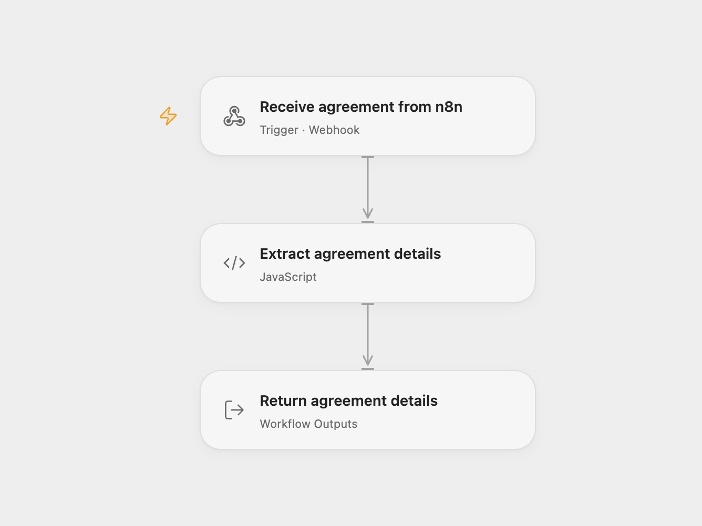

# Receive Adobe Sign Agreement Events

Receive Adobe Sign agreement notifications and expose agreement details.

<picture>
  <source media="(prefers-color-scheme: dark)" srcset="preview-dark.png">
  
</picture>

[Open Flow JSON](templates/receive-adobe-sign-agreement-events.openflow.json) · [n8n JSON](templates/receive-adobe-sign-agreement-events.n8n.json)

## Setup

Import the bundled n8n workflow and activate it. Register its shared GET and POST webhook URL with Adobe Acrobat Sign. The n8n workflow answers Adobe's verification request by echoing the `x-adobesign-clientid` header. In **Choose delivery mode**, select `relay` and set the Open Flow webhook URL in **Forward agreement to Open Flow**. Use `direct` to keep agreement details in n8n without forwarding. Use one mode.

## Behavior

A notification is acknowledged by n8n, then its original body, agreement ID, participant sets and status are available as workflow results. Relay mode sends the complete original event to Open Flow. Configure the Adobe webhook to include agreement details and participant sets. Verification GET requests are acknowledged without an agreement. The Open Flow webhook is unauthenticated and accepts events from callers with its URL; restrict access to trusted callers. A failed relay happens after Adobe receives its response, so inspect n8n executions and replay deliberately if needed. Agreement details may contain sensitive information.

Inspiration &amp; credits

## Changes to the source

- Add an optional relay and stop the verification request before agreement extraction.

Adapted from [Adobe Sign webhook agreement data](https://github.com/Zie619/n8n-workflows/blob/ae8cf6dc5b873cbb4f74587aa9180ed3a9f70682/workflows/Respondtowebhook/0194_Respondtowebhook_Webhook_Import_Webhook.json) in [Zie619/n8n-workflows](https://github.com/Zie619/n8n-workflows). The source export does not identify a separate template author or license.

The collection’s [MIT notice](https://github.com/Zie619/n8n-workflows/blob/94007c1445d9258a7da116646b79473e7c7c3282/LICENSE) is pinned at a later revision. This is the collection notice at that revision; it does not establish a separate original template author's license. Our changes are listed above; see [repository licensing](../../README.md#licensing).

> MIT License
>
> Copyright (c) 2025 Zie619
>
> Permission is hereby granted, free of charge, to any person obtaining a copy
> of this software and associated documentation files (the "Software"), to deal
> in the Software without restriction, including without limitation the rights
> to use, copy, modify, merge, publish, distribute, sublicense, and/or sell
> copies of the Software, and to permit persons to whom the Software is
> furnished to do so, subject to the following conditions:
>
> The above copyright notice and this permission notice shall be included in all
> copies or substantial portions of the Software.
>
> THE SOFTWARE IS PROVIDED "AS IS", WITHOUT WARRANTY OF ANY KIND, EXPRESS OR
> IMPLIED, INCLUDING BUT NOT LIMITED TO THE WARRANTIES OF MERCHANTABILITY,
> FITNESS FOR A PARTICULAR PURPOSE AND NONINFRINGEMENT. IN NO EVENT SHALL THE
> AUTHORS OR COPYRIGHT HOLDERS BE LIABLE FOR ANY CLAIM, DAMAGES OR OTHER
> LIABILITY, WHETHER IN AN ACTION OF CONTRACT, TORT OR OTHERWISE, ARISING FROM,
> OUT OF OR IN CONNECTION WITH THE SOFTWARE OR THE USE OR OTHER DEALINGS IN THE
> SOFTWARE.

