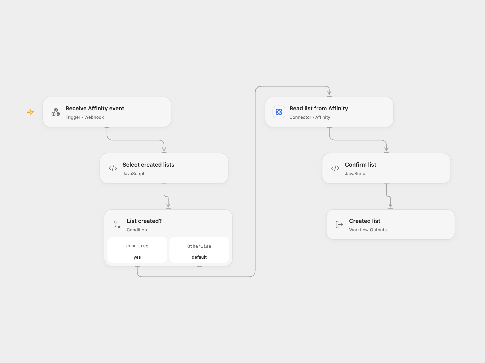

# Receive Affinity List Created Events

Receive new-list events from Affinity and retrieve the complete list record.

<picture>
  <source media="(prefers-color-scheme: dark)" srcset="preview-dark.png">
  
</picture>

[Open Flow JSON](templates/receive-affinity-list-created.openflow.json) · [n8n JSON](templates/receive-affinity-list-created.n8n.json)

## Setup

Connect an Affinity API key in **Read list from Affinity** and allow Provider API access. Deploy the POST webhook over HTTPS. Create an Affinity webhook subscription for `list.created` with that URL using the [Affinity API](https://api-docs.affinity.co/#create-a-new-webhook-subscription). The service sends a sample event during registration. Remove the subscription in Affinity when the webhook is no longer used. Affinity permits three subscriptions per instance.

In n8n, connect the Affinity API credential and activate the trigger. n8n creates and removes the subscription itself.

## Behavior

For each `list.created` event, the workflow looks up the list using its ID and returns the full V1 list record with the event type. Sample events and other event types do not trigger a lookup. The webhook acknowledges receipt before the lookup completes; acknowledgment does not confirm a successful lookup. A failed lookup stops that run. Affinity may retry undelivered callbacks.

The template does not verify the caller. Protect the webhook URL and execution history because list data may be sensitive. Use the subscription URL only with trusted recipients.

Inspiration &amp; credits

## Changes to the source

- Open Flow uses a manually managed subscription and filters events before fetching the V1 list. n8n manages the subscription through its native trigger.

Adapted from [Receive updates when a new list is created in Affinity](https://github.com/Zie619/n8n-workflows/blob/ae8cf6dc5b873cbb4f74587aa9180ed3a9f70682/workflows/Affinity/1085_Affinity_Create_Triggered.json) in [Zie619/n8n-workflows](https://github.com/Zie619/n8n-workflows). The source export does not identify a separate template author or license.

The collection’s [MIT notice](https://github.com/Zie619/n8n-workflows/blob/94007c1445d9258a7da116646b79473e7c7c3282/LICENSE) is pinned at a later revision. This is the collection notice at that revision; it does not establish a separate original template author's license. Our changes are listed above; see [repository licensing](../../README.md#licensing).

> MIT License
>
> Copyright (c) 2025 Zie619
>
> Permission is hereby granted, free of charge, to any person obtaining a copy
> of this software and associated documentation files (the "Software"), to deal
> in the Software without restriction, including without limitation the rights
> to use, copy, modify, merge, publish, distribute, sublicense, and/or sell
> copies of the Software, and to permit persons to whom the Software is
> furnished to do so, subject to the following conditions:
>
> The above copyright notice and this permission notice shall be included in all
> copies or substantial portions of the Software.
>
> THE SOFTWARE IS PROVIDED "AS IS", WITHOUT WARRANTY OF ANY KIND, EXPRESS OR
> IMPLIED, INCLUDING BUT NOT LIMITED TO THE WARRANTIES OF MERCHANTABILITY,
> FITNESS FOR A PARTICULAR PURPOSE AND NONINFRINGEMENT. IN NO EVENT SHALL THE
> AUTHORS OR COPYRIGHT HOLDERS BE LIABLE FOR ANY CLAIM, DAMAGES OR OTHER
> LIABILITY, WHETHER IN AN ACTION OF CONTRACT, TORT OR OTHERWISE, ARISING FROM,
> OUT OF OR IN CONNECTION WITH THE SOFTWARE OR THE USE OR OTHER DEALINGS IN THE
> SOFTWARE.

