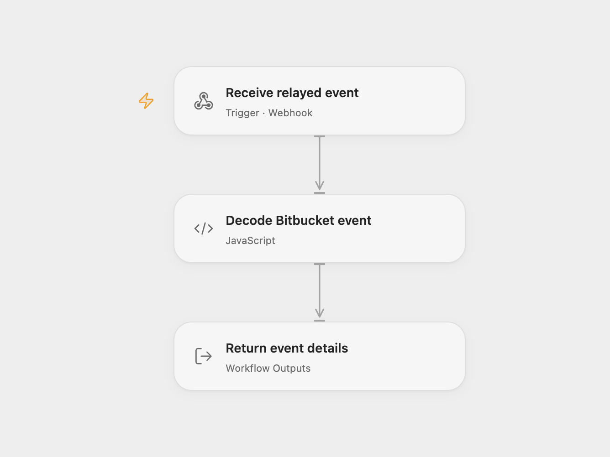

# Receive Bitbucket Repository Pushes

Receive push events for a Bitbucket repository.

<picture>
  <source media="(prefers-color-scheme: dark)" srcset="preview-dark.png">
  
</picture>

[Open Flow JSON](templates/receive-bitbucket-repository-pushes.openflow.json) · [n8n JSON](templates/receive-bitbucket-repository-pushes.n8n.json)

## Setup and use

Import the n8n workflow, connect Bitbucket and set the workspace and repository in **Bitbucket Trigger**. Activate it to register a repo:push webhook. For Open Flow enter its webhook URL in **Forward to Open Flow** and enable that node; leave it disabled for n8n alone. Restrict access to the webhook endpoints.

## Behavior

The trigger emits each complete repository push event. The optional relay forwards it to Open Flow as workflow output. The fixed n8n trigger compares the webhook UUID but does not verify a cryptographic signature; restrict access and inspect n8n execution history for relay failures. Event details may appear in execution history.

Inspiration &amp; credits

## Changes to the source

- Replace the example repository with placeholders and add an optional n8n relay.

Adapted from [Bitbucket repository push events](https://github.com/Zie619/n8n-workflows/blob/ae8cf6dc5b873cbb4f74587aa9180ed3a9f70682/workflows/Bitbucket/0999_Bitbucket_Automate_Triggered.json) in [Zie619/n8n-workflows](https://github.com/Zie619/n8n-workflows). The source export does not identify a separate template author or license.

The collection’s [MIT notice](https://github.com/Zie619/n8n-workflows/blob/94007c1445d9258a7da116646b79473e7c7c3282/LICENSE) is pinned at a later revision. This is the collection notice at that revision; it does not establish a separate original template author's license. Our changes are listed above; see [repository licensing](../../README.md#licensing).

> MIT License
>
> Copyright (c) 2025 Zie619
>
> Permission is hereby granted, free of charge, to any person obtaining a copy
> of this software and associated documentation files (the "Software"), to deal
> in the Software without restriction, including without limitation the rights
> to use, copy, modify, merge, publish, distribute, sublicense, and/or sell
> copies of the Software, and to permit persons to whom the Software is
> furnished to do so, subject to the following conditions:
>
> The above copyright notice and this permission notice shall be included in all
> copies or substantial portions of the Software.
>
> THE SOFTWARE IS PROVIDED "AS IS", WITHOUT WARRANTY OF ANY KIND, EXPRESS OR
> IMPLIED, INCLUDING BUT NOT LIMITED TO THE WARRANTIES OF MERCHANTABILITY,
> FITNESS FOR A PARTICULAR PURPOSE AND NONINFRINGEMENT. IN NO EVENT SHALL THE
> AUTHORS OR COPYRIGHT HOLDERS BE LIABLE FOR ANY CLAIM, DAMAGES OR OTHER
> LIABILITY, WHETHER IN AN ACTION OF CONTRACT, TORT OR OTHERWISE, ARISING FROM,
> OUT OF OR IN CONNECTION WITH THE SOFTWARE OR THE USE OR OTHER DEALINGS IN THE
> SOFTWARE.

