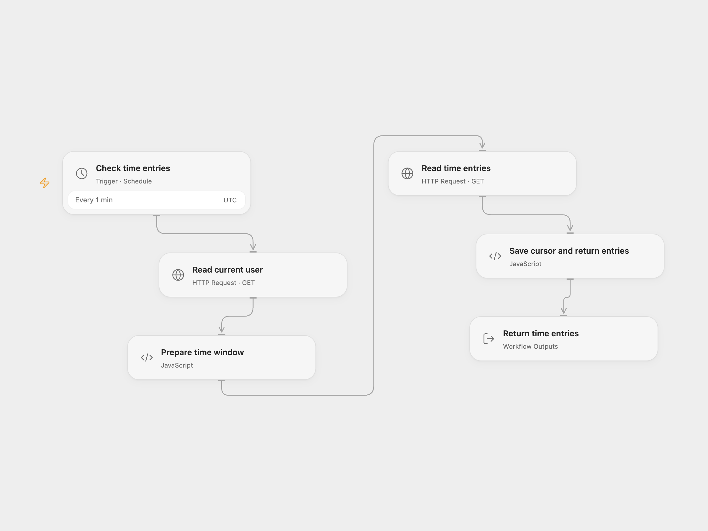

# Receive Clockify Time Entries

Poll Clockify for completed time entries.

<picture>
  <source media="(prefers-color-scheme: dark)" srcset="preview-dark.png">
  
</picture>

[Open Flow JSON](templates/receive-clockify-time-entries.openflow.json) · [n8n JSON](templates/receive-clockify-time-entries.n8n.json)

## Setup and use

Connect Clockify and select a workspace in the n8n workflow. For Open Flow, enable persistent State, set the workspace ID and bind secret Variable CLOCKIFY_API_KEY. Prevent overlapping runs and use one format.

## Behavior

The n8n trigger polls the current user's completed entries. Open Flow also polls the current user, returning complete entries and advancing the cursor only after a successful response. The first Open Flow poll has no start unless startOverride is set. Entries backdated before a saved cursor may be missed. The source reads the default first page; Open Flow stops without advancing if it receives 50 entries, so set startOverride before the first run and use endOverride to select shorter windows. For later recovery set endOverride after the saved cursor; repeat until caught up, then clear it. Full entries may appear in execution history.

Inspiration &amp; credits

## Changes to the source

- Open Flow polls the API directly and returns an array; n8n retains the original trigger. A full default page stops the cursor so a shorter window can be selected.

Adapted from [Clockify time entries](https://github.com/Zie619/n8n-workflows/blob/ae8cf6dc5b873cbb4f74587aa9180ed3a9f70682/workflows/Clockify/1005_Clockify_Automate_Triggered.json) in [Zie619/n8n-workflows](https://github.com/Zie619/n8n-workflows). The source export does not identify a separate template author or license.

The collection’s [MIT notice](https://github.com/Zie619/n8n-workflows/blob/94007c1445d9258a7da116646b79473e7c7c3282/LICENSE) is pinned at a later revision. This is the collection notice at that revision; it does not establish a separate original template author's license. Our changes are listed above; see [repository licensing](../../README.md#licensing).

> MIT License
>
> Copyright (c) 2025 Zie619
>
> Permission is hereby granted, free of charge, to any person obtaining a copy
> of this software and associated documentation files (the "Software"), to deal
> in the Software without restriction, including without limitation the rights
> to use, copy, modify, merge, publish, distribute, sublicense, and/or sell
> copies of the Software, and to permit persons to whom the Software is
> furnished to do so, subject to the following conditions:
>
> The above copyright notice and this permission notice shall be included in all
> copies or substantial portions of the Software.
>
> THE SOFTWARE IS PROVIDED "AS IS", WITHOUT WARRANTY OF ANY KIND, EXPRESS OR
> IMPLIED, INCLUDING BUT NOT LIMITED TO THE WARRANTIES OF MERCHANTABILITY,
> FITNESS FOR A PARTICULAR PURPOSE AND NONINFRINGEMENT. IN NO EVENT SHALL THE
> AUTHORS OR COPYRIGHT HOLDERS BE LIABLE FOR ANY CLAIM, DAMAGES OR OTHER
> LIABILITY, WHETHER IN AN ACTION OF CONTRACT, TORT OR OTHERWISE, ARISING FROM,
> OUT OF OR IN CONNECTION WITH THE SOFTWARE OR THE USE OR OTHER DEALINGS IN THE
> SOFTWARE.

