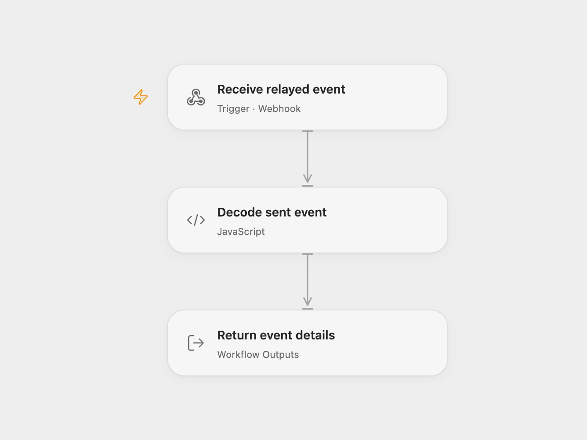

# Receive Mailjet Sent Events

Receive Mailjet email sent events with exact message IDs.

<picture>
  <source media="(prefers-color-scheme: dark)" srcset="preview-dark.png">
  
</picture>

[Open Flow JSON](templates/receive-mailjet-sent-events.openflow.json) · [n8n JSON](templates/receive-mailjet-sent-events.n8n.json)

## Setup and use

Import and activate the n8n workflow, then register the **Receive Mailjet events** production webhook URL in Mailjet for the sent event. The URL must be publicly reachable by Mailjet. For Open Flow enter its webhook URL in **Forward to Open Flow** and enable that node; leave it disabled for n8n alone. Restrict access to the webhook endpoints.

## Behavior

Mailjet may send multiple events in one request. The n8n workflow reads the original bytes and emits each event separately. Integers outside JavaScript’s safe range become decimal strings to preserve exact IDs. The optional relay forwards each event to Open Flow. Neither endpoint authenticates the sender; restrict access and inspect n8n execution history for relay failures. Event details may appear in execution history.

Inspiration &amp; credits

## Changes to the source

- Replace automatic trigger registration with a manually registered raw webhook and preserve large numeric IDs as strings; add an optional n8n relay.

Adapted from [Mailjet sent events](https://github.com/Zie619/n8n-workflows/blob/ae8cf6dc5b873cbb4f74587aa9180ed3a9f70682/workflows/Mailjet/0994_Mailjet_Automate_Triggered.json) in [Zie619/n8n-workflows](https://github.com/Zie619/n8n-workflows). The source export does not identify a separate template author or license.

The collection’s [MIT notice](https://github.com/Zie619/n8n-workflows/blob/94007c1445d9258a7da116646b79473e7c7c3282/LICENSE) is pinned at a later revision. This is the collection notice at that revision; it does not establish a separate original template author's license. Our changes are listed above; see [repository licensing](../../README.md#licensing).

> MIT License
>
> Copyright (c) 2025 Zie619
>
> Permission is hereby granted, free of charge, to any person obtaining a copy
> of this software and associated documentation files (the "Software"), to deal
> in the Software without restriction, including without limitation the rights
> to use, copy, modify, merge, publish, distribute, sublicense, and/or sell
> copies of the Software, and to permit persons to whom the Software is
> furnished to do so, subject to the following conditions:
>
> The above copyright notice and this permission notice shall be included in all
> copies or substantial portions of the Software.
>
> THE SOFTWARE IS PROVIDED "AS IS", WITHOUT WARRANTY OF ANY KIND, EXPRESS OR
> IMPLIED, INCLUDING BUT NOT LIMITED TO THE WARRANTIES OF MERCHANTABILITY,
> FITNESS FOR A PARTICULAR PURPOSE AND NONINFRINGEMENT. IN NO EVENT SHALL THE
> AUTHORS OR COPYRIGHT HOLDERS BE LIABLE FOR ANY CLAIM, DAMAGES OR OTHER
> LIABILITY, WHETHER IN AN ACTION OF CONTRACT, TORT OR OTHERWISE, ARISING FROM,
> OUT OF OR IN CONNECTION WITH THE SOFTWARE OR THE USE OR OTHER DEALINGS IN THE
> SOFTWARE.

