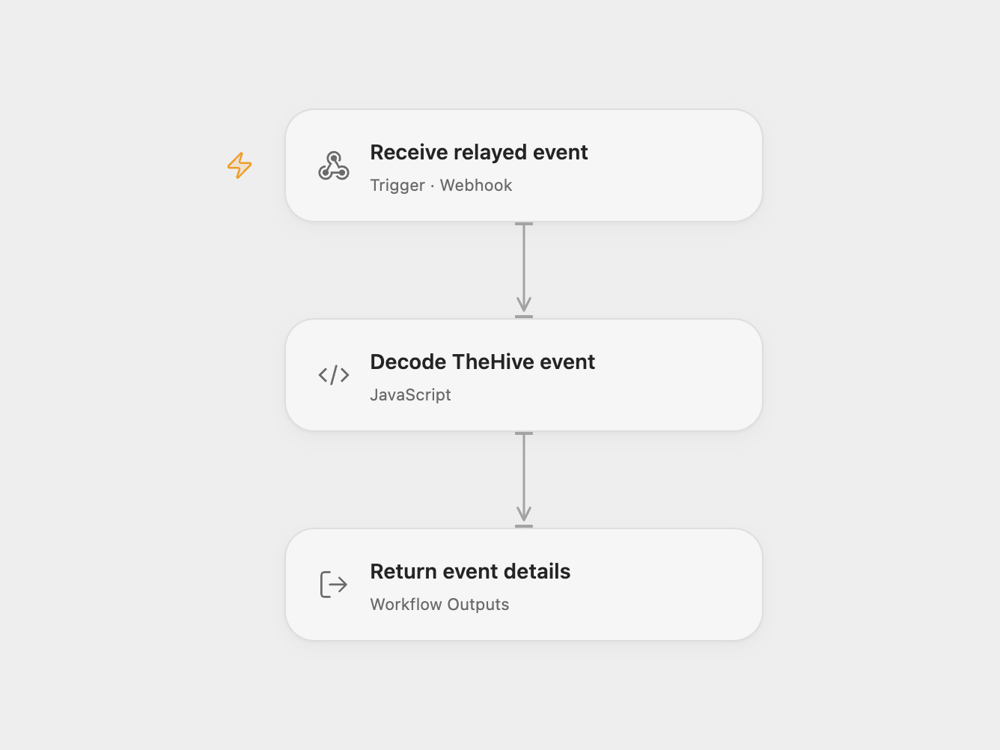

# Receive TheHive Event Updates

Receive all TheHive events with their original request details.

<picture>
  <source media="(prefers-color-scheme: dark)" srcset="preview-dark.png">
  
</picture>

[Open Flow JSON](templates/receive-thehive-event-updates.openflow.json) · [n8n JSON](templates/receive-thehive-event-updates.n8n.json)

## Setup and use

Import the supplied n8n workflow and configure TheHive to send its webhooks to the production URL of **TheHive Trigger**. For Open Flow set the destination in **Forward to Open Flow** and enable that node before activating n8n. Leave it disabled to use n8n alone. Restrict access to the webhook and relay endpoints.

## Behavior

TheHive Trigger accepts events with operation and objectType and subscribes to all event types. It emits the normalized event name and the full request body, headers and query. The optional relay forwards that complete trigger output to Open Flow, which exposes it as workflow output for downstream processing. TheHive is acknowledged before forwarding, so inspect n8n execution history for relay failures. Request headers and event details may appear in execution history; restrict access and avoid sending unnecessary secrets.

Inspiration &amp; credits

## Changes to the source

- Add an optional n8n relay to preserve the complete trigger output in Open Flow.

Adapted from [TheHive event updates](https://github.com/Zie619/n8n-workflows/blob/ae8cf6dc5b873cbb4f74587aa9180ed3a9f70682/workflows/Thehive/0205_Thehive_Update_Triggered.json) in [Zie619/n8n-workflows](https://github.com/Zie619/n8n-workflows). The source export does not identify a separate template author or license.

The collection’s [MIT notice](https://github.com/Zie619/n8n-workflows/blob/94007c1445d9258a7da116646b79473e7c7c3282/LICENSE) is pinned at a later revision. This is the collection notice at that revision; it does not establish a separate original template author's license. Our changes are listed above; see [repository licensing](../../README.md#licensing).

> MIT License
>
> Copyright (c) 2025 Zie619
>
> Permission is hereby granted, free of charge, to any person obtaining a copy
> of this software and associated documentation files (the "Software"), to deal
> in the Software without restriction, including without limitation the rights
> to use, copy, modify, merge, publish, distribute, sublicense, and/or sell
> copies of the Software, and to permit persons to whom the Software is
> furnished to do so, subject to the following conditions:
>
> The above copyright notice and this permission notice shall be included in all
> copies or substantial portions of the Software.
>
> THE SOFTWARE IS PROVIDED "AS IS", WITHOUT WARRANTY OF ANY KIND, EXPRESS OR
> IMPLIED, INCLUDING BUT NOT LIMITED TO THE WARRANTIES OF MERCHANTABILITY,
> FITNESS FOR A PARTICULAR PURPOSE AND NONINFRINGEMENT. IN NO EVENT SHALL THE
> AUTHORS OR COPYRIGHT HOLDERS BE LIABLE FOR ANY CLAIM, DAMAGES OR OTHER
> LIABILITY, WHETHER IN AN ACTION OF CONTRACT, TORT OR OTHERWISE, ARISING FROM,
> OUT OF OR IN CONNECTION WITH THE SOFTWARE OR THE USE OR OTHER DEALINGS IN THE
> SOFTWARE.

