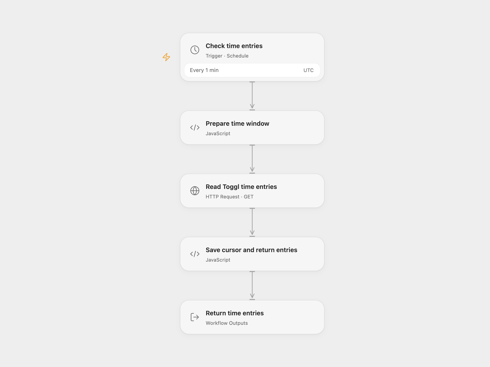

# Receive Toggl Time Entries

Poll Toggl for time entries on a schedule.

<picture>
  <source media="(prefers-color-scheme: dark)" srcset="preview-dark.png">
  
</picture>

[Open Flow JSON](templates/receive-toggl-time-entries.openflow.json) · [n8n JSON](templates/receive-toggl-time-entries.n8n.json)

## Setup and use

Connect Toggl in the supplied n8n workflow and configure its polling schedule. For Open Flow enable persistent State, bind secret Variable TOGGL_API_TOKEN as the HTTP Basic username, leave the password as api_token, and adjust the schedule. Prevent overlapping runs. Use one format.

## Behavior

The first poll starts at the current UTC date; later polls start at the previous successful poll time and end at the current time. The workflow returns the full entries in each window. Like the original trigger, the query selects by entry start time, so entries backdated before the window can be missed. Toggl limits this endpoint to 1,000 entries. Open Flow stops without advancing the cursor if it receives 1,000 or more; set **Prepare time window** recoveryEnd to a timestamp after the saved cursor and before now, run once, and repeat with later timestamps until caught up. Then clear recoveryEnd. Full entries may appear in execution history.

Inspiration &amp; credits

## Changes to the source

- Open Flow polls the Toggl API directly with persistent State and returns an array per poll; n8n retains the original trigger.

Adapted from [Toggl time entries](https://github.com/Zie619/n8n-workflows/blob/ae8cf6dc5b873cbb4f74587aa9180ed3a9f70682/workflows/Toggl/0147_Toggl_Create_Triggered.json) in [Zie619/n8n-workflows](https://github.com/Zie619/n8n-workflows). The source export does not identify a separate template author or license.

The collection’s [MIT notice](https://github.com/Zie619/n8n-workflows/blob/94007c1445d9258a7da116646b79473e7c7c3282/LICENSE) is pinned at a later revision. This is the collection notice at that revision; it does not establish a separate original template author's license. Our changes are listed above; see [repository licensing](../../README.md#licensing).

> MIT License
>
> Copyright (c) 2025 Zie619
>
> Permission is hereby granted, free of charge, to any person obtaining a copy
> of this software and associated documentation files (the "Software"), to deal
> in the Software without restriction, including without limitation the rights
> to use, copy, modify, merge, publish, distribute, sublicense, and/or sell
> copies of the Software, and to permit persons to whom the Software is
> furnished to do so, subject to the following conditions:
>
> The above copyright notice and this permission notice shall be included in all
> copies or substantial portions of the Software.
>
> THE SOFTWARE IS PROVIDED "AS IS", WITHOUT WARRANTY OF ANY KIND, EXPRESS OR
> IMPLIED, INCLUDING BUT NOT LIMITED TO THE WARRANTIES OF MERCHANTABILITY,
> FITNESS FOR A PARTICULAR PURPOSE AND NONINFRINGEMENT. IN NO EVENT SHALL THE
> AUTHORS OR COPYRIGHT HOLDERS BE LIABLE FOR ANY CLAIM, DAMAGES OR OTHER
> LIABILITY, WHETHER IN AN ACTION OF CONTRACT, TORT OR OTHERWISE, ARISING FROM,
> OUT OF OR IN CONNECTION WITH THE SOFTWARE OR THE USE OR OTHER DEALINGS IN THE
> SOFTWARE.

