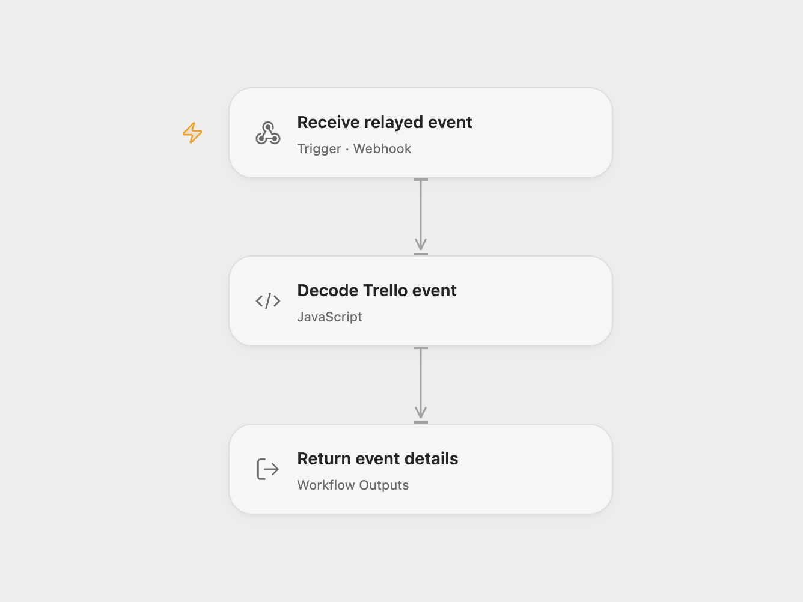

# Receive Trello List Changes

Receive change events for a Trello list.

<picture>
  <source media="(prefers-color-scheme: dark)" srcset="preview-dark.png">
  
</picture>

[Open Flow JSON](templates/receive-trello-list-changes.openflow.json) · [n8n JSON](templates/receive-trello-list-changes.n8n.json)

## Setup and use

Import the n8n workflow, configure Trello credentials and set the list model ID in **Trello Trigger**. n8n registers a Trello webhook when activated; its URL must be reachable by Trello. For Open Flow set the destination in **Forward to Open Flow** and enable that node. Leave it disabled to use n8n alone. Restrict access to the webhook endpoints.

## Behavior

The Trello trigger emits the complete webhook payload for changes on the configured model. The optional relay forwards it to Open Flow as workflow output. The n8n trigger acknowledges requests before forwarding and does not validate Trello signatures; restrict access and inspect n8n execution history for relay failures. Event details may appear in execution history.

Inspiration &amp; credits

## Changes to the source

- Add an optional n8n relay for complete event payloads in Open Flow.

Adapted from [Trello list changes](https://github.com/Zie619/n8n-workflows/blob/ae8cf6dc5b873cbb4f74587aa9180ed3a9f70682/workflows/Trello/0076_Trello_Update_Triggered.json) in [Zie619/n8n-workflows](https://github.com/Zie619/n8n-workflows). The source export does not identify a separate template author or license.

The collection’s [MIT notice](https://github.com/Zie619/n8n-workflows/blob/94007c1445d9258a7da116646b79473e7c7c3282/LICENSE) is pinned at a later revision. This is the collection notice at that revision; it does not establish a separate original template author's license. Our changes are listed above; see [repository licensing](../../README.md#licensing).

> MIT License
>
> Copyright (c) 2025 Zie619
>
> Permission is hereby granted, free of charge, to any person obtaining a copy
> of this software and associated documentation files (the "Software"), to deal
> in the Software without restriction, including without limitation the rights
> to use, copy, modify, merge, publish, distribute, sublicense, and/or sell
> copies of the Software, and to permit persons to whom the Software is
> furnished to do so, subject to the following conditions:
>
> The above copyright notice and this permission notice shall be included in all
> copies or substantial portions of the Software.
>
> THE SOFTWARE IS PROVIDED "AS IS", WITHOUT WARRANTY OF ANY KIND, EXPRESS OR
> IMPLIED, INCLUDING BUT NOT LIMITED TO THE WARRANTIES OF MERCHANTABILITY,
> FITNESS FOR A PARTICULAR PURPOSE AND NONINFRINGEMENT. IN NO EVENT SHALL THE
> AUTHORS OR COPYRIGHT HOLDERS BE LIABLE FOR ANY CLAIM, DAMAGES OR OTHER
> LIABILITY, WHETHER IN AN ACTION OF CONTRACT, TORT OR OTHERWISE, ARISING FROM,
> OUT OF OR IN CONNECTION WITH THE SOFTWARE OR THE USE OR OTHER DEALINGS IN THE
> SOFTWARE.

