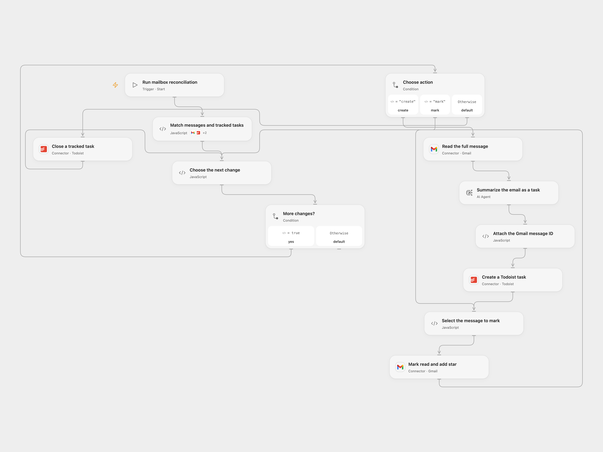

# Reconcile Gmail Messages with Todoist Tasks

Turn unread or starred inbox messages into Todoist tasks and close tracked tasks when their messages leave the active inbox set.

<picture>
  <source media="(prefers-color-scheme: dark)" srcset="preview-dark.png">
  
</picture>

[Open Flow JSON](templates/reconcile-gmail-messages-with-todoist-tasks.openflow.json) · [n8n JSON](templates/reconcile-gmail-messages-with-todoist-tasks.n8n.json)

## Setup

Connect Gmail, Todoist and an OpenAI model. Set the same Todoist project ID in **Match messages and tracked tasks** and **Create a Todoist task**. Run the workflow manually. In n8n connect the same services and set the project ID in both Todoist HTTP nodes and connect Todoist API credentials there. The source's IMAP and schedule triggers remain disabled.

## Behavior

The workflow reads all unread or starred inbox messages and all open tasks in the configured project. For each message without a tracked task, it summarizes the message and suggests actions and a reply, creates a task with the email subject, then marks the email read and starred. A task created by this workflow carries its Gmail message ID in the description. Existing tracked tasks for messages no longer unread or starred in the inbox are closed. Tasks without this marker are not changed. Keep the marker intact and use a dedicated project.

Email content is sent to the model; review suggested actions and replies before using them. Earlier changes can remain after a failure. If a task creation or close has an unknown outcome, inspect Todoist and Gmail before running again. The workflow does not automatically replay uncertain writes.

Inspiration &amp; credits

## Changes to the source

- Match by Gmail message ID instead of subject and restrict task closure to marked tasks in the configured project.
- Create the task before marking an unread message read and starred, and read all result pages before deciding which tracked tasks to close.

Adapted from [Email mailbox as Todoist tasks](https://github.com/Zie619/n8n-workflows/blob/ae8cf6dc5b873cbb4f74587aa9180ed3a9f70682/workflows/Todoist/1749_Todoist_Schedule_Send_Scheduled.json) in [Zie619/n8n-workflows](https://github.com/Zie619/n8n-workflows). The source export does not identify a separate template author or license.

The collection’s [MIT notice](https://github.com/Zie619/n8n-workflows/blob/94007c1445d9258a7da116646b79473e7c7c3282/LICENSE) is pinned at a later revision. This is the collection notice at that revision; it does not establish a separate original template author's license. Our changes are listed above; see [repository licensing](../../README.md#licensing).

> MIT License
>
> Copyright (c) 2025 Zie619
>
> Permission is hereby granted, free of charge, to any person obtaining a copy
> of this software and associated documentation files (the "Software"), to deal
> in the Software without restriction, including without limitation the rights
> to use, copy, modify, merge, publish, distribute, sublicense, and/or sell
> copies of the Software, and to permit persons to whom the Software is
> furnished to do so, subject to the following conditions:
>
> The above copyright notice and this permission notice shall be included in all
> copies or substantial portions of the Software.
>
> THE SOFTWARE IS PROVIDED "AS IS", WITHOUT WARRANTY OF ANY KIND, EXPRESS OR
> IMPLIED, INCLUDING BUT NOT LIMITED TO THE WARRANTIES OF MERCHANTABILITY,
> FITNESS FOR A PARTICULAR PURPOSE AND NONINFRINGEMENT. IN NO EVENT SHALL THE
> AUTHORS OR COPYRIGHT HOLDERS BE LIABLE FOR ANY CLAIM, DAMAGES OR OTHER
> LIABILITY, WHETHER IN AN ACTION OF CONTRACT, TORT OR OTHERWISE, ARISING FROM,
> OUT OF OR IN CONNECTION WITH THE SOFTWARE OR THE USE OR OTHER DEALINGS IN THE
> SOFTWARE.

