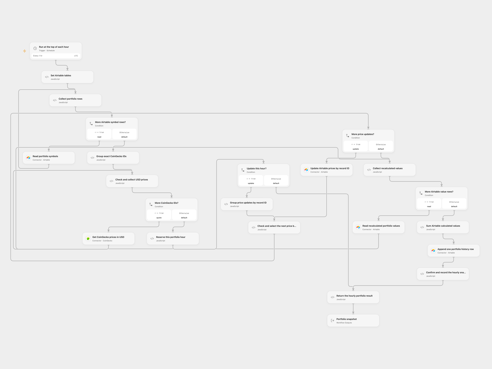

# Record Hourly Crypto Portfolio Value in Airtable

Update portfolio rows with CoinGecko USD prices and log the total of Airtable’s calculated holding values.

<!-- template-actions:start -->
 
<!-- template-actions:end -->

<picture>
  <source media="(prefers-color-scheme: dark)" srcset="preview-dark.png">
  
</picture>

## Setup

1. Connect CoinGecko and Airtable. Give the Airtable connection read and write access to the base and enable Provider API Request access for the two Airtable list nodes.
2. In **Set Airtable tables**, enter your Airtable base ID and table names. The default tables are **Portfolio** and **Portfolio Value**. In the portfolio table, `Symbol` contains CoinGecko API IDs such as `bitcoin` and `ethereum`. Use a writable number field for `Present Price` and a numeric calculation for `Present Value`. In the history table, create a numeric `Portfolio Value (US$)` field.
3. Publish the workflow. It runs at the top of every hour in UTC.

## Behavior

The workflow reads the full portfolio and fetches every USD price before updating any rows. It writes prices by Airtable record ID. It reads all calculated `Present Value` cells again after the updates, then appends their sum to the history table. CoinGecko API IDs can appear on multiple holdings. Every holding is counted. An empty portfolio produces no snapshot.

Failed reads, missing quotes, and unconfirmed writes stop the run. If Airtable writes may have succeeded, inspect both tables before replaying that hour. The workflow stores a pending State entry keyed by the scheduled UTC hour, such as `portfolio:2026-01-01T09:00:00.000Z`. Clear only that published State entry if you have confirmed the history row was never created and the run has ended. Confirmed markers are kept for 14 days. Use one active workflow per portfolio and keep other writers from changing the same prices during a run.

In n8n

Set the base and both tables in **Set Airtable tables**. Use the same Airtable **Bearer Auth** credential for the Airtable calls. Select a CoinGecko **Header Auth** credential whose header is `x-cg-demo-api-key` in **Get CoinGecko prices in USD**.

Select one Data Table with the text columns `hour_key` and `status` in all checkpoint nodes. In regular mode on self-hosted n8n, set `N8N_CONCURRENCY_PRODUCTION_LIMIT=1` to serialize the checkpoint check and insert. Keep one active copy per portfolio. The Schedule Trigger supplies its emitted timestamp, which is truncated to the UTC hour. If a delayed execution crosses an hour boundary, it uses the emitted hour. Verify both Airtable tables before removing a pending checkpoint and running that hour again.

Inspiration &amp; credits

Adapted from [Update Crypto Values](https://github.com/Zie619/n8n-workflows/blob/ae8cf6dc5b873cbb4f74587aa9180ed3a9f70682/workflows/Coingecko/0177_Coingecko_Cron_Update_Scheduled.json) in [Zie619/n8n-workflows](https://github.com/Zie619/n8n-workflows). Attribution: Zie619 / n8n-workflows.

The collection’s [MIT notice](https://github.com/Zie619/n8n-workflows/blob/94007c1445d9258a7da116646b79473e7c7c3282/LICENSE) is pinned at a later revision. This is the collection notice at that revision; it does not establish a separate original template author's license. Our changes are listed above; see [repository licensing](../../README.md#licensing).

> MIT License
>
> Copyright (c) 2025 Zie619
>
> Permission is hereby granted, free of charge, to any person obtaining a copy
> of this software and associated documentation files (the "Software"), to deal
> in the Software without restriction, including without limitation the rights
> to use, copy, modify, merge, publish, distribute, sublicense, and/or sell
> copies of the Software, and to permit persons to whom the Software is
> furnished to do so, subject to the following conditions:
>
> The above copyright notice and this permission notice shall be included in all
> copies or substantial portions of the Software.
>
> THE SOFTWARE IS PROVIDED "AS IS", WITHOUT WARRANTY OF ANY KIND, EXPRESS OR
> IMPLIED, INCLUDING BUT NOT LIMITED TO THE WARRANTIES OF MERCHANTABILITY,
> FITNESS FOR A PARTICULAR PURPOSE AND NONINFRINGEMENT. IN NO EVENT SHALL THE
> AUTHORS OR COPYRIGHT HOLDERS BE LIABLE FOR ANY CLAIM, DAMAGES OR OTHER
> LIABILITY, WHETHER IN AN ACTION OF CONTRACT, TORT OR OTHERWISE, ARISING FROM,
> OUT OF OR IN CONNECTION WITH THE SOFTWARE OR THE USE OR OTHER DEALINGS IN THE
> SOFTWARE.

