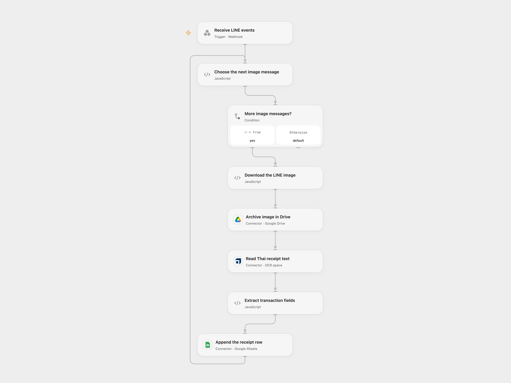

# Record LINE Receipt Images in Google Sheets

Archive LINE receipt images and record extracted Thai transfer details in Google Sheets.

<picture>
  <source media="(prefers-color-scheme: dark)" srcset="preview-dark.png">
  
</picture>

[Open Flow JSON](templates/record-line-receipts-in-google-sheets.openflow.json) · [n8n JSON](templates/record-line-receipts-in-google-sheets.n8n.json)

## Setup

Bind the LINE channel access token as Secret Variable `LINE_CHANNEL_ACCESS_TOKEN`. Connect Google Drive, OCR.space and Google Sheets; set the destination folder ID in **Archive image in Drive** and spreadsheet ID and range in **Append the receipt row**. Create the sheet with columns in this order: Transaction Type, Date & Time, Sender Name, Sender Account, Receiver Bank, Receiver Name, Receiver Account, Transaction ID, Amount, Fee. Register the Open Flow webhook with LINE. The public endpoint does not verify LINE signatures; anyone with its URL can trigger reads and writes.

For n8n connect LINE header authentication, Google Drive, OCR.space header authentication (header `apikey`) and Google Sheets. Set the same folder, spreadsheet and sheet in their nodes and register the n8n webhook with LINE. Use one format for a channel.

## Behavior

Each image message in the LINE event array is downloaded, archived in Drive, sent to OCR.space and parsed for the source's Thai transfer fields. Other event types are ignored. The parser is tailored to the source's Thai bank and PromptPay receipt layout; it stops without appending a row if required fields cannot be extracted. Review the resulting values against the image. Receipt images and transaction details are sensitive; control access to the Drive folder, sheet and OCR provider.

The webhook acknowledges receipt before processing completes. Earlier files or rows may remain if a later step fails. An uncertain Drive upload or Sheets append may already have succeeded; inspect both destinations before replaying, and account for earlier events in the same request. No automatic deduplication or retry is added.

Inspiration &amp; credits

## Changes to the source

- Upload the image bytes directly to OCR.space instead of assuming a private Drive file has a public URL.
- Process all image events, preserve their message IDs, and stop before the sheet write when required fields are missing.

Adapted from [LINE BOT - Google Sheets Record Receipt](https://github.com/Zie619/n8n-workflows/blob/ae8cf6dc5b873cbb4f74587aa9180ed3a9f70682/workflows/Webhook/1612_Webhook_Code_Automate_Webhook.json) in [Zie619/n8n-workflows](https://github.com/Zie619/n8n-workflows). The source export does not identify a separate template author or license.

The collection’s [MIT notice](https://github.com/Zie619/n8n-workflows/blob/94007c1445d9258a7da116646b79473e7c7c3282/LICENSE) is pinned at a later revision. This is the collection notice at that revision; it does not establish a separate original template author's license. Our changes are listed above; see [repository licensing](../../README.md#licensing).

> MIT License
>
> Copyright (c) 2025 Zie619
>
> Permission is hereby granted, free of charge, to any person obtaining a copy
> of this software and associated documentation files (the "Software"), to deal
> in the Software without restriction, including without limitation the rights
> to use, copy, modify, merge, publish, distribute, sublicense, and/or sell
> copies of the Software, and to permit persons to whom the Software is
> furnished to do so, subject to the following conditions:
>
> The above copyright notice and this permission notice shall be included in all
> copies or substantial portions of the Software.
>
> THE SOFTWARE IS PROVIDED "AS IS", WITHOUT WARRANTY OF ANY KIND, EXPRESS OR
> IMPLIED, INCLUDING BUT NOT LIMITED TO THE WARRANTIES OF MERCHANTABILITY,
> FITNESS FOR A PARTICULAR PURPOSE AND NONINFRINGEMENT. IN NO EVENT SHALL THE
> AUTHORS OR COPYRIGHT HOLDERS BE LIABLE FOR ANY CLAIM, DAMAGES OR OTHER
> LIABILITY, WHETHER IN AN ACTION OF CONTRACT, TORT OR OTHERWISE, ARISING FROM,
> OUT OF OR IN CONNECTION WITH THE SOFTWARE OR THE USE OR OTHER DEALINGS IN THE
> SOFTWARE.

