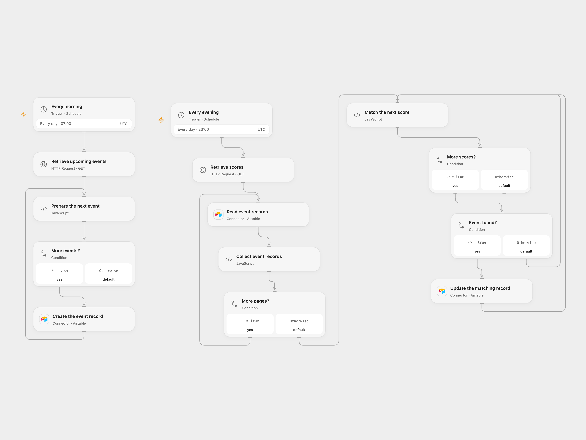

# Record NHL Events and Scores in Airtable

Create upcoming NHL event records and update matching records with scores.

<picture>
  <source media="(prefers-color-scheme: dark)" srcset="preview-dark.png">
  
</picture>

[Open Flow JSON](templates/record-nhl-events-and-scores-in-airtable.openflow.json) · [n8n JSON](templates/record-nhl-events-and-scores-in-airtable.n8n.json)

## Setup

Connect Airtable with read and write access and set the same base and table in each node. Create text fields named event_id, sports_key, sport_title, commence_time, home_team, away_team, scores, completed and last_update. Store the Odds API key in Secret Variable ODDS_API_KEY. For n8n, configure an HTTP Header Auth credential named x-api-key, Airtable credentials and the same table. Activate one format.

## Behavior

At 07:00 UTC the workflow creates one record per upcoming NHL event. At 23:00 UTC it retrieves recent scores, reads the Airtable table and updates records whose event_id matches an event. Scores are stored as JSON text. Scores without a matching record are skipped. Duplicate matching event IDs stop the run; remove duplicates before enabling. Morning runs do not deduplicate and can create duplicates on repeated imports.

Errors stop processing; prior writes remain. A failed or uncertain write may have succeeded. Inspect the table before replaying. API responses and all collected Airtable records must fit host limits. The source's merge across separate schedules could not link the executions; this version matches the stored event ID to its Airtable record ID.

Inspiration &amp; credits

## Changes to the source

- Rename the source id field to event_id to preserve Airtable record IDs. Replace embedded credentials and private table identifiers. Retrieve existing records for the evening join and use Airtable record IDs for updates.
- Use UTC schedules, serialize score arrays as text, skip unmatched scores and stop on duplicate matches.

Adapted from [Automating Betting Data Retrieval with TheOddsAPI and Airtable](https://github.com/Zie619/n8n-workflows/blob/ae8cf6dc5b873cbb4f74587aa9180ed3a9f70682/workflows/Http/1111_HTTP_Schedule_Automation_Webhook.json) in [Zie619/n8n-workflows](https://github.com/Zie619/n8n-workflows). The source export does not identify a separate template author or license.

The collection’s [MIT notice](https://github.com/Zie619/n8n-workflows/blob/94007c1445d9258a7da116646b79473e7c7c3282/LICENSE) is pinned at a later revision. This is the collection notice at that revision; it does not establish a separate original template author's license. Our changes are listed above; see [repository licensing](../../README.md#licensing).

> MIT License
>
> Copyright (c) 2025 Zie619
>
> Permission is hereby granted, free of charge, to any person obtaining a copy
> of this software and associated documentation files (the "Software"), to deal
> in the Software without restriction, including without limitation the rights
> to use, copy, modify, merge, publish, distribute, sublicense, and/or sell
> copies of the Software, and to permit persons to whom the Software is
> furnished to do so, subject to the following conditions:
>
> The above copyright notice and this permission notice shall be included in all
> copies or substantial portions of the Software.
>
> THE SOFTWARE IS PROVIDED "AS IS", WITHOUT WARRANTY OF ANY KIND, EXPRESS OR
> IMPLIED, INCLUDING BUT NOT LIMITED TO THE WARRANTIES OF MERCHANTABILITY,
> FITNESS FOR A PARTICULAR PURPOSE AND NONINFRINGEMENT. IN NO EVENT SHALL THE
> AUTHORS OR COPYRIGHT HOLDERS BE LIABLE FOR ANY CLAIM, DAMAGES OR OTHER
> LIABILITY, WHETHER IN AN ACTION OF CONTRACT, TORT OR OTHERWISE, ARISING FROM,
> OUT OF OR IN CONNECTION WITH THE SOFTWARE OR THE USE OR OTHER DEALINGS IN THE
> SOFTWARE.

