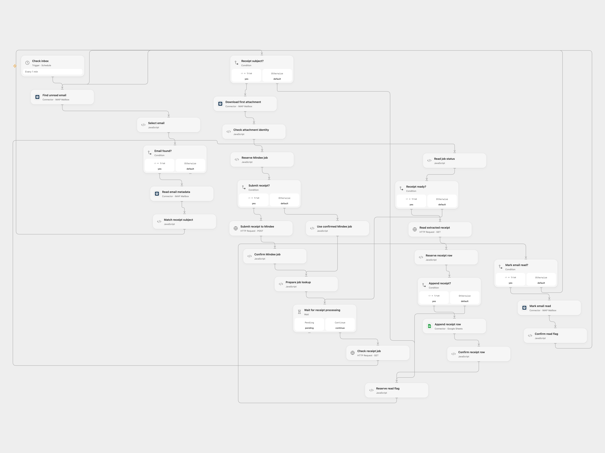

# Record Receipt Emails in Google Sheets

Extract the first receipt attachment from matching emails and record its fields.

<!-- template-actions:start -->
 
<!-- template-actions:end -->

<picture>
  <source media="(prefers-color-scheme: dark)" srcset="preview-dark.png">
  
</picture>

## Setup

Connect the same IMAP account to the four IMAP nodes. Create a Mindee V2 Receipt model retaining date, purchase_category, locale.currency and total_amount; enter its ID in both Mindee job nodes and bind MINDEE_API_KEY to the Mindee HTTP nodes. The connector attachment transit URL must be accessible to Mindee without authentication or redirects. Connect Google Sheets and set the same spreadsheet ID in Reserve receipt row. Create a Receipts sheet with Date, Description, Category, Currency and Amount columns. Enable persistent State and prevent overlapping runs.

In self-hosted n8n install n8n-nodes-imap 3.0.1 and make mailparser available to the Code task runner with NODE_FUNCTION_ALLOW_EXTERNAL=mailparser. Configure the IMAP connection, Mindee V2 model ID and Header Auth on Mindee HTTP nodes, a private Data Table with item_key, status and payload text columns, the same unique mailbox key in every Data Table node, and the target sheet. Use one format. n8n reads unseen messages without marking them, submits the first attachment bytes directly and marks each message read only after its row is confirmed; unmatched messages are marked read without a row. Use trusted TLS certificates.

The subject matches expenses or receipt, including the source's misspelling reciept. The description is the part after the first hyphen. Unmatched messages are marked read without a row. Open Flow marks matched messages read only after the row is confirmed. Missing receipt fields are blank. Inspect extracted values; they may be inaccurate. IMAP UIDs are scoped to INBOX and its UID validity; clear or migrate the matching State checkpoints if the mailbox UID validity changes.

Unknown Mindee job, sheet append and read flag results block replay. Inspect the corresponding service. In Open Flow enter the key and confirmed or absent in the relevant reserve node; for a confirmed Mindee job also supply its job ID. Clear recovery fields afterward. For a pending read flag, if the message is already read no replay is needed; if it is unread, set the read-flag resolution to absent before retrying. In n8n inspect the pending Data Table row and target sheet. For a confirmed job put its ID in payload and set ready-poll; for an absent job delete the row. For a confirmed sheet append set ready-mark; for an absent append set ready-poll. For a confirmed read flag set done; for an absent flag set ready-mark. Rerun the schedule after inspection. The source marked messages read on receipt; this version waits until successful processing.

Inspiration &amp; credits

Adapted from [Receipt email to Google Sheets](https://github.com/Zie619/n8n-workflows/blob/ae8cf6dc5b873cbb4f74587aa9180ed3a9f70682/workflows/Googlesheets/1188_GoogleSheets_Emailreadimap_Create.json) in [Zie619/n8n-workflows](https://github.com/Zie619/n8n-workflows). The source export does not identify a separate template author or license.

The collection’s [MIT notice](https://github.com/Zie619/n8n-workflows/blob/94007c1445d9258a7da116646b79473e7c7c3282/LICENSE) is pinned at a later revision. This is the collection notice at that revision; it does not establish a separate original template author's license. Our changes are listed above; see [repository licensing](../../README.md#licensing).

> MIT License
>
> Copyright (c) 2025 Zie619
>
> Permission is hereby granted, free of charge, to any person obtaining a copy
> of this software and associated documentation files (the "Software"), to deal
> in the Software without restriction, including without limitation the rights
> to use, copy, modify, merge, publish, distribute, sublicense, and/or sell
> copies of the Software, and to permit persons to whom the Software is
> furnished to do so, subject to the following conditions:
>
> The above copyright notice and this permission notice shall be included in all
> copies or substantial portions of the Software.
>
> THE SOFTWARE IS PROVIDED "AS IS", WITHOUT WARRANTY OF ANY KIND, EXPRESS OR
> IMPLIED, INCLUDING BUT NOT LIMITED TO THE WARRANTIES OF MERCHANTABILITY,
> FITNESS FOR A PARTICULAR PURPOSE AND NONINFRINGEMENT. IN NO EVENT SHALL THE
> AUTHORS OR COPYRIGHT HOLDERS BE LIABLE FOR ANY CLAIM, DAMAGES OR OTHER
> LIABILITY, WHETHER IN AN ACTION OF CONTRACT, TORT OR OTHERWISE, ARISING FROM,
> OUT OF OR IN CONNECTION WITH THE SOFTWARE OR THE USE OR OTHER DEALINGS IN THE
> SOFTWARE.

