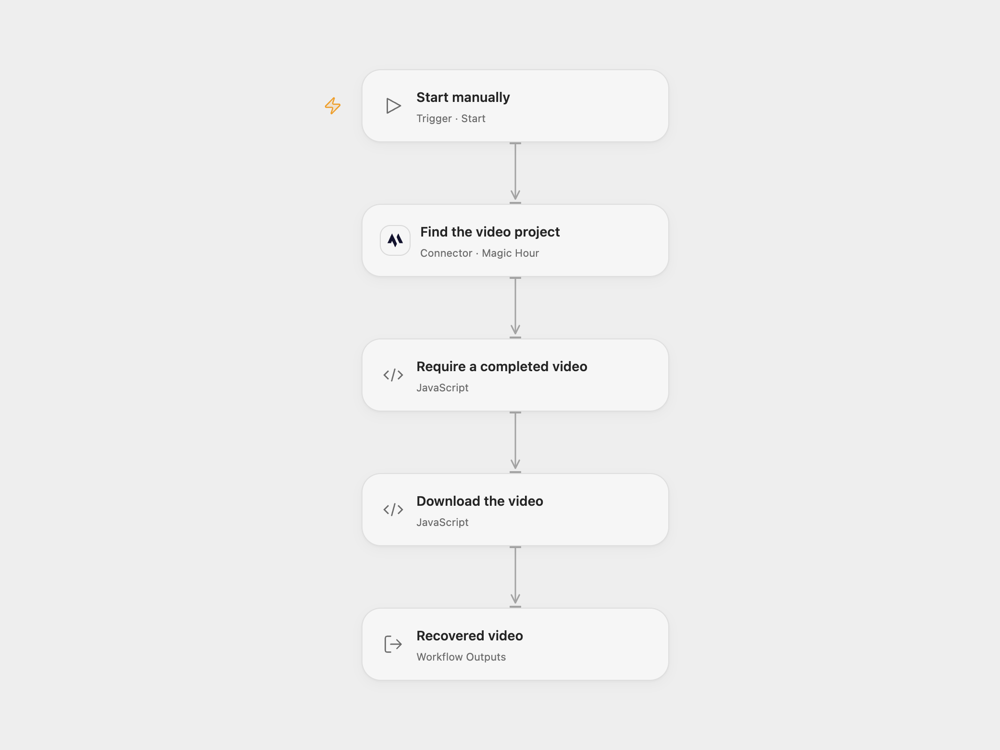

# Recover a Magic Hour Video

Retrieve a completed Magic Hour video using its project ID.

<picture>
  <source media="(prefers-color-scheme: dark)" srcset="preview-dark.png">
  
</picture>

[Open Flow JSON](templates/recover-a-magic-hour-video.openflow.json) · [n8n JSON](templates/recover-a-magic-hour-video.n8n.json)

## Setup

Connect Magic Hour in **Find the video project** and set the same existing project ID there and in **Require a completed video**. Allow the vendor download hostname in **Download the video**; the default is videos.magichour.ai and the returned URL may use another host. In n8n, install the Magic Hour community node (the source used version 1.0.3), connect its API credential and set the project ID in **Magic Hour**. Run either format manually.

## Behavior

The workflow checks the existing project once and downloads its first video when its status is complete. Pending, canceled or failed projects stop without downloading. The workflow does not create a new project or poll for completion. Open Flow returns the project ID, temporary vendor URL and run-owned video artifact; n8n returns downloaded binary. The vendor URL can expire.

Open Flow accepts MP4 downloads up to 1 MiB, and its artifact is available to subsequent workflow steps. Download errors stop the run. Restrict access to temporary URLs and video content.

Inspiration &amp; credits

## Changes to the source

- Open Flow uses the formal Magic Hour project Action, validates the project ID and MP4 bytes, and returns the temporary URL alongside the artifact.

Adapted from [Recover a completed video with Magic Hour](https://github.com/enescingoz/awesome-n8n-templates/blob/827110332c21cbe000ab13f6d292d5adb1f1f8db/Other_Integrations_and_Use_Cases/Recover%20a%20completed%20video%20with%20Magic%20Hour.json) in [enescingoz/awesome-n8n-templates](https://github.com/enescingoz/awesome-n8n-templates).

Source collection notice: © 2024–2026 Enes Cingoz, [CC BY 4.0](https://github.com/enescingoz/awesome-n8n-templates/blob/827110332c21cbe000ab13f6d292d5adb1f1f8db/LICENSE). The source includes a separate MIT notice for these workflows, reproduced below. See [repository licensing](../../README.md#licensing) for the scope of OOMOL contributions and third-party material.

[Magic Hour workflow license](https://github.com/enescingoz/awesome-n8n-templates/blob/827110332c21cbe000ab13f6d292d5adb1f1f8db/docs/Magic%20Hour%20workflow%20license.txt):

> MIT License
>
> Copyright (c) 2025 Magic Hour AI
>
> Permission is hereby granted, free of charge, to any person obtaining a copy
> of this software and associated documentation files (the "Software"), to deal
> in the Software without restriction, including without limitation the rights
> to use, copy, modify, merge, publish, distribute, sublicense, and/or sell
> copies of the Software, and to permit persons to whom the Software is
> furnished to do so, subject to the following conditions:
>
> The above copyright notice and this permission notice shall be included in all
> copies or substantial portions of the Software.
>
> THE SOFTWARE IS PROVIDED "AS IS", WITHOUT WARRANTY OF ANY KIND, EXPRESS OR
> IMPLIED, INCLUDING BUT NOT LIMITED TO THE WARRANTIES OF MERCHANTABILITY,
> FITNESS FOR A PARTICULAR PURPOSE AND NONINFRINGEMENT. IN NO EVENT SHALL THE
> AUTHORS OR COPYRIGHT HOLDERS BE LIABLE FOR ANY CLAIM, DAMAGES OR OTHER
> LIABILITY, WHETHER IN AN ACTION OF CONTRACT, TORT OR OTHERWISE, ARISING FROM,
> OUT OF OR IN CONNECTION WITH THE SOFTWARE OR THE USE OR OTHER DEALINGS IN THE
> SOFTWARE.

