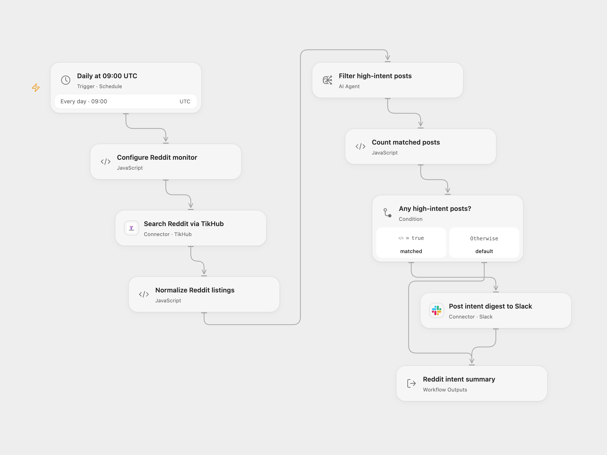

# Reddit Brand & Intent Radar

Scan Reddit discussions on a schedule, filter high-intent buyer or feedback posts with AI, and send a Slack digest.

<!-- template-actions:start -->

<!-- template-actions:end -->

<picture>
  <source media="(prefers-color-scheme: dark)" srcset="preview-dark.png">
  
</picture>

## Requirements

- TikHub connection (OOMOL-provided access or TikHub API token)
- Slack connection with chat:write permission and access to the destination channel
- Configured AI model on the Open Flow AI Agent node
- Target subreddit, search query, and product positioning configured on the Configure Reddit monitor node

## Setup

1. Import `templates/reddit-intent-monitor.openflow.json` into Open Flow.
2. Replace any placeholder values (such as `YOUR_SLACK_CHANNEL_ID` or `YOUR_GATEWAY_MODEL_ID`) with your own configuration.
3. Connect your required integrations (for example, Slack) and run or activate the workflow trigger.
