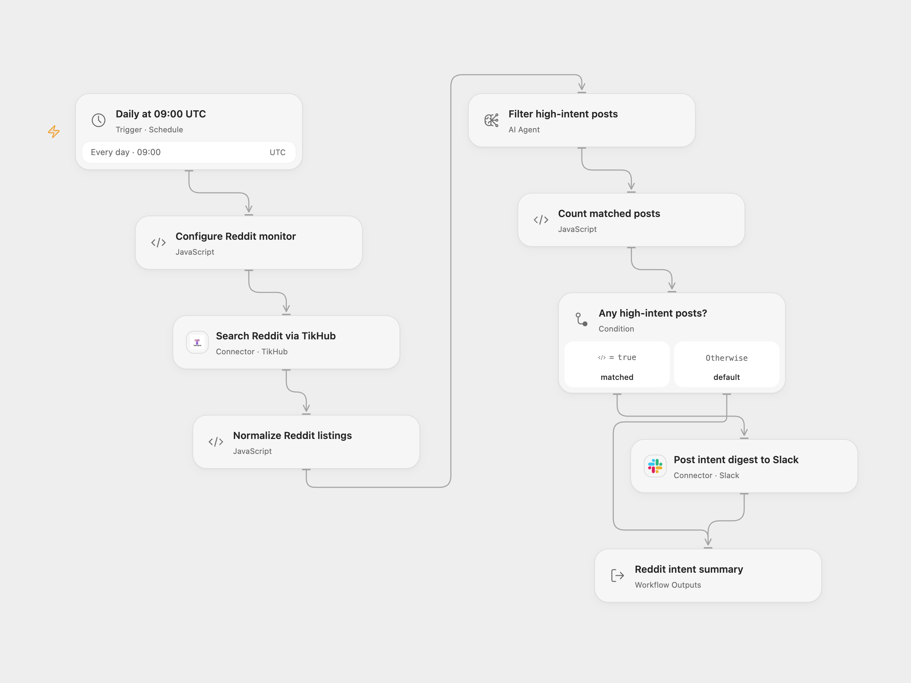

# Reddit ブランド・購買意向レーダー

Reddit の議論を定期的にスキャンし、AI で購買意向やフィードバックの強い投稿を絞り込んで、Slack にダイジェストを送信します。

<!-- template-actions:start -->

<!-- template-actions:end -->

<picture>
  <source media="(prefers-color-scheme: dark)" srcset="../../preview-dark.png">
  
</picture>

## 前提条件

- TikHub 接続（OOMOL 提供のアクセスまたは TikHub API トークン）
- chat:write 権限を持ち、対象チャンネルにアクセスできる Slack 接続
- Open Flow AI Agent ノードに設定済みの AI モデル
- Configure Reddit monitor ノードに設定した対象 subreddit、検索クエリ、製品のポジショニング

## セットアップ

1. `templates/reddit-intent-monitor.openflow.json` を Open Flow にインポートします。
2. プレースホルダー値（`YOUR_SLACK_CHANNEL_ID` や `YOUR_GATEWAY_MODEL_ID` など）をご自身の設定に置き換えます。
3. 必要な連携（TikHub や Slack など）を接続し、ワークフローのトリガーを実行または有効化します。
