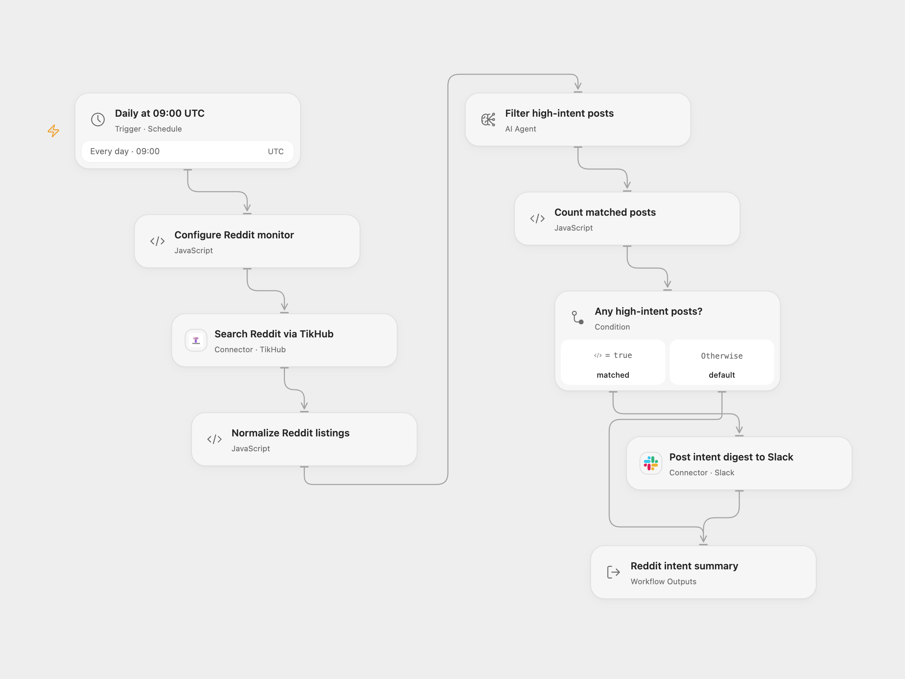

# Reddit 品牌与意向雷达

定时扫描 Reddit 讨论，用 AI 筛选高购买意向或产品反馈帖子，并发送 Slack 摘要。

<picture>
  <source media="(prefers-color-scheme: dark)" srcset="../../preview-dark.png">
  
</picture>

## 前提条件

- 具有 chat:write 权限并可访问目标频道的 Slack 连接
- 已在 Open Flow AI Agent 节点上配置 AI 模型
- 已在 Start/Defaults 节点上配置目标 subreddit、搜索词和产品定位

## 模板

- Open Flow: [templates/reddit-intent-monitor.openflow.json](../../templates/reddit-intent-monitor.openflow.json)

## 配置步骤

1. 将 `templates/reddit-intent-monitor.openflow.json` 导入 Open Flow。
2. 将占位值（如 `YOUR_SLACK_CHANNEL_ID` 或 `YOUR_GATEWAY_MODEL_ID`）替换为你自己的配置。
3. 连接所需的集成（例如 Slack），然后运行或启用工作流触发器。
