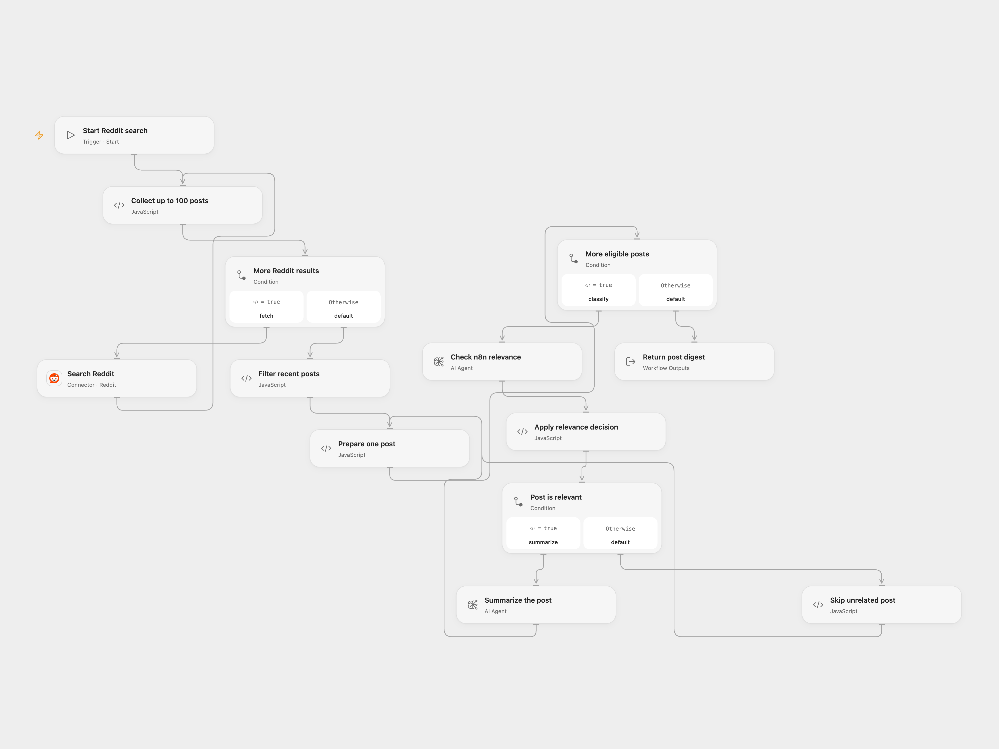

# Reddit n8n Post Digest

Search recent Reddit posts and return one summary for each relevant n8n discussion.

<picture>
  <source media="(prefers-color-scheme: dark)" srcset="preview-dark.png">
  
</picture>

[Open Flow JSON](templates/reddit-n8n-post-digest.openflow.json) · [n8n JSON](templates/reddit-n8n-post-digest.n8n.json)

## Setup and use

Connect Reddit with read access and configure an available AI model in both Agent nodes. Run the workflow to search all Reddit for `n8n` sorted newest first. In Open Flow, edit the timezone input on **Filter recent posts** (default UTC); in n8n set the workflow timezone.

The workflow examines at most 100 search results, follows short pages, and keeps posts with at least 5 upvotes, nonempty text, and a creation time after midnight seven days before the run. It classifies only the first 500 characters. A classification containing the case-sensitive text `No` is excluded; each other post receives a one-sentence summary. Results include subreddit, subscriber count, upvotes, date and URL. Empty or entirely excluded results return no summaries. Model results are probabilistic and should be reviewed.

Open Flow returns an array and processes each post through classification and summary before the next. n8n returns individual items and executes nodes in its normal item batches. Open Flow uses the displayed timezone for dates; configure it to match n8n's workflow timezone. Open Flow fails on malformed Reddit data or a repeated pagination cursor; n8n follows its node behavior. Both formats make two model calls per included post, and a model failure stops the run.

Inspiration &amp; credits

## Changes to the source

- Replace retired OpenAI completion models with a configurable current model; n8n's response mapping preserves the source conditions and output fields. Open Flow uses Agent nodes and does not enforce the source model's 32/128-token limits.
- The source note says more than five upvotes; the actual condition is at least five. Its enabled summary prompt asks for one sentence.

Adapted from [Reddit AI digest](https://github.com/enescingoz/awesome-n8n-templates/blob/827110332c21cbe000ab13f6d292d5adb1f1f8db/Instagram_Twitter_Social_Media/Reddit%20AI%20digest.json) in [enescingoz/awesome-n8n-templates](https://github.com/enescingoz/awesome-n8n-templates).

Source collection notice: © 2024–2026 Enes Cingoz, [CC BY 4.0](https://github.com/enescingoz/awesome-n8n-templates/blob/827110332c21cbe000ab13f6d292d5adb1f1f8db/LICENSE). The source export does not identify a separate template author or license. See [repository licensing](../../README.md#licensing) for the scope of OOMOL contributions and third-party material.

