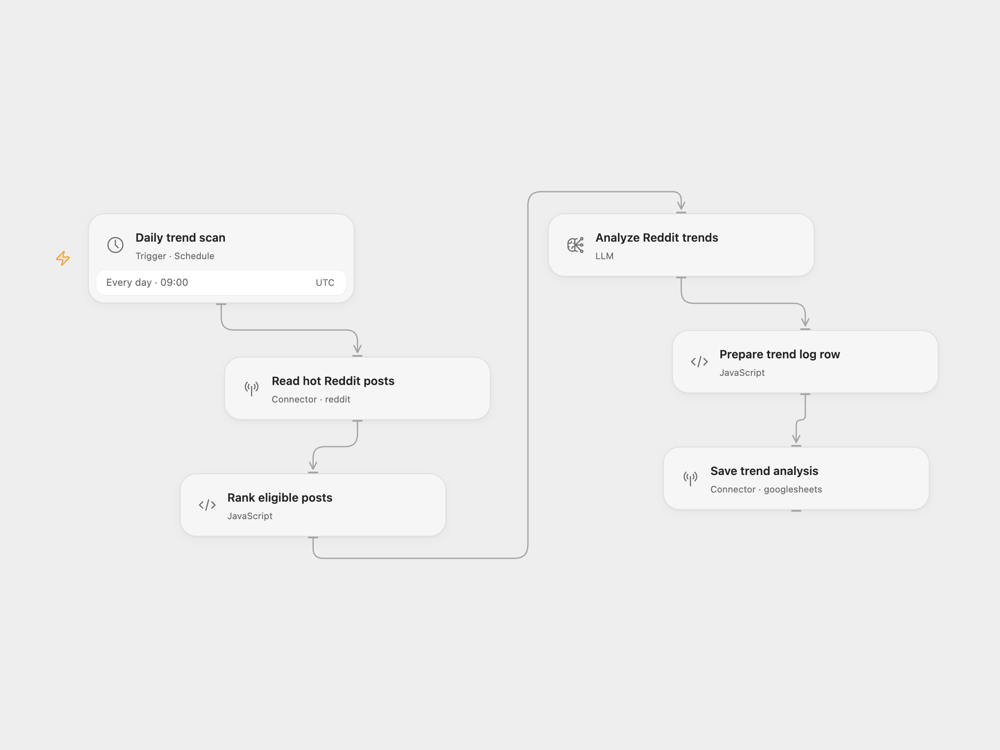

# Reddit Trend Log

Read a subreddit’s hot posts at 09:00 each day, rank the eligible posts, and log an AI trend analysis and content ideas in Google Sheets.

<picture>
  <source media="(prefers-color-scheme: dark)" srcset="preview-dark.png">
  
</picture>

[Open Flow JSON](templates/reddit-trend-log.openflow.json) · [n8n JSON](templates/reddit-trend-log.n8n.json)

## Setup

Create a sheet named `Trend Log` with these headers in columns A–E:

| Date | Posts | Trends | Content Ideas | Sentiment |
| --- | --- | --- | --- | --- |

For Open Flow, connect Reddit in **Read hot Reddit posts** and change `SaaS` to your subreddit name without `r/`. Connect Google Sheets in **Save trend analysis** and replace `YOUR_SPREADSHEET_ID`. Select a configured `gpt-4o-mini` model in **Analyze Reddit trends** and confirm the schedule timezone, initially UTC.

For n8n, connect Reddit in **Reddit: Fetch Posts**, OpenAI in **AI: Quick Analysis**, and Google Sheets in **Log to Sheets**. Set the subreddit, spreadsheet, and `Trend Log` tab, and confirm the workflow timezone before enabling it.

The workflow uses the first 20 hot posts, keeps scores strictly greater than 3, sorts by descending score, and analyzes at most 15 posts. One model request and one sheet row are produced per successful run, including an empty eligible list. Trends and content ideas are stored as JSON text. Repeated runs append another row; there is no deduplication or post publishing.

Malformed or incomplete model JSON produces empty trends and ideas with sentiment `unknown`. A failed Reddit or model request stops without writing. The configured limits are two Reddit attempts, three model attempts, and two sheet-write attempts, with intervals of five, two, and one second. Open Flow retries only failures the platform marks safe to retry; n8n retries node errors. A repeated write or request can create another log row.

## Changes to the source

- Use account-backed Reddit reads instead of an unauthenticated public endpoint.
- Remove server environment variables and provide explicit configuration placeholders.
- Use the current n8n model node and real line breaks in its post list.
- Validate numeric post metrics and incomplete analysis, preserve the parse-failure fallback, and write literal sheet values with RAW formatting.
- Tell the model to return empty analysis for an empty post list and treat titles as data.

## Source and license

Adapted from [SocialPulse Lite - Reddit Trend Monitor](https://github.com/enescingoz/awesome-n8n-templates/blob/827110332c21cbe000ab13f6d292d5adb1f1f8db/AI_Research_RAG_and_Data_Analysis/SocialPulse%20Lite%20-%20Reddit%20Trend%20Monitor.json) in [enescingoz/awesome-n8n-templates](https://github.com/enescingoz/awesome-n8n-templates).

Source collection notice: © 2024–2026 Enes Cingoz, [CC BY 4.0](https://github.com/enescingoz/awesome-n8n-templates/blob/827110332c21cbe000ab13f6d292d5adb1f1f8db/LICENSE). The source export does not identify a separate template author or license. See [repository licensing](../../README.md#licensing) for the scope of OOMOL contributions and third-party material.
